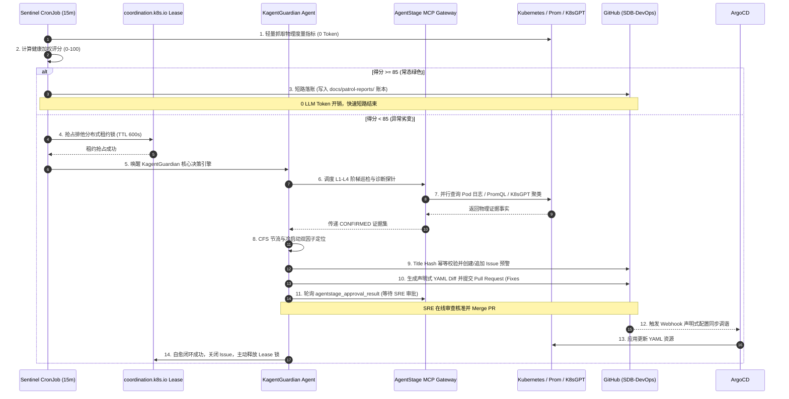
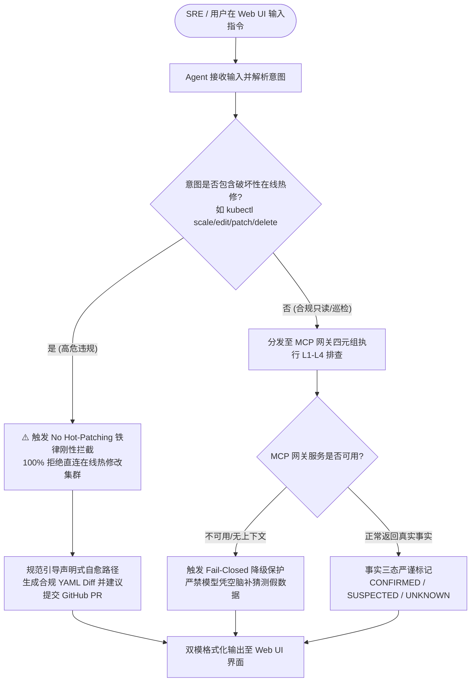

# KagentGuardian 架构设计与端到端工作时序规范说明

> **文档标识**：`DOC-DES-04` (v2.0 企业级架构与可视化拓扑规范)  
> **关联图纸**：`kagent-guardian-architecture.drawio`  
> **所属仓库**：`SDB-DevOps/KagentGuardian`  
> **面向对象**：系统架构师、平台开发者、SRE 专家团队、安全合规审计人员  

---

## 一、可视化架构图纸概述 (Draw.io Overview)

在 `docs/design/kagent-guardian-architecture.drawio`（及 `doc/design/kagent-guardian-architecture.drawio`）中，完整绘制了 Kagent Guardian 智能体的系统架构模型与运行时工作机制。图纸由两大核心视图（多页结构）组成：

1. **Page 1: 总体架构与主要模块图 (Architecture & Modules)**
   - 全景展示触发调度、并发治理、Agent 认知引擎、统一 MCP 网关、四元组工具链与底层集群的垂直拓扑分层。
2. **Page 2: 端到端工作时序与自愈闭环流 (How It Works: Execution Workflow)**
   - 详尽呈现“阶梯短路混合巡检流”与“Web UI 网页交互/生产零热修防御流”两条生产基线工作流。

```
+-------------------------------------------------------------------------+
|                  kagent-guardian-architecture.drawio                    |
+------------------------------------+------------------------------------+
| Page 1: 总体架构与核心模块拓扑规范  | Page 2: 端到端工作时序与自愈闭环流  |
| - 触发与周期调度层                 | - 阶梯短路巡检 (85分短路/0 Token)  |
| - 平台治理与安全门禁层             | - 分布式 Lease 锁抢占与并发防脑裂  |
| - 智能体核心决策引擎 (L1-L4 SOP)   | - CFS 算力与冷启动双因子定位       |
| - MCP 统一反向代理网关             | - Web UI No Hot-Patching 刚性拦截  |
| - 隔离四元组受控 RemoteMCPServer   | - GitHub Issue 幂等查重与声明式 PR |
| - GitOps 单一事实源与 ArgoCD 调谐  | - PEP HITL 人工核准与调谐自愈      |
+------------------------------------+------------------------------------+
```

---

## 二、Page 1: 总体架构与主要模块规范说明

### 2.1 模块分层职责

#### 1. 触发与周期调度层 (Triggers & Scheduling)
- **SRE Web UI 控制台**：向 SRE 专家提供面向对话的平台交互、手动按需体检卡片调取与高危自愈工单确认。
- **Sentinel CronJob (`kagent-guardian-sentinel`)**：每 15 分钟运行的超轻量只读哨兵。采集 CPU、内存、CrashLoop、5xx 等物理指标并计算健康分。当基线 $\ge 85$ 时触发短路机制直接写入账本，实现 **0 LLM Token 开销**；当 $< 85$ 时方唤醒智能体排查。
- **Archiver CronJob (`kagent-guardian-ledger-archiver`)**：每日 23:55 自动签名归档当天全部巡检记录至 `docs/patrol-reports/` 目录。
- **Session GC CronJob (`kagent-guardian-session-gc`)**：自动回收超过 7 天的历史会话与沙箱残余数据。

#### 2. 平台治理与安全门禁层 (Governance & Security Enclosure)
- **分布式排他租约锁 (`Lease Lock`)**：基于 `coordination.k8s.io/leases/kagent-guardian-lock`，设置 600s TTL。确保同一时刻全集群仅有一个 Guardian 实例执行深度诊断和自愈流程，彻底防止多实例并发冲突与脑裂。
- **Substrate 黄金快照 (`GoldenSnapshotReady`)**：预编译容器运行态与内存镜像，冷启动时间由原来的 15s+ 缩短至 $\le 3.5\text{s}$，为突发巡检和交互提供亚秒级响应。
- **策略决策点 (PEP / HITL)**：实施 **Fail-Closed** 安全降级机制；严禁智能体直接发起破坏性在线写入。高危操作强制转换为待审批工单，并通过 HMAC-SHA256 防篡改签名进行人机核准。

#### 3. 核心智能体认知与决策引擎 (Agent Core Decision Engine)
- **L1-L4 阶梯巡检 SOP 推理机**：
  - **L1 物理基座层**：节点 Ready 状态、DiskPressure、MemoryPressure、系统负载。
  - **L2 运行时层**：Substrate 容器、Atenet 网关延迟、CFS 节流率与数据库连接池。
  - **L3 控制面层**：`kagent-controller` 调谐状态机、CRD Conditions 与 Kubernetes Events。
  - **L4 端到端探针**：Golden Snapshot 探针与瞬态沙箱 Ping-Pong 对话检测。
- **CFS 算力与冷启动双因子决策树**：结合 CFS 节流率与冷启动耗时双因子复合判定，精准识别真实 CPU 配额瓶颈与临时沙箱初始化延时，杜绝盲目扩容。
- **事实三态分类器**：
  - `CONFIRMED FACTS`：必须 100% 由 MCP 工具返回的真实物理证据（日志、指标、Event）支撑；
  - `SUSPECTED HYPOTHESES`：基于已知事实与架构知识库推导出的排查假设；

---

## 三、Page 2: 工作时序与自愈闭环流程规范说明

### 3.1 主流程一：阶梯短路智能巡检流 (Tiered Short-Circuit Patrol)



### 3.2 主流程二：Web UI 网页交互与零热修防御流 (Web UI Guardrails)



---

## 四、Draw.io 图纸查看与协同编辑指南

### 4.1 在 VS Code 内直接查看与编辑
1. 在 VS Code 插件市场搜索并安装 **`Draw.io Integration`** (作者：*Henning Dieterichs*)。
2. 在项目目录中直接点击打开：
   - `docs/design/kagent-guardian-architecture.drawio`
   - 或 `doc/design/kagent-guardian-architecture.drawio`
3. 底部标签页可自由切换：
   - `1. 总体架构与主要模块 (Architecture & Modules)`
   - `2. 工作时序与自愈闭环流 (How It Works: Workflow & Self-Healing)`

### 4.2 在在线浏览器查看与导出
1. 访问官方免费设计平台 [app.diagrams.net](https://app.diagrams.net/)。
2. 点击 **`File -> Open From -> Device...`**，载入 `kagent-guardian-architecture.drawio`。
3. 支持一键导出为矢量图 (`SVG`)、高分辨率位图 (`PNG`) 或打印级文档 (`PDF`)。

---

## 五、版本发布与审计留痕

| 版本 | 修订日期 | 责任人 | 变更摘要 |
| :--- | :--- | :--- | :--- |
| **v1.0** | 2026-11-13 | SRE 架构组 | 初始高低阶设计蓝图发布 (`DOC-DES-01`) |
| **v2.0** | 2026-11-23 | DevOps 核心组 | 完成 Draw.io 架构全景与工作时序可视化图谱交付 (`kagent-guardian-architecture.drawio`)，固化零热修、PEP、四元组 MCP 网关与纯 GitHub 闭环运营规范 |

  - `UNKNOWN / MISSING`：工具未能抓取或不可达的数据盲区，严禁大模型臆测。
- **双模结构化输出格式化器**：支持输出 Markdown 格式的健康状态体检大盘卡片，或包含完整证据链、拓扑下钻分析与声明式 GitOps PR 建议的深度排障报告。

#### 4. 统一 MCP 网关与四元组工具组 (Enterprise MCP Gateway & Quad-Tool Cluster)
- **`agentstage-mcp-gateway` (Port 8080)**：统一反向代理与 Bearer 鉴权，实现工具名隔离，消除 duplicate tool 注册冲突。
- **`mcp-proxy-k8s-read`**：`k8s_get_resources`, `k8s_describe_resource`, `k8s_get_events`, `k8s_get_pod_logs`, `k8s_check_service_connectivity`。
- **`mcp-proxy-kagent-tool`**：`prometheus_promql_tool`, `prometheus_query_tool`, `argo_rollouts_list`, `argo_check_plugin_logs`。
- **`mcp-proxy-k8sgpt-read`**：`analyze`, `cluster-info`, `get-logs`, `list-events`。
- **`mcp-proxy-github-ops`**：`github_create_branch`, `github_create_or_update_file`, `github_create_pull_request`, `agentstage_approval_result`。

#### 5. 底座基础设施与 GitOps 唯一真实源 (Infrastructure & GitOps)
- **Kubernetes 集群**：承载 Agent 运行时与受管业务。
- **GitHub 官方仓库 (`SDB-DevOps/KagentGuardian`)**：系统单一事实源（Single Source of Truth），包含全量配置 YAML、自愈 PR、故障预警 Issue 与每日巡检账本。
- **ArgoCD 调谐引擎**：监听 Git 仓库的主干提交与 PR 合并，以声明式调谐（Sync）应用变更，实现无缝闭环。
