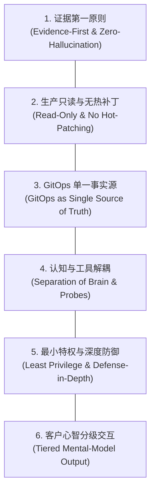
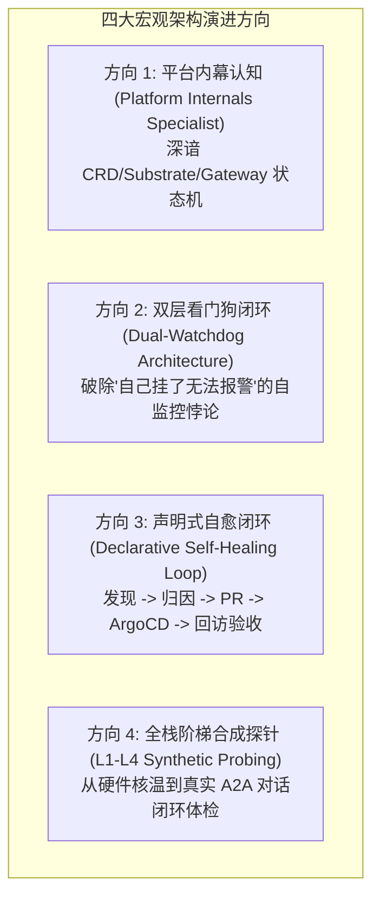
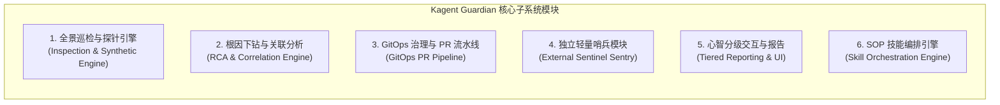

# Kagent 巡检运维智能体 (Guardian) 总体高级设计规范 (High-Level Design)

> **文档标识**：`DOC-DES-02`  
> **所属项目**：Kagent Guardian 平台运维与自愈智能体  
> **面向对象**：系统架构师、平台核心开发者、SRE 专家团队  
> **设计定位**：本文档为 Kagent 平台巡检与智能运维体系的高阶架构纲领（High-Level Design），确立了智能体的核心设计原则、宏观演进方向、子系统模块划分，并设立了生产运维中绝不可逾越的“反模式与禁区”。

---

## 一、系统总体设计原则 (Core Design Principles)

为了在企业级严肃生产场景中构建值得信赖的 AI SRE，Kagent Guardian 遵循以下六大核心设计原则：



### 1. 证据第一原则 (Fact/Evidence-First & Zero-Hallucination)
* **原则内核**：大模型的“联想力”是创造力，但更是运维排障的毒药。Guardian 的任何排障结论、健康评分或根因判断，**必须 100% 由 MCP 工具返回的真实物理证据（日志行、Event 时间戳、Prometheus 指标、CRD Condition）支撑**。
* **执行约束**：强制实行事实三态标记：
  - `CONFIRMED FACTS`：有工具返回的真实证据支撑；
  - `SUSPECTED HYPOTHESES`：基于已知事实与架构知识库推导出的排查假设；
  - `UNKNOWN / MISSING`：工具未能抓取或当前不可达的盲区，严禁自行补全。

### 2. 生产只读与安全红线 (Read-Only Diagnostics & No Hot-Patching)
* **原则内核**：生产环境绝对禁止任何智能体获得任意写权限。**严禁在运行时直接执行 `kubectl edit`、`kubectl patch`、`kubectl delete` 等破坏性临时热修复命令**。
* **执行约束**：所有诊断探针（L1-L4）与工具服务（MCP）均以只读权限（Read-Only ServiceAccount）运行，物理上切断热改后门。

### 3. GitOps 单一事实源原则 (GitOps Single Source of Truth)
* **原则内核**：平台的一切状态由 Git 仓库中的声明式代码定义。系统自愈和参数调优不得在集群内部产生“幽灵修改”。
* **执行约束**：Guardian 发现参数缺陷（如 CFS CPU 配额过紧）后，唯一的修改路径是通过 GitHub API 建立特性分支，生成声明式 YAML Diff，发起 Pull Request 并附带完整排障证据链，经人工审核合并后由 ArgoCD 自动调谐同步至集群。

### 4. 认知经验与执行工具解耦 (Separation of Knowledge & MCP Tools)
* **原则内核**：**知识库（Knowledge Base / Skills）负责教 Agent “如何专业思考与推导”，MCP 工具负责让 Agent “感知集群客观现实”**。
* **执行约束**：严禁将数万行底层源码粗暴填塞入 System Prompt（导致 Token 浪费和注意力稀释）；通过独立领域知识库固化 CRD 拓扑、Substrate 状态机与故障树，MCP 仅输出紧凑的标准 JSON 事实。

### 5. 最小特权与深度防御原则 (Least Privilege & Defense-in-Depth)
* **原则内核**：智能体及其挂载的 MCP Server 仅拥有执行特定领域任务所需的绝对最小权限。
* **执行约束**：K8s API 访问收敛于特定 CRD 和资源类型；GitHub 交互采用限时安装凭证（GitHub App Installation Token），且仅限目标代码仓库的只读+PR提交权限。

### 6. 客户心智分级交互原则 (Tiered Mental-Model Communication)
* **原则内核**：输出格式必须匹配提问者的认知带宽与业务场景，拒绝不加整理的信息轰炸。
* **执行约束**：先给 L1 SRE 快速处置建议（“一句话结论 + 是否需介入 + 快速操作”），再给 L2/L3 深度证据链（“根因推导 + 指标依据 + 关联日志”），兼顾效率与严谨。

---

## 二、宏观架构演进方向 (Strategic Architectural Directions)

Guardian 并非通用的云原生运维外挂，而是深植于 Kagent 生态的“垂直领域专家”。其演进围绕四大战略方向展开：



### 1. 平台内幕深层认知 (Platform Internals Specialist)
* **定位**：脱离单纯的 “Pod 是否 CrashLoopBackOff” 的通用浅层判断，深刻理解 Kagent 控制面逻辑：
  - 掌握 `Agent -> AgentTemplate -> Harness -> ModelConfig` 的父子依赖树；
  - 掌握 Substrate 运行时对于沙箱 Actor 容器的生命周期管理与冷启动特性；
  - 掌握 AgentGateway 的请求驻留机制（Request Parking）与 Linux CFS CPU 配额截流行为。

### 2. 双层看门狗架构 (Dual-Watchdog Architecture)
* **定位**：彻底破除“自己挂了谁来报警”的自监控死循环。
  - **Level 1（平台内专家 In-Platform Guardian）**：常驻 Kagent 平台内部，承担复杂多轮排障、根因分析、PR 生成的重度计算；
  - **Level 2（集群外哨兵 External Watchdog）**：独立于 Kagent 的超轻量级 Alpine 容器（CronJob / Prometheus Rule），脱离 Kagent 控制面运行。每 60s 对 Gateway 和 Controller 执行纯 HTTP `/healthz` 存活检测。一旦控制面连续 3 次探活超时，哨兵绕过 Kagent 直接向企业 PagerDuty / 钉钉发出控制面死锁告警。

### 3. 声明式自愈闭环 (Declarative Self-Healing State Machine)
* **定位**：将排障与治理闭环化，从“发现故障”直接打通至“参数调优上线与健康复访”：
  `健康巡检 -> 瓶颈检测 -> 知识库推导 -> 生成分支与 Diff -> 提交 GitHub PR -> CI/CD 审查合并 -> ArgoCD 调谐 -> 自动执行 L4 探针复访验收`。

### 4. 全栈阶梯合成探针 (L1-L4 Full-Stack Synthetic Probing)
* **定位**：告别片面监控，实现四级穿透：
  - **L1 物理资源层**：Node CPU、Memory、Disk、Kubelet 连接；
  - **L2 运行时层**：Substrate 沙箱 Pod、AgentGateway、PostgreSQL 存储状态；
  - **L3 控制面层**：CRD 定义合规性、Controller Manager 控制流及 Event 异常；
  - **L4 会话合成层**：动态创建真实测试 Agent，发起合成 Ping-Pong 对话，度量端到端冷启动延时与 Token 流吞吐。

---

## 三、核心功能模块设计 (High-Level Functional Modules)

Guardian 平台巡检与智能运维体系由以下六大高阶子系统模块组成：



### 1. 全景巡检与探针引擎模块 (Inspection & Synthetic Probing Module)
* **核心职责**：定时或按需驱动 L1-L4 阶梯巡检流水线。
* **主要功能**：
  - 采集节点 CPU/内存/磁盘与 CFS 调度延迟指标；
  - 审计核心控制面 Pod 与 PostgreSQL 持久化连接；
  - 调用 `kagent-api` 发起无状态真实会话测试，度量请求响应时间（RTT）；
  - 输出格式化健康体检报告与综合健康度得分（0-100 分）。

### 2. 根因下钻与关联分析模块 (RCA & Correlation Engine)
* **核心职责**：在系统出现亚健康或故障时，实施跨维度数据关联推导。
* **主要功能**：
  - 逆向追踪 CR 依赖拓扑（Agent -> Template -> ModelConfig -> Secret）；
  - 自动抓取失败 Pod 关联的 `kubectl describe events` 与最近 200 行错误堆栈；
  - 集成 `k8sgpt-mcp-server` 完成 Kubernetes 原生事件的 AI 预筛选；
  - 智能切分“内部集群故障”与“外部上游模型提供商故障”。

### 3. GitOps 治理与 PR 流水线模块 (GitOps PR Pipeline)
* **核心职责**：将自愈动作收敛在声明式代码流中。
* **主要功能**：
  - 调用 `github-mcp-server` 安全拉取主分支代码；
  - 根据调优算法计算参数（如将沙箱 CPU Limit 从 1000m 调优至 2500m，调高网关 Parking 超时至 45s）；
  - 自动创建修复分支（`fix/guardian-tune-...`），提交 YAML 变更 Diff；
  - 发起 Pull Request，附带 Markdown 格式的完整证据链，等待平台运维人员审核合入。

### 4. 独立轻量哨兵模块 (External Sentinel Sentry)
* **核心职责**：脱离 Kagent 控制面，作为第二道安全防线。
* **主要功能**：
  - 极轻量 Alpine 容器常驻集群节点；
  - 周期性对 Kagent Controller 与 Gateway 的 `/healthz` 执行无状态 HTTP 探活；
  - 连续失败即触发外部直达告警（绕过 Web 控制台与 Guardian Agent）。

### 5. 心智分级交互与报告模块 (Tiered Reporting & UI Module)
* **核心职责**：在 Kagent Web 控制台面向不同运维角色进行差异化信息呈现。
* **主要功能**：
  - 一线（L1）：输出绿黄红状态指示灯与一句话处置指引；
  - 专家（L2/L3）：出具标准 5 段式完整 RCA 报告（摘要、证据、根因、步骤、风险）；
  - 结构化 Markdown 与代码 Diff 语法高亮。

### 6. SOP 技能编排引擎模块 (Skill Orchestration Engine)
* **核心职责**：解耦复杂多步排障流程，按标准 SOP（Runbook）有序执行。
* **主要功能**：
  - 加载领域专属排障技能文件（如 `agent-troubleshooting.skill`）；
  - 固化阶段门禁（Phase 1 基础检查未过不得盲目执行 Phase 4 合成测试）；
  - 保证排障步骤标准化、可复现、可审计。

---

## 四、架构禁区与必须避免的方向 (Anti-Patterns to Strictly Avoid)

为了确保企业生产环境的绝对安全与系统架构的优雅演进，Guardian 明确划定以下六大“禁区”：

```
┌────────────────────────────────────────────────────────────────────────┐
│                        六大架构禁区 (Strictly Prohibited)               │
├────────────────────────────────────────────────────────────────────────┤
│ [禁区 1] 严禁生产热打补丁 (No Hot-Patching)                            │
│          禁止 Agent 直连 kubectl apply/patch/delete 临时改动生产集群    │
│                                                                        │
│ [禁区 2] 严禁全量源码粗暴填塞 Prompt (No Raw Code Dumping)             │
│          禁止将 Go/React 源码塞进 System Prompt，必须走提炼知识库      │
│                                                                        │
│ [禁区 3] 严禁无物理证据的幻觉诊断 (Zero-Evidence Hallucination)         │
│          禁止在未成功调用 MCP 获取日志/指标时编造“可能原因是网络丢包”   │
│                                                                        │
│ [禁区 4] 严禁依赖单一平台内监控 (No Single-Tier Self-Monitoring)       │
│          禁止将监控警报全部押宝在平台自身，必须有外挂独立哨兵保底      │
│                                                                        │
│ [禁区 5] 严禁混淆内部与外部依赖故障 (No Model Vendor Confusion)        │
│          禁止将外部 LLM 429 限流归因为 K8s 算力不足                    │
│                                                                        │
│ [禁区 6] 严禁授予 Agent 越权管理权限 (No Over-Privileged SA)            │
│          禁止挂载 ClusterAdmin 权限；诊断纯只读，修改走 Git PR 审查    │
└────────────────────────────────────────────────────────────────────────┘
```

1. **禁区一：严禁生产热打补丁 (No Hot-Patching)**
   * **违规表现**：Agent 在排查到问题后，直接调用具备写权限的 K8s API 修改 Pod、Deployment 或 Secret。
   * **危害**：破坏 GitOps 单一源，导致集群状态不可重现，被下一次 CD 覆盖引发二次灾难，严重违反企业生产变更合规。
2. **禁区二：严禁将全量源码粗暴填塞入 System Prompt (No Raw Code Dumping)**
   * **违规表现**：为了让 Agent “懂平台”，将数万行控制器源码和架构文件全量作为 System Prompt 输入。
   * **危害**：Token 消耗指数级暴涨，每次推理时延增加 10-20 秒，且大模型遭遇严重的注意力稀释（Lost in the Middle），导致真正关键的巡检指令被遗忘。
3. **禁区三：严禁无物理证据的纯幻觉诊断 (Zero-Evidence Hallucination)**
   * **违规表现**：当 MCP 工具报错或无返回时，Agent 凭借预训练概率凭空脑补“大概率是 Pod 内存溢出或 DNS 解析失败”。
   * **危害**：严重误导一线运维，白白浪费黄金抢修时间。
4. **禁区四：严禁单一自监控闭环 (No Single-Tier Self-Monitoring)**
   * **违规表现**：只依靠 Kagent 平台内部的智能体负责平台巡检，没有任何平台外的独立探针。
   * **危害**：平台整体宕机时，监控系统集体静默，陷入“死机却无人知晓”的灾难境地。
5. **禁区五：严禁混淆内部集群故障与外部模型供应商故障 (No Model Vendor Confusion)**
   * **违规表现**：因外部模型服务商 API 限流或响应超时，Agent 误将问题定性为 Substrate 运行时或 K8s 算力崩溃。
   * **危害**：引发不必要的主机扩容和容器重启，增加额外基础设施账单却完全未解决根本问题。
6. **禁区六：严禁授予 Agent 越权管理特权 (No Over-Privileged ServiceAccount)**
   * **违规表现**：为图省事给 Agent 绑定 `cluster-admin` 角色。
   * **危害**：大模型存在被提示词注入（Prompt Injection）攻击的风险。一旦 Agent 被恶意引导，可能导致全集群资源被删或企业核心敏感数据泄露。

---

## 五、设计总结与落地指引

本高阶设计文档与《客户需求痛点分析文档》（`DOC-REQ-01`）共同构成了 Kagent Guardian 的顶层方法论与架构基石：

- **业务上**：紧扣客户三类运维心智，精准化解 8 大现场痛点；
- **架构上**：坚守六大原则，构建内幕专精、双层看门狗、声明式闭环的高可用体系；
- **工程上**：严守六大禁区，确保零幻觉、纯只读、GitOps 审查，打造真正经得起企业生产检验的工业级 AI SRE。
