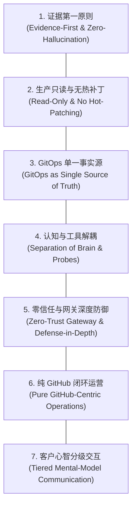
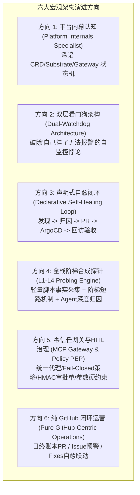
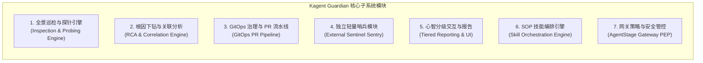

# Kagent 巡检运维智能体 (Guardian) 总体高级设计规范 (High-Level Design)

> **文档标识**：`DOC-DES-02` (v2.0 企业安全与策略治理修订版)  
> **所属项目**：Kagent Guardian 平台运维与自愈智能体  
> **面向对象**：系统架构师、平台核心开发者、SRE 专家团队、安全合规审计专家  
> **设计定位**：本文档为 Kagent 平台巡检与智能运维体系的高阶架构纲领（High-Level Design）。文档承接《客户需求痛点分析》（`DOC-REQ-01`），吸收自《讨论八》至《讨论十三》的最新架构演进成果，确立了**零信任网关治理（PEP）、纯 GitHub 运营闭环、阶梯短路混合执行引擎、双层看门狗、声明式 GitOps 自愈**五大核心支柱，并设立了生产运维中绝不可逾越的八大架构禁区。

---

## 一、系统总体设计原则 (Core Design Principles)

为了在企业级严肃生产场景中构建绝对安全、可审计、值得信赖的 AI SRE，Kagent Guardian 遵循以下七大核心设计原则：



### 1. 证据第一原则 (Fact/Evidence-First & Zero-Hallucination)
* **原则内核**：大模型的“联想力”是创造力，但更是运维排障的毒药。Guardian 的任何排障结论、健康评分或根因判断，**必须 100% 由底层工具返回的真实物理证据（日志行、Event 时间戳、Prometheus 指标、CRD Condition）支撑**。
* **执行约束**：强制实行事实三态标记：
  - `CONFIRMED FACTS`：有底层工具返回的真实物理指标与日志证据支撑；
  - `SUSPECTED HYPOTHESES`：基于已知事实与架构知识库推导出的排查假设；
  - `UNKNOWN / MISSING`：工具未能抓取或当前不可达的盲区，严禁大模型自行脑补或猜测。

### 2. 生产只读与安全红线 (Read-Only Diagnostics & No Hot-Patching)
* **原则内核**：生产环境绝对禁止任何智能体获得直连集群的热改写权限。**严禁在运行时直接执行 `kubectl edit`、`kubectl patch`、`kubectl delete` 等破坏性临时热修复命令**。
* **执行约束**：所有诊断探针（L1-L4）与工具服务（MCP）均以只读或受限身份运行，物理上切断热改后门。

### 3. GitOps 单一事实源原则 (GitOps Single Source of Truth)
* **原则内核**：平台的一切状态由 Git 仓库中的声明式代码定义。系统自愈和参数调优不得在集群内部产生“幽灵修改”。
* **执行约束**：Guardian 发现参数缺陷（如 CFS CPU 配额过紧）后，唯一的修改路径是通过 GitHub API 建立特性分支，生成声明式 YAML Diff，发起 Pull Request 并附带完整排障证据链，经人工审核合并后由 ArgoCD 自动调谐同步至集群。

### 4. 认知经验与执行工具解耦 (Separation of Knowledge & MCP Tools)
* **原则内核**：**知识库（Knowledge Base / Skills）负责教 Agent “如何专业思考与推导”，MCP 工具负责让 Agent “感知集群客观现实”**。
* **执行约束**：严禁将数万行底层源码粗暴填塞入 System Prompt（导致 Token 浪费和注意力稀释）；通过独立领域知识库固化 CRD 拓扑、Substrate 状态机与故障树，MCP 仅输出紧凑的标准 JSON 事实。

### 5. 零信任与网关深度防御原则 (Zero-Trust Gateway & Defense-in-Depth)
* **原则内核**：智能体不得直连未经管控的物理 MCP 服务，**所有工具调用必须收敛至统一的 Policy Enforcement Point (PEP - 策略执行点) 网关**。
* **执行约束**：
  - **网关阻断（Fail-Closed）**：AgentStage MCP Gateway 作为统一反向代理，策略未显式放行的工具一律默认阻断；
  - **人机协同审批（HITL）**：高危或破坏性写操作（删除资源、Merge PR、Shell 执行）强制拦截为带 HMAC-SHA256 签名的审批工单，经管理员核准前严禁下发；
  - **参数强边界（ParamPolicy）**：对 `owner`、`repo`、`namespace` 等资源定位参数实行白名单硬校验，杜绝大模型被越狱后跨租户破坏；
  - **凭据物理隔离（Credential Isolation）**：GitHub Token、K8s 凭证仅在网关层内存组装，对 Agent 完全透明隔离。

### 6. 纯 GitHub 闭环运营原则 (Pure GitHub-Centric Operations)
* **原则内核**：针对企业无外部即时通讯工具（钉钉/企微）且 Slack/Teams 受限的场景，以 GitHub 作为唯一运作、协同与审计枢纽。
* **执行约束**：
  - **日常绿色巡检**：日终生成签收 PR（`[Daily-Patrol] YYYY-MM-DD Ledger`），SRE 点击 Merge 完成归档签收，合规审计 100% 留痕；
  - **异常预警工单**：自动创建 GitHub Issue 并 `@SDB-DevOps/sre-team`，通过 GitHub Mobile 移动端原生推送与邮件秒级直达；
  - **自愈联动闭环**：自愈 PR 显式绑定 `Fixes #<Issue-ID>`，审查批准合入后自动关闭 Issue，驱动 ArgoCD 调谐并触发 L4 复测。

### 7. 客户心智分级交互原则 (Tiered Mental-Model Communication)
* **原则内核**：输出格式必须匹配提问者的认知带宽与业务场景，拒绝不加整理的信息轰炸。
* **执行约束**：先给 L1 SRE 快速处置建议（“一句话结论 + 是否需介入 + 快速操作”），再给 L2/L3 深度证据链（“根因推导 + 指标依据 + 关联日志”），兼顾效率与严谨。

---

## 二、宏观架构演进方向 (Strategic Architectural Directions)

Guardian 并非通用的云原生运维外挂，而是深植于 Kagent 生态的“垂直领域专家”。其演进围绕六大战略方向展开：



### 1. 平台内幕深层认知 (Platform Internals Specialist)
* **定位**：脱离单纯的 “Pod 是否 CrashLoopBackOff” 的通用浅层判断，深刻理解 Kagent 控制面逻辑：
  - 掌握 `Agent -> AgentTemplate -> Harness -> ModelConfig` 的父子依赖树；
  - 掌握 Substrate 运行时对于沙箱 Actor 容器的生命周期管理与冷启动特性；
  - 掌握 AgentGateway 的请求驻留机制（Request Parking）与 Linux CFS CPU 配额截流行为。

### 2. 双层看门狗架构 (Dual-Watchdog Architecture)
* **定位**：彻底破除“自己挂了谁来报警”的自监控死循环。
  - **Level 1（平台内专家 In-Platform Guardian）**：常驻 Kagent 平台内部，承担复杂多轮排障、根因分析、PR 生成的重度计算；
  - **Level 2（集群外哨兵 External Watchdog）**：独立于 Kagent 的超轻量级 Alpine 容器（CronJob），脱离 Kagent 控制面运行。每 60s 对 Gateway 和 Controller 执行纯 HTTP `/healthz` 存活检测。检测失败首先向集群 Prometheus Alertmanager 标准 v2 接口投递告警，Alertmanager 不可达时降级直连 Webhook。

### 3. 声明式自愈闭环与并发租约 (Declarative Self-Healing & Lease Governance)
* **定位**：杜绝生产环境临时热修与多实例并发踩踏。
  - **Kubernetes Lease 并发锁**：任何自愈动作前必须原子抢占 `kagent-guardian-remediation-lock`，抢占失败安全退出；
  - **PR 幂等查重**：存在未闭环的自愈 PR 时严禁新建，改为追加时序证据评论；
  - **ArgoCD 状态机**：等待 `Synced && Healthy` 稳定 30 秒后再触发复测验收，消除假阴性。

### 4. 阶梯短路全栈合成探针与混合执行引擎 (Tiered Short-Circuit & Hybrid Probing)
* **定位**：解决高频定时体检下大模型高昂 Token 成本与不可控执行延迟。
  - **混合架构（Hybrid Engine）**：日常基线体检优先由轻量 Shell/Curl 哨兵脚本高速采集 L1-L4 指标；仅当发现指标越界、亚健康或需根因深度推导时，才唤醒 Guardian Agent（大模型）；
  - **阶梯短路（Tiered Short-Circuit）**：
    - **L1 基础设施层**：Node 资源、CPU/内存/磁盘水位、网络可达；（若致命异常则熔断并立即报警，跳过 L2-L4）；
    - **L2 运行时与中间件层**：Substrate 调度池、PostgreSQL 数据库连通、Gateway 驻留队列；
    - **L3 控制面与 CRD 拓扑**：Controller Manager、Agent CR 状态机、K8s Event 异常；
    - **L4 会话合成层**：动态创建测试会话，发起真实 Ping-Pong 对话，度量冷启动时延与端到端 Token 吞吐。

### 5. 零信任网关治理与人机协同审批闭环 (Gateway Policy PEP & HITL Governance)
* **定位**：将大模型与底层生产设施之间的调用完全纳入受控网关（AgentStage MCP Gateway）。
  - **统一切片（Tool Groups）**：分为只读探针（`mcp-proxy-k8s-read`、`mcp-proxy-k8sgpt-read`）、日常运维（`mcp-proxy-github-ops`）和全量受控（`mcp-proxy-kagent-tool`，内含 Prometheus PromQL）；
  - **审批拦截（HITL）**：敏感操作（如删除资源、合并代码、Shell 命令）自动拦截进入 PostgreSQL 审批流，计算 HMAC-SHA256 防篡改验签，支持 Web UI 一键核准；
  - **边界收敛（ParamPolicy）**：强制约束操作参数必须在白名单内（`owner in [SDB-DevOps]`，`namespace in [kagent, substrate, default]`），消除未受约束参数的安全敞口。

### 6. 纯 GitHub 闭环运营体系 (Pure GitHub-Centric Operations)
* **定位**：在零外部即时通讯依赖的前提下，实现 100% 审计合规与秒级运维协同。
  - **日终巡检签收 PR**：无异常时每天生成一个签收 PR，SRE 点击 Merge 即完成签收确认，形成法定变更与巡检历史；
  - **异常报警 Issue**：异常指标自动触发建单，Title Hash 幂等查重防刷屏，手机 GitHub App 秒级 Push 推送；
  - **自愈 PR 联动结单**：自愈分支生成 PR 并标注 `Fixes #Issue-ID`，合并后 GitHub 自动关闭关联工单。

---

## 三、核心功能模块设计 (High-Level Functional Modules)

Guardian 平台巡检与智能运维体系由以下七大高阶子系统模块组成：



### 1. 全景巡检与探针引擎模块 (Inspection & Probing Engine)
* **核心职责**：通过混合执行架构驱动 L1-L4 阶梯巡检流水线。
* **主要功能**：
  - 调度哨兵脚本低开销采集 L1-L3 基础资源与运行时指标；
  - 遇到亚健康或指标异常时，唤醒 Guardian Agent 调用 `mcp-proxy-kagent-tool` 执行 PromQL 深度指标分析；
  - 调用 `kagent-api` 发起无状态真实会话测试，度量请求响应时间（RTT）；
  - 输出格式化健康体检报告与加权综合健康度得分（0-100 分）。

### 2. 根因下钻与关联分析模块 (RCA & Correlation Engine)
* **核心职责**：在系统出现亚健康或故障时，实施跨维度数据关联推导。
* **主要功能**：
  - 逆向追踪 CR 依赖拓扑（Agent -> Template -> ModelConfig -> Secret）；
  - 抓取 Pod 关联的 `kubectl describe events` 与最近错误堆栈；
  - 集成 `mcp-proxy-k8sgpt-read` 完成 Kubernetes 原生事件的 AI 预筛选；
  - 智能切分“内部集群基础设施故障”与“外部上游模型提供商故障（429/500）”。

### 3. GitOps 治理与 PR 流水线模块 (GitOps PR Pipeline)
* **核心职责**：将系统自愈、参数变更与日常巡检归档全面收敛在声明式 Git 仓库中。
* **主要功能**：
  - 抢占 Kubernetes Lease 分布式排他锁，防止并发巡检导致分支冲突；
  - 执行自愈 PR 幂等查重，若存在未结单 PR 则追加指标评论而非泛滥建分支；
  - 调用 `mcp-proxy-github-ops` 自动创建特性分支与提交 YAML Diff；
  - 生成日常绿色巡检 PR（`[Daily-Patrol] YYYY-MM-DD Ledger`）与异常工单（GitHub Issue）；
  - 监听 ArgoCD Application CR 的 `Synced && Healthy` 状态机，就绪后唤醒瞬态探针验收。

### 4. 独立轻量哨兵模块 (External Sentinel Sentry)
* **核心职责**：脱离 Kagent 控制面，作为第二道安全防线。
* **主要功能**：
  - 极轻量 Alpine 容器独立常驻集群；
  - 周期性（每 60 秒）对 Kagent Controller 与 Gateway 的 `/healthz` 执行无状态探活；
  - 对接 Prometheus Alertmanager 标准接口实施告警抑制收敛；不可达时降级直接通过 Webhook 报警。

### 5. 自适应心智分级交互与报告模块 (Adaptive Tiered Interaction & UI)
* **核心职责**：面向不同交互场景与运维角色进行自适应信息呈现。
* **主要功能**：
  - **日常敏捷问答（Fast Inquiry Mode）**：输出 3 行精简卡片（指示灯、综合得分、核心依据），秒级响应无冗余；
  - **专家深度排障（Deep RCA Mode）**：输出标准五段式完整 RCA 报告（摘要、证据链、根因分析、分级处置、风险评估）；
  - 结构化 Markdown 与代码 Diff 语法高亮。

### 6. SOP 技能编排引擎模块 (Skill Orchestration Engine)
* **核心职责**：解耦复杂多步排障流程，按标准 SOP（Runbook）有序执行。
* **主要功能**：
  - 加载领域专属排障技能文件（如 `agent-troubleshooting.skill`）；
  - 固化阶段门禁（Phase 1 基础检查未过不得盲目执行 Phase 4 合成测试）；
  - 保证排障步骤标准化、可复现、可审计。

### 7. 网关策略与安全管控模块 (AgentStage Gateway PEP Module)
* **核心职责**：作为智能体与执行工具之间的集中安全策略执行点（PEP）。
* **主要功能**：
  - 本地确定性 6 步策略校验（路径鉴权 -> 凭据身份 -> 工具白名单 -> 参数范围 -> 审批阻断 -> 审计记账）；
  - 将上游工具按权限切片为不同 Tool Groups（只读、运维、管理）；
  - 拦截高危操作（如 `k8s_delete_resource`、`shell`、`merge_pull_request`），生成 HMAC-SHA256 防篡改审批单；
  - 强制执行 `ParamPolicy` 参数白名单（`owner`、`repo`、`namespace`），消减未约束参数风险。

---

## 四、架构禁区与必须避免的方向 (Anti-Patterns to Strictly Avoid)

为了确保企业生产环境的绝对安全与系统架构的优雅演进，Guardian 明确划定以下八大“禁区”：

```
┌────────────────────────────────────────────────────────────────────────┐
│                        八大架构禁区 (Strictly Prohibited)               │
├────────────────────────────────────────────────────────────────────────┤
│ [禁区 1] 严禁生产热打补丁 (No Hot-Patching)                            │
│          禁止直连 kubectl apply/patch/delete 临时改动生产集群          │
│                                                                        │
│ [禁区 2] 严禁全量源码粗暴填塞 Prompt (No Raw Code Dumping)             │
│          禁止将 Go/React 源码塞进 System Prompt，必须走提炼知识库      │
│                                                                        │
│ [禁区 3] 严禁无物理证据的幻觉诊断 (Zero-Evidence Hallucination)         │
│          禁止在未获取日志/指标证据时编造“可能原因是网络丢包”           │
│                                                                        │
│ [禁区 4] 严禁单一平台内自监控闭环 (No Single-Tier Self-Monitoring)     │
│          禁止将监控全盘托付给 Agent 自身，必须有独立哨兵保底           │
│                                                                        │
│ [禁区 5] 严禁混淆内部与外部依赖故障 (No Model Vendor Confusion)        │
│          禁止将外部 LLM 429/500 限流故障定性为集群 K8s 算力瓶颈        │
│                                                                        │
│ [禁区 6] 严禁授予 Agent 越权管理特权 (No Over-Privileged SA)            │
│          禁止直挂 ClusterAdmin，敏感写操作必须经网关与 GitOps 隔离     │
│                                                                        │
│ [禁区 7] 严禁绕过网关直连未受控 MCP (No Direct Unregulated MCP)        │
│          禁止 Agent 绕过 MCP Gateway PEP，所有工具必须走策略拦截与审计 │
│                                                                        │
│ [禁区 8] 严禁无边界调用资源定位参数 (No Unbounded Resource Parameters)  │
│          必须配置 ParamPolicy 严格限定 owner/repo/namespace 范围       │
└────────────────────────────────────────────────────────────────────────┘
```

1. **禁区一：严禁生产热打补丁 (No Hot-Patching)**
   * **违规表现**：Agent 在排查到问题后，直接调用具备写权限的 K8s API 修改 Pod、Deployment 或 Secret。
   * **危害**：破坏 GitOps 单一源，导致集群状态不可重现，被下一次 CD 覆盖引发二次灾难，严重违反企业生产变更合规。
2. **禁区二：严禁将全量源码粗暴填塞入 System Prompt (No Raw Code Dumping)**
   * **违规表现**：为了让 Agent “懂平台”，将数万行控制器源码和架构文件全量作为 System Prompt 输入。
   * **危害**：Token 消耗指数级暴涨，每次推理时延增加 10-20 秒，且大模型遭遇严重的注意力稀释（Lost in the Middle），导致真正关键的巡检指令被遗忘。
3. **禁区三：严禁无物理证据的纯幻觉诊断 (Zero-Evidence Hallucination)**
   * **违规表现**：当底层工具报错或无返回时，Agent 凭借预训练概率凭空脑补“大概率是 Pod 内存溢出或 DNS 解析失败”。
   * **危害**：严重误导一线运维，白白浪费黄金抢修时间。
4. **禁区四：严禁单一自监控闭环 (No Single-Tier Self-Monitoring)**
   * **违规表现**：只依靠 Kagent 平台内部的智能体负责平台巡检，没有任何平台外的独立探针。
   * **危害**：平台整体宕机时，监控系统集体静默，陷入“死机却无人知晓”的灾难境地。
5. **禁区五：严禁混淆内部集群故障与外部模型供应商故障 (No Model Vendor Confusion)**
   * **违规表现**：因外部模型服务商 API 限流或响应超时，Agent 误将问题定性为 Substrate 运行时或 K8s 算力崩溃。
   * **危害**：引发不必要的主机扩容和容器重启，增加额外基础设施账单却完全未解决根本问题。
6. **禁区六：严禁授予 Agent 越权管理特权 (No Over-Privileged ServiceAccount)**
   * **违规表现**：为图省事给 Agent 绑定 `cluster-admin` 角色。
   * **危害**：大模型存在被提示词注入（Prompt Injection）攻击的风险。一旦 Agent 被恶意引导，可能导致全集群资源被删或企业核心敏感数据泄露。
7. **禁区七：严禁绕过网关直连未受控 MCP (No Direct Unregulated MCP)**
   * **违规表现**：智能体直接调用未受网关策略管控的裸接口。
   * **危害**：缺失集中式 Policy 校验（PEP）与 HMAC 签名审批单，模型幻觉产生的即时破坏动作无法被阻断，Prompt 越狱可能套取直连凭据。
8. **禁区八：严禁无边界调用资源定位参数 (No Unbounded Resource Parameters)**
   * **违规表现**：工具参数允许传入任意 `namespace` 或 `repo`。
   * **危害**：模型产生越权幻觉时可能跨命名空间删除生产业务资源，必须通过 ParamPolicy 锁定白名单。

---

## 五、设计总结与落地指引

本高阶设计规范（`DOC-DES-02` v2.0 修订版）全面吸收了《讨论八》至《讨论十三》的技术结晶：

- **业务上**：以纯 GitHub 运营（Daily Ledger PR + Issue 跟踪）彻底解决客户无外部企业 IM 的推送与合规签收痛点；
- **架构上**：以混合执行引擎（阶梯短路）降低 90% 巡检 Token 开销，以双层看门狗消除监控自盲区；
- **安全上**：融入 AgentStage MCP Gateway 作为统一 PEP，借助 Fail-Closed 策略、HMAC-SHA256 签名审批单与 ParamPolicy 参数白名单，打造出真正能经受严肃企业级生产检验的零信任 AI SRE。
