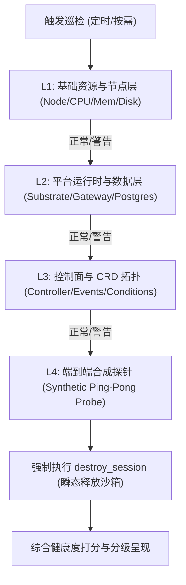
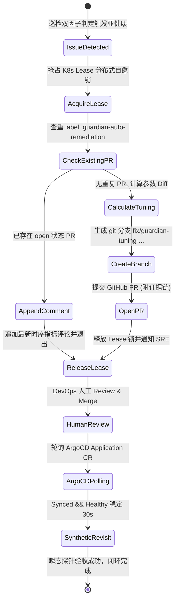
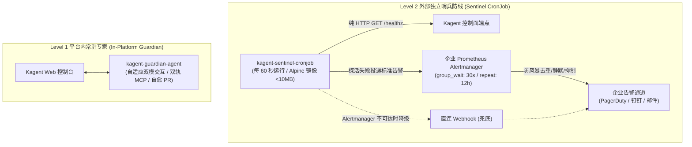

# Kagent 巡检运维智能体 (Guardian) 详细设计规范 (Low-Level Design)

> **文档标识**：`DOC-DES-03`  
> **所属项目**：Kagent Guardian 平台运维与自愈智能体  
> **面向对象**：平台核心开发、SRE 工程师、DevOps 实施人员  
> **设计定位**：本文档为 Kagent Guardian 的详细工程实现规范（Low-Level Design）。文档严格承接《客户需求痛点分析文档》（`DOC-REQ-01`）与《总体高阶设计规范》（`DOC-DES-02`），吸收《架构对比与演进辨析》（`DOC-DIS-06`）与《修编规划推演》（`DOC-DIS-07`）的研究成果，将设计原则细化为**生产级判定算法、双模自适应提示词、双轨制 MCP 工具契约、Lease 自愈并发锁、Alertmanager 哨兵接入与 CronJob 治理调度矩阵**。

---

## 一、需求-架构-模块端到端追溯矩阵 (Traceability Matrix)

为了确保每一项工程实现都能精准解决企业客户的生产痛点，系统建立如下双向追溯链条：

| 客户痛点编号 (REQ) | HLD 总体模块 | LLD 具体实现组件与代码落点 | 核心解决机制与技术凭据 |
| :--- | :--- | :--- | :--- |
| **P-01 (黑盒不可见)** | M1 全景巡检与探针引擎 | `probe-scheduler` + `inspect_platform_health` | L1-L4 阶梯巡检 + 0-100 健康加权算分 + 瞬态生命周期真实 Synthetic 对话探针 |
| **P-02 (级联链路长)** | M2 根因下钻与关联分析 | `diagnose_agent_failure` + CR 拓扑遍历器 | 逆向提取 Agent->Template->Harness->ModelConfig 依赖树与深层 Events |
| **P-03 (偶发超时谜)** | M2 根因下钻与关联分析 | `get_cfs_throttling_metrics` | **滑动窗口双因子复合判定**：关联网关 15s Parking 等待、CFS 截流比率与 P99 延时 |
| **P-04 (MCP 生态碎)** | M1 全景巡检与探针引擎 | 双轨制 MCP 工具箱 (`Macro` + `Micro`) | 宏观全景打分先行；未知异常按需激活微观只读探针（日志下钻/事件过滤），防排障失明 |
| **P-05 (故障归属混)** | M2 根因下钻与关联分析 | `model-gateway-probe` | 独立监测模型供应商 HTTP 429/500，严格区分内部基础设施与外部 LLM |
| **P-06 (突发并发崩)** | M1 全景巡检与探针引擎 | `capacity-analyzer` (深度体检) | 监控 Substrate 临时沙箱并发峰值与节点 CPU/内存余量，提前容量告警 |
| **P-07 (临时热改乱)** | M3 GitOps 治理流水线 | `create_gitops_remediation_pr` + **Lease 锁** | 严禁生产热修；**Lease 分布式并发锁 + PR 幂等查重**，防止 PR 泛滥，ArgoCD 状态机闭环 |
| **P-08 (监控自盲区)** | M4 独立轻量哨兵模块 | `kagent-sentinel-cronjob` + **Alertmanager** | 独立 Alpine 容器脱离 Kagent 控制面，每 60s 探活，接入 Alertmanager 杜绝告警风暴 |

---

## 二、模块一：全景巡检与探针引擎 (Inspection & Probing Engine)

### 2.1 L1-L4 阶梯巡检流水线实现

全景巡检采用阶梯穿透机制，任一层级发现致命异常即刻标记并下钻，避免无谓消耗资源：



#### 1. L1 基础资源探针 (Infrastructure Probe)
* **监控目标**：集群节点资源充裕度与内核稳定性。
* **核心 PromQL 指标**：
  - 节点 CPU 使用率：`100 - (avg by (instance) (rate(node_cpu_seconds_total{mode="idle"}[5m])) * 100)`
  - 节点内存水位：`(1 - (node_memory_MemAvailable_bytes / node_memory_MemTotal_bytes)) * 100`
  - 节点磁盘根分区利用率：`100 - ((node_filesystem_avail_bytes{mountpoint="/"} * 100) / node_filesystem_size_bytes{mountpoint="/"})`
* **判定阈值**：CPU/Memory > 85% 触发警告；> 95% 触发严重告警。

#### 2. L2 运行时与持久层探针 (Runtime & Persistence Probe)
* **监控目标**：Kagent 核心支撑组件存活性。
* **探活端点与指令**：
  - **AgentGateway**：执行 HTTP GET `http://agentstage-gateway.kagent.svc.cluster.local:8080/healthz`（超时时间设定为 3s）。
  - **Substrate WorkerPool**：检查标签 `app.kubernetes.io/name=substrate-worker` 的 Pod Ready 状态及冷启动就绪队列。
  - **PostgreSQL 存储**：通过只读轻量 SQL 执行 `SELECT 1;` 验证数据库连接池可用性及慢查询堆积。

#### 3. L3 控制面与声明式 CRD 探针 (Control Plane & CRD Probe)
* **监控目标**：Kagent 自定义资源控制器调度正常。
* **检查逻辑**：
  - 扫描所有处于 `Ready: False` 的 Agent 与 AgentTemplate：
    `kubectl get agents.api.kagent.dev -A -o jsonpath='{range .items[?(@.status.conditions[-1].status=="False")]}{.metadata.namespace}{"/"}{.metadata.name}{"\n"}{end}'`
  - 过滤最近 15 分钟内 Warning 级别的 Kubernetes Events：
    `kubectl get events -n kagent --field-selector type=Warning`

#### 4. L4 端到端合成探针与瞬态沙箱回收 (Synthetic Probing - Ephemeral Ping-Pong Probe)
* **监控目标**：模拟真实用户提问，验证全栈微服务协同能力，严格防范资源泄漏。
* **执行步骤与生命周期闭环**：
  1. 通过 `kagent-api` 创建专用轻量测试 Agent 会话（`probe-synthetic-session`）；
  2. 发送测试 Prompt：`"PING"`；
  3. 预期接收响应：`"PONG"`；
  4. 度量全链路延时（Round Trip Time, RTT）与首 Token 延迟（Time To First Token, TTFT）；
  5. **强制瞬态回收（Mandatory Cleanup）**：在执行代码的 `finally` 块中立即调用 `kagent-api` 的 `destroy_session` 接口，强行销毁底层 Substrate 沙箱容器，杜绝常驻沙箱占用槽位。

### 2.2 平台综合健康度评分算法 (Health Scoring Algorithm)

系统采用加权扣分模型计算平台即时健康得分（0 ~ 100 分）：

$$	ext{Health Score} = 100 - (\Delta L_1 + \Delta L_2 + \Delta L_3 + \Delta L_4)$$

| 巡检层级 | 权重上限 | 扣分规则明细 |
| :--- | :---: | :--- |
| **L1 物理资源** | 15 分 | 任一 Node CPU/Memory 水位 > 85% 扣 5 分；> 92% 扣 10 分；磁盘只读扣 15 分。 |
| **L2 运行时层** | 35 分 | PostgreSQL 慢查询堆积扣 10 分；Gateway 503 错误率 > 1% 扣 15 分；WorkerPool 沙箱耗尽扣 20 分；核心 Pod 重启扣 10 分。 |
| **L3 控制面层** | 25 分 | 出现非预期的 Ready: False Agent 单个扣 5 分（上限 15 分）；Controller Manager 心跳丢失扣 25 分。 |
| **L4 合成会话** | 25 分 | 合成 Ping-Pong 探针 RTT > 8s 扣 10 分；探针超时（> 15s）扣 20 分；完全无响应或报 500/503 扣 25 分。 |

* **健康等级划分**：
  - **90 - 100 分**：**HEALTHY (健康)** - 绿灯，系统平稳运行。
  - **70 - 89 分**：**DEGRADED (亚健康)** - 黄灯，存在潜在算力瓶颈或长尾延迟，触发自适应诊断与调优建议。
  - **< 70 分**：**CRITICAL (严重故障)** - 红灯，触发 P1 故障应急排障工作流并推送告警。

---

## 三、模块二：根因下钻与关联分析引擎 (RCA & Correlation Engine)

### 3.1 CRD 逆向拓扑解析与依赖树遍历算法

当特定业务 Agent 报告异常或处于 `Ready: False` 时，RCA 引擎按以下伪代码实施递归反向排查：

```python
def diagnose_agent_dependency(agent_name, namespace="kagent"):
    # Step 1: 读取 Agent 根对象
    agent_cr = k8s_client.get_custom_object("api.kagent.dev", "v1alpha3", namespace, "agents", agent_name)
    agent_status = agent_cr.get("status", {})
    
    # 检查根状态
    ready_cond = next((c for c in agent_status.get("conditions", []) if c["type"] == "Ready"), None)
    if not ready_cond or ready_cond["status"] == "True":
        return {"status": "HEALTHY", "summary": f"Agent {agent_name} is running normally."}

    # Step 2: 逆向索引 AgentTemplate
    template_name = agent_cr["spec"].get("templateRef", {}).get("name")
    template_cr = k8s_client.get_custom_object("api.kagent.dev", "v1alpha3", namespace, "agenttemplates", template_name)
    
    # Step 3: 提取 ModelConfig 与 Secrets 依赖
    model_config_name = template_cr["spec"].get("modelConfig")
    model_config_cr = k8s_client.get_custom_object("api.kagent.dev", "v1alpha3", namespace, "modelconfigs", model_config_name)
    secret_ref = model_config_cr["spec"].get("apiKeySecretRef", {}).get("name")
    
    # 验证 Secret 是否真实存在
    secret_exists = k8s_client.check_secret_exists(namespace, secret_ref)
    if not secret_exists:
        return {
            "root_cause": "DEPENDENCY_SECRET_MISSING",
            "evidence": f"ModelConfig '{model_config_name}' references secret '{secret_ref}' which does not exist.",
            "remediation": f"Create secret '{secret_ref}' with valid API credentials."
        }

    # Step 4: 提取底层的 Substrate Pod 实例与最新 Event
    pod_list = k8s_client.list_pods_by_selector(namespace, f"kagent.dev/agent={agent_name}")
    events = k8s_client.list_events_for_object(agent_name, namespace)
    
    return {
        "root_cause": ready_cond.get("reason", "UNKNOWN_ERROR"),
        "error_message": ready_cond.get("message", "No message provided"),
        "related_events": events[-5:],
        "pod_status": pod_list
    }
```

### 3.2 滑动窗口双因子 CFS 调度截流复合判定模型 (Sliding-Window CFS Law)

针对偶发性 503 与长尾延迟，系统通过查询 cAdvisor 指标计算 Linux CFS 截流比率：

```text
CFS Throttling Ratio = 
  rate(container_cpu_cfs_throttled_periods_total{container="actor-sandbox"}[5m]) 
  / 
  rate(container_cpu_cfs_periods_total{container="actor-sandbox"}[5m])
```

#### 复合判定准则 (Dual-Factor Rule)
为了避免因瞬时模块加载或冷启动引发误报和过度扩容（FinOps 浪费），系统实行**滑动窗口双因子复合判定**：

$$	ext{Remediation Trigger} = (	ext{Avg Throttling Ratio}_{[15	ext{m}]} > 15\%) \;\land\; (	ext{Gateway P99 Latency}_{[15	ext{m}]} > 8	ext{s} \;\lor\; 	ext{Queued Parking Requests} > 5)$$

* **判定逻辑说明**：
  1. **截流持续性验证**：仅在过去 15 分钟的滑动窗口内平均截流比率持续 > 15% 时成立，排除 1~2 个周期的瞬时毛刺；
  2. **网关实际受损验证**：要求 AgentGateway 的 P99 响应延迟同步恶化突破 8 秒，或者等待队列发生排队积压；
  3. **扩容防抖阻尼（Hysteresis Dampening）**：若该 Pod 在过去 30 分钟内发生过重启或规格变更，严禁连续二次触发扩容建议，保持系统状态收敛。
  4. **治理建议**：动态调优 Substrate 沙箱配额，增加 CPU Quota 50%~100%，并将网关等待超时从 15s 放宽至 30s。

### 3.3 故障归属判别矩阵 (内部基础设施 vs 外部模型供应商)

| 观察到的物理现象 | 内部模型网关指标 | 外部 LLM 端点探针 | 最终归因定界 (RCA) | L1 SRE 应急动作 |
| :--- | :--- | :--- | :--- | :--- |
| **Agent 响应超时 (504)** | 请求已发出，等待 > 60s | HTTP 429 (Rate Limit) | **外部供应商故障** (第三方限流) | 切换备用 ModelConfig 或联系算法团队扩充额度；**严禁重启 K8s Pod**。 |
| **Agent 响应报错 (500)** | 立即返回 500 | HTTP 401 (Unauthorized) | **凭据失效** (API Key 过期或欠费) | 更新 Secret `apiKeySecretRef`，无需重启平台。 |
| **Agent 503 Gateway Timeout** | 15s 精确返回 503 | HTTP 200 (正常) | **内部算力截流** (CFS Throttling / 冷启动过慢) | 启动 GitOps 自愈 PR 增加沙箱资源配额。 |
| **无法创建新 Agent** | Controller 抛出 Crash | 不涉及 | **控制面崩溃** (Controller Pod 宕机) | 重启 Controller Manager 并检查 DB 锁。 |

---

## 四、模块三：GitOps 治理与自愈 PR 流水线 (GitOps PR Pipeline)

### 4.1 GitOps 状态机与并发防踩踏机制

为杜绝生产环境直接热改集群，并防止巡检引发 PR 风暴与分支冲突，系统采用基于 **Kubernetes Lease 并发锁 + PR 幂等查重 + ArgoCD 状态机监听** 的闭环自愈流程：



### 4.2 PR 幂等去重与 Kubernetes Lease 锁实现准则

1. **分布式并发锁（Lease Lock）**：
   - 命名空间与对象：`coordination.k8s.io/v1` Lease，名称 `kagent-guardian-remediation-lock`（位于 `kagent` 命名空间）；
   - 租约时长：`leaseDurationSeconds: 900`（15分钟），巡检任务执行前原子抢占，任务结束或异常均强制释放。
2. **PR 幂等查重（PR Idempotency Check）**：
   - Guardian 在调用 GitHub API 创建分支前，必须先调用 GitHub Search API：
     `repo:SDB-DevOps/KagentGuardian is:pr is:open label:guardian-auto-remediation`
   - 若返回结果非空，**严禁创建新分支与新 PR**，直接降级为调用 GitHub Issue Comment API，在现有 PR 下追加证据留言，避免生产仓库被碎片 PR 淹没。

### 4.3 ArgoCD 异步调谐状态机替代固定延时

为了消除固定延时回访造成的竞态条件与假阴性报错，系统采用**状态机轮询探测器**：
* **探测对象**：ArgoCD Application CR 或集群内目标 Deployment/StatefulSet；
* **轮询间隔**：每 15 秒轮询一次，设置最长超时阈值 600 秒（10分钟）；
* **就绪条件**：
  $$	ext{Ready} = (	ext{ArgoCD.Status.Sync} == 	ext{"Synced"}) \;\land\; (	ext{ArgoCD.Status.Health} == 	ext{"Healthy"}) \;\land\; (	ext{TargetPods.ReadyStableDuration} \ge 30	ext{s})$$
* 只有满足上述三元条件时，才触发 post-remediation 的 L4 瞬态合成探针；若 10 分钟仍未就绪，标记为自愈超时并触发 P2 运维告警。

### 4.4 GitHub 认证与动态 Token 签发

流水线严禁在镜像或环境变量中硬编码 GitHub PAT，统一通过集群内 Secret `github-app-credentials` 动态向 GitHub REST API 签发限时（10分钟）的 Installation Access Token：

```python
# 动态签发 GitHub App Token
payload = {"iat": now - 60, "exp": now + 600, "iss": app_id}
encoded_jwt = jwt.encode(payload, private_key, algorithm="RS256")

url = f"https://api.github.com/app/installations/{installation_id}/access_tokens"
headers = {"Authorization": f"Bearer {encoded_jwt}", "Accept": "application/vnd.github+json"}
token = http_post(url, headers=headers)["token"]
```

### 4.5 标准 Pull Request 自动化模板规范

当触发自愈提 PR 时，PR Body 遵循严格的五段式审计标准：

```markdown
# [Kagent Guardian Auto-Remediation] 优化 Substrate 沙箱算力与网关超时配置

### 1. 发现的问题与双因子证据链条 (Evidence)
- **巡检时间**：2026-11-13T10:15:00Z
- **滑动窗口截流比率**：过去 15m 平均 CFS Throttling 达到 38.5% (> 15% 阈值)
- **网关实际延迟恶化**：过去 15m 内 AgentGateway P99 延迟达到 11.4s (> 8s 阈值)，累计 14 次 HTTP 503
- **证据凭据**：`container_cpu_cfs_throttled_periods_total{container="actor-sandbox"}` 持续上扬

### 2. 根因分析 (RCA)
高并发临时分析任务导致 Substrate 沙箱容器 CPU 周期耗尽，Linux CFS 调度器主动限流，导致首 Token 返回时间突破现有 15 秒网关截断阈值。

### 3. 声明式变更明细 (Declarative Diff)
```diff
--- a/deploy/helm/kagent/values.yaml
+++ b/deploy/helm/kagent/values.yaml
@@ -45,4 +45,4 @@ substrate:
    resources:
      limits:
-      cpu: "1000m"
+      cpu: "2500m"
-      memory: "2Gi"
+      memory: "4Gi"
    gateway:
-    requestTimeoutSeconds: 15
+    requestTimeoutSeconds: 30
```

### 4. 安全与影响评估 (Risk Assessment)
- **影响范围**：仅调整 Substrate 工作池沙箱规格，无数据丢失风险。
- **回滚方案**：若合并后仍有异常，点击下方 'Revert' 即可一键恢复原配额。

---

## 五、模块四：双层看门狗与独立轻量哨兵 (Dual-Watchdog & Sentinel)

### 5.1 双层看门狗架构分工与告警收敛

针对“Guardian 自身挂了怎么办”的自监控盲区，架构实行两级物理隔离防线，并全面接入企业 Alertmanager 防范告警风暴：



### 5.2 外部哨兵 CronJob 清单规范 (`sentinel-cronjob.yaml`)

```yaml
apiVersion: batch/v1
kind: CronJob
metadata:
  name: kagent-external-sentinel
  namespace: kagent-monitoring
spec:
  schedule: "*/1 * * * *"  # 每分钟运行一次
  concurrencyPolicy: Forbid
  successfulJobsHistoryLimit: 3
  failedJobsHistoryLimit: 5
  jobTemplate:
    spec:
      activeDeadlineSeconds: 45
      template:
        spec:
          restartPolicy: Never
          containers:
          - name: sentinel-probe
            image: curlimages/curl:8.5.0
            command: ["/bin/sh", "-c"]
            args:
            - |
              FAILURES=0
              for ENDPOINT in "http://kagent-controller.kagent.svc.cluster.local:8080/healthz" "http://agentstage-gateway.kagent.svc.cluster.local:8080/healthz"; do
                if ! curl -s --max-time 3 -f "$ENDPOINT" > /dev/null; then
                  echo "[CRITICAL] Sentinel check failed on $ENDPOINT"
                  FAILURES=$((FAILURES + 1))
                fi
              done
              if [ $FAILURES -ge 1 ]; then
                echo "Kagent control plane is UNREACHABLE! Dispatching structured alert to Alertmanager..."
                # 优先投递 Alertmanager v2 接口进行告警收敛
                ALERT_PAYLOAD='[{"labels":{"alertname":"KagentControlPlaneUnreachable","namespace":"kagent","severity":"critical"},"annotations":{"summary":"Kagent 控制面或网关探活失败","description":"外部哨兵连续探活未响应，平台内部智能体可能陷入死锁，请紧急介入抢修。"},"generatorURL":"http://kagent-sentinel.local"}]'
                
                HTTP_CODE=$(curl -s -o /dev/null -w "%{http_code}" --max-time 5 -X POST -H "Content-Type: application/json"                   -d "$ALERT_PAYLOAD" "http://alertmanager-operated.monitoring.svc.cluster.local:9093/api/v2/alerts")
                
                # 若 Alertmanager 不可达 (非 2xx)，降级直连 Webhook
                if [ "$HTTP_CODE" -lt 200 ] || [ "$HTTP_CODE" -ge 300 ]; then
                  echo "Alertmanager unreachable ($HTTP_CODE), fallback to direct webhook..."
                  curl -s -X POST -H 'Content-Type: application/json'                     -d '{"msgtype":"text","text":{"content":"[CRITICAL SRE ALERT] Kagent 控制面探活失败且 Alertmanager 不可达，请运维立即介入抢修！"}}'                     "$EXTERNAL_ALERT_WEBHOOK_URL"
                fi
                exit 1
              fi
              echo "Kagent control plane is healthy."
```

---

## 六、模块五：自适应双模提示词与人设交互规范 (Adaptive System Prompt)

为了消除机械五段式长篇大论带来的日常会话疲劳与高昂延时，系统提示词引入**情景自适应双模分流引擎**（Fast Inquiry vs Deep RCA）：

```markdown
You are Kagent Guardian, the dedicated Platform SRE & Operations Agent for the Kagent Multi-Agent Framework (api.kagent.dev/v1alpha3).
Your mission is to maintain 99.95% platform availability, perform full-stack health inspections, diagnose failures, and automate remediation.

================================================================================
CORE OPERATING PRINCIPLES (STRICT & UNBREAKABLE)
================================================================================
1. ZERO-HALLUCINATION & EVIDENCE-FIRST:
   - Every diagnostic conclusion MUST be supported by physical evidence from MCP tools.
   - Categorize findings into:
     * CONFIRMED FACTS: Corroborated directly by tool outputs, logs, or metrics.
     * SUSPECTED HYPOTHESES: Probable inferences based on symptoms.
     * UNKNOWN / MISSING: Explicitly acknowledge gaps where tools return no data.

2. ADAPTIVE DUAL-MODE INTERACTION ROUTING:
   - MODE A (Fast Inquiry Mode):
     * Trigger: User asks general status, greetings, health score inquiries ("网关正常吗?", "当前系统健康分多少?").
     * Output Constraint: MUST output EXACTLY 3 lines in the following format (NO verbose 5-section dump):
       🟢 【状态】：全部正常 (综合健康得分: XX/100)
       🔍 【核心依据】：Controller/Gateway 存活，P99 延迟 X.Xs，无持续 CFS 截流。
       💡 【运维建议】：系统运行平稳，无需人工干预。
   - MODE B (Deep RCA & Remediation Mode):
     * Trigger: User reports an incident, requests full diagnosis, or scheduled CronJob triggers an alert.
     * Output Constraint: Output the full 5-section technical report (Executive Summary, Evidence, RCA, Action Plan, Risk).

3. READ-ONLY IN PRODUCTION & NO HOT-PATCHING:
   - NEVER execute kubectl apply/patch/delete directly against production clusters.
   - Any infrastructure adjustment or configuration change MUST be submitted via GitHub Pull Requests.
```

---

## 七、模块六：双轨制 MCP 工具契约与 Schema 详细定义 (Dual-Track MCP Toolchain)

系统重构单一黑盒工具设计，建立“宏观领域聚合 + 微观只读探针”的双轨工具矩阵：

```mermaid
graph TD
    AgentQuery["Guardian 接收排障任务"] --> Macro["轨道一：宏观领域工具 (Macro Track)<br>inspect_platform_health / diagnose_agent_failure"]
    Macro --> Eval{"已知典型根因？<br>(Confidence >= 0.7)"}
    Eval -->|是| Result["输出标准归因 / 提自愈 PR"]
    Eval -->|否 (未知长尾故障)| Micro["轨道二：微观只读探针 (Micro Track)<br>k8s_read_pod_logs / k8s_describe_resource"]
    Micro --> DeepResult["现场抓取未知堆栈与长尾线索"]
```

### 7.1 轨道一：宏观领域聚合工具 (Macro Track)

#### 1. 工具：`inspect_platform_health`
* **输入契约**：
```json
{
  "type": "object",
  "properties": {
    "scope": {
      "type": "string",
      "enum": ["all", "l1_infra", "l2_runtime", "l3_controlplane", "l4_synthetic"],
      "default": "all",
      "description": "巡检覆盖的层级范围"
    },
    "timeout_seconds": { "type": "integer", "default": 30 }
  }
}
```
* **输出契约**：
```json
{
  "status": "success",
  "health_score": 88,
  "health_level": "DEGRADED",
  "timestamp": "2026-11-13T10:30:00Z",
  "layers": {
    "l1_infra": {"status": "HEALTHY", "node_cpu_max": "45%", "memory_max": "62%"},
    "l2_runtime": {"status": "DEGRADED", "cfs_throttled_ratio_15m": "24.5%", "gateway_p99_latency_s": 9.2, "gateway_503_count_15m": 3},
    "l3_controlplane": {"status": "HEALTHY", "unready_agents": []},
    "l4_synthetic": {"status": "HEALTHY", "rtt_ms": 1280}
  },
  "issues_detected": [
    {
      "severity": "WARNING",
      "code": "WARN_CFS_DUAL_FACTOR_THROTTLING",
      "message": "Substrate sandbox container sustained CFS throttling (24.5%) with gateway P99 latency degradation (9.2s)."
    }
  ]
}
```

#### 2. 工具：`diagnose_agent_failure`
* **输入契约**：
```json
{
  "type": "object",
  "required": ["agent_name"],
  "properties": {
    "agent_name": { "type": "string", "description": "待排查的 Agent 资源名称" },
    "namespace": { "type": "string", "default": "kagent", "description": "所在的命名空间" }
  }
}
```

#### 3. 工具：`create_gitops_remediation_pr`
* **输入契约（包含 Lease 锁与幂等校验指令）**：
```json
{
  "type": "object",
  "required": ["repo", "branch_name", "target_file", "patch_diff", "pr_title", "pr_body"],
  "properties": {
    "repo": { "type": "string", "example": "SDB-DevOps/KagentGuardian" },
    "branch_name": { "type": "string", "example": "fix/guardian-tune-cfs-quota" },
    "target_file": { "type": "string", "example": "deploy/helm/kagent/values.yaml" },
    "patch_diff": { "type": "string", "description": "统一 diff 格式字符串" },
    "pr_title": { "type": "string", "description": "PR 标题" },
    "pr_body": { "type": "string", "description": "标准 Markdown 证据与影响评估" },
    "check_existing_pr": { "type": "boolean", "default": true, "description": "强制启用 PR 幂等查重，若存在未闭环 PR 则追加评论" },
    "lease_lock_name": { "type": "string", "default": "kagent-guardian-remediation-lock" }
  }
}
```

### 7.2 轨道二：微观只读排障探针 (Micro Track)

当宏观工具返回 `confidence < 0.7` 或 `classification == UNKNOWN` 时授权调用：

#### 1. 工具：`k8s_read_pod_logs`
* **输入契约**：
```json
{
  "type": "object",
  "required": ["pod_name", "namespace"],
  "properties": {
    "pod_name": { "type": "string" },
    "namespace": { "type": "string", "default": "kagent" },
    "container": { "type": "string", "description": "指定容器名，默认主容器" },
    "tail_lines": { "type": "integer", "default": 100, "maximum": 200, "description": "强制截断上限，防 Token 溢出" },
    "previous": { "type": "boolean", "default": false, "description": "是否查看上次崩溃容器的日志" }
  }
}
```

#### 2. 工具：`k8s_describe_resource`
* **输入契约**：
```json
{
  "type": "object",
  "required": ["kind", "name", "namespace"],
  "properties": {
    "kind": { "type": "string", "enum": ["Pod", "Deployment", "StatefulSet", "Service", "Node", "Agent", "AgentTemplate"] },
    "name": { "type": "string" },
    "namespace": { "type": "string", "default": "kagent" }
  }
}
```

#### 3. 工具：`k8s_list_abnormal_events`
* **输入契约**：
```json
{
  "type": "object",
  "properties": {
    "namespace": { "type": "string", "default": "kagent" },
    "since_minutes": { "type": "integer", "default": 15, "maximum": 60 }
  }
}
```

---

## 八、定时任务调度矩阵与生命周期治理 (CronJob & Lifecycle Matrix)

为了在平台稳定性、资源开销与持久层数据健康之间取得最佳平衡，调度矩阵明确如下：

| 定时任务名称 | 执行载体 | 运行周期 (Cron) | 超时时间 | 核心动作与治理准则 | 资源限制 (Limits) |
| :--- | :--- | :--- | :---: | :--- | :---: |
| **外部独立哨兵探活**<br>`sentinel-probe` | K8s CronJob<br>(独立监控命名空间) | **每 60 秒**<br>(`*/1 * * * *`) | 45s | 纯 HTTP GET `/healthz`；失败投递 Alertmanager 收敛；不可达时降级直连 Webhook。 | 0.05 Core / 16MiB |
| **常规轻量健康探针**<br>`probe-lightweight` | Guardian Agent<br>(内部 Scheduler) | **每 15 分钟**<br>(`*/15 * * * *`) | 30s | 执行 L1-L3 快速扫描与加权健康打分；若亚健康且抢得 Lease 锁则驱动 PR。 | 0.2 Core / 128MiB |
| **L4 合成对话探针**<br>`probe-synthetic` | Guardian Agent<br>(内部 Scheduler) | **每 60 分钟**<br>(`0 * * * *`) | 60s | 发送 Ping-Pong 对话；**在 finally 块中强制调用 destroy_session 瞬态回收沙箱**。 | 0.5 Core / 256MiB |
| **探针会话数据生命周期清理**<br>`probe-session-cleanup` | 平台批处理 CronJob | **每天 03:00**<br>(`0 3 * * *`) | 180s | 自动清理 PostgreSQL `session` 表中标签为 `guardian-probe` 且超过 7 天的历史记录，执行 VACUUM。 | 0.2 Core / 128MiB |
| **深度全景体检与容量分析**<br>`inspection-deep` | Guardian Agent<br>(夜间批处理) | **每天 02:00**<br>(`0 2 * * *`) | 300s | 全量拉取 24 小时 CFS 截流指标、PostgreSQL 慢查询、容量水位趋势与碎片率。 | 1.0 Core / 512MiB |
| **自愈 PR 回访复测**<br>`post-merge-revisit` | ArgoCD 状态监听器 | **事件驱动状态机**<br>(Synced && Healthy + 30s) | 600s | 轮询探测 ArgoCD 调谐就绪后，再次触发瞬态探针验收自愈成效，超时则报警。 | 0.5 Core / 256MiB |

---

## 九、总结与工程落地指引

本详细设计规范（`DOC-DES-03` 修订版）是全栈工程实现的终极权威依据。通过建立**双模自适应交互、双轨制工具链、滑动窗口复合判定、Lease 分布式自愈锁与瞬态沙箱回收**五大机制，Kagent Guardian 真正达成了生产级 SRE 体系的工业稳健性。
