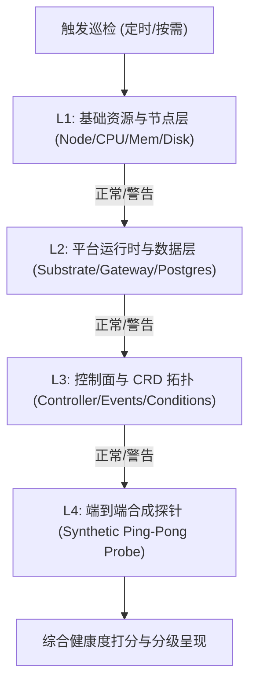
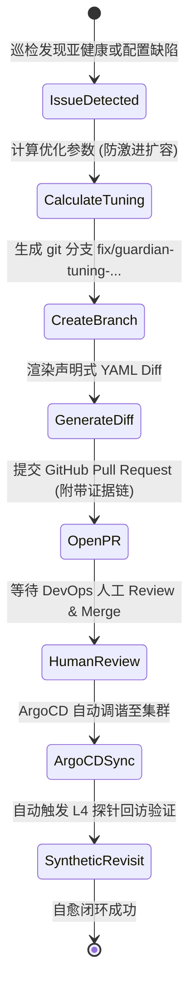
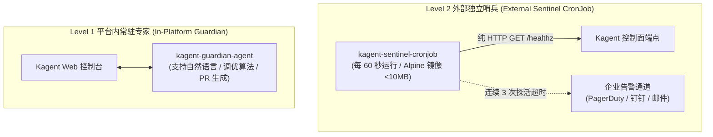

# Kagent 巡检运维智能体 (Guardian) 详细设计规范 (Low-Level Design)

> **文档标识**：`DOC-DES-03`  
> **所属项目**：Kagent Guardian 平台运维与自愈智能体  
> **面向对象**：平台核心开发、SRE 工程师、DevOps 实施人员  
> **设计定位**：本文档为 Kagent Guardian 的详细工程实现规范（Low-Level Design）。文档严格承接《客户需求痛点分析文档》（`DOC-REQ-01`）与《总体高阶设计规范》（`DOC-DES-02`），将设计原则与宏观架构细化为**具体模块实现、Prompt 模板、MCP 工具 Schema 契约、CronJob 调度策略与排障调用链**。

---

## 一、需求-架构-模块端到端追溯矩阵 (Traceability Matrix)

为了确保每一项工程实现都能精准解决企业客户的生产痛点，系统建立如下双向追溯链条：

| 客户痛点编号 (REQ) | HLD 总体模块 | LLD 具体实现组件与代码落点 | 核心解决机制与技术凭据 |
| :--- | :--- | :--- | :--- |
| **P-01 (黑盒不可见)** | M1 全景巡检与探针引擎 | `probe-scheduler` + `inspect_platform_health` | L1-L4 阶梯巡检 + 0-100 健康加权算分 + 端到端真实 Synthetic 对话探针 |
| **P-02 (级联链路长)** | M2 根因下钻与关联分析 | `diagnose_agent_failure` + CR 拓扑遍历器 | 逆向提取 Agent->Template->Harness->ModelConfig 依赖树与深层 Events |
| **P-03 (偶发超时谜)** | M2 根因下钻与关联分析 | `get_cfs_throttling_metrics` | 抓取 CFS 调度截流比率，关联网关 15s Parking 等待与冷启动耗时 |
| **P-04 (MCP 生态碎)** | M1 全景巡检与探针引擎 | `audit_mcp_servers` 探针 | JSON-RPC 握手连通性、Schema 契约校验与底层后端 API 限流审计 |
| **P-05 (故障归属混)** | M2 根因下钻与关联分析 | `model-gateway-probe` | 独立监测模型供应商 HTTP 429/500，严格区分内部基础设施与外部 LLM |
| **P-06 (突发并发崩)** | M1 全景巡检与探针引擎 | `capacity-analyzer` (深度体检) | 监控 Substrate 临时沙箱并发峰值与节点 CPU/内存余量，提前容量告警 |
| **P-07 (临时热改乱)** | M3 GitOps 治理流水线 | `create_gitops_remediation_pr` | 严禁生产热修；计算优化参数后自动在 GitHub 建分支提 PR 供人工 Review |
| **P-08 (监控自盲区)** | M4 独立轻量哨兵模块 | `kagent-sentinel-cronjob` | 独立 Alpine 容器脱离 Kagent 控制面，每 60s 探活，连续 3 次失败直发 PagerDuty |

---

## 二、模块一：全景巡检与探针引擎 (Inspection & Probing Engine)

### 2.1 L1-L4 阶梯巡检流水线实现

全景巡检采用阶梯穿透机制，任一层级发现致命异常即刻标记并下钻，避免无谓消耗资源：



#### 1. L1 基础资源探针 (Infrastructure Probe)
* **监控目标**：集群节点资源充裕度与内核稳定性。
* **核心 PromQL 指标**：
  - 节点 CPU 使用率：`100 - (avg by (instance) (rate(node_cpu_seconds_total{mode="idle"}[5m])) * 100)`
  - 节点内存水位：`(1 - (node_memory_MemAvailable_bytes / node_memory_MemTotal_bytes)) * 100`
  - 节点磁盘根分区利用率：`100 - ((node_filesystem_avail_bytes{mountpoint="/"} * 100) / node_filesystem_size_bytes{mountpoint="/"})`
* **判定阈值**：CPU/Memory > 85% 触发警告；> 95% 触发严重告警。

#### 2. L2 运行时与持久层探针 (Runtime & Persistence Probe)
* **监控目标**：Kagent 核心支撑组件存活性。
* **探活端点与指令**：
  - **AgentGateway**：执行 HTTP GET `http://agentstage-gateway.kagent.svc.cluster.local:8080/healthz`（超时时间设定为 3s）。
  - **Substrate WorkerPool**：检查标签 `app.kubernetes.io/name=substrate-worker` 的 Pod Ready 状态及冷启动就绪队列。
  - **PostgreSQL 存储**：通过只读轻量 SQL 执行 `SELECT 1;` 验证数据库连接池可用性及慢查询堆积。

#### 3. L3 控制面与声明式 CRD 探针 (Control Plane & CRD Probe)
* **监控目标**：Kagent 自定义资源控制器调度正常。
* **检查逻辑**：
  - 扫描所有处于 `Ready: False` 的 Agent 与 AgentTemplate：
    `kubectl get agents.api.kagent.dev -A -o jsonpath='{range .items[?(@.status.conditions[-1].status=="False")]}{.metadata.namespace}{"/"}{.metadata.name}{"\n"}{end}'`
  - 过滤最近 15 分钟内 Warning 级别的 Kubernetes Events：
    `kubectl get events -n kagent --field-selector type=Warning`

#### 4. L4 端到端合成探针 (Synthetic Probing - Ping-Pong Probe)
* **监控目标**：模拟真实用户提问，验证全栈微服务协同能力。
* **执行步骤**：
  1. 通过 `kagent-api` 调用平台内部预置的探针专用轻量 Agent（`probe-synthetic-agent`）；
  2. 发送测试 Prompt：`"PING"`；
  3. 预期接收响应：`"PONG"`；
  4. 度量全链路延时（Round Trip Time, RTT）与首 Token 延迟（Time To First Token, TTFT）；
  5. 若 RTT > 15s 或返回 503/504，则断定平台遭遇算力截流或会话驻留超时。

### 2.2 平台综合健康度评分算法 (Health Scoring Algorithm)

系统采用加权扣分模型计算平台即时健康得分（0 ~ 100 分）：

$$	ext{Health Score} = 100 - (\Delta L_1 + \Delta L_2 + \Delta L_3 + \Delta L_4)$$

| 巡检层级 | 权重上限 | 扣分规则明细 |
| :--- | :---: | :--- |
| **L1 物理资源** | 15 分 | 任一 Node CPU/Memory 水位 > 85% 扣 5 分；> 92% 扣 10 分；磁盘只读扣 15 分。 |
| **L2 运行时层** | 35 分 | PostgreSQL 慢查询堆积扣 10 分；Gateway 503 错误率 > 1% 扣 15 分；WorkerPool 沙箱耗尽扣 20 分；核心 Pod 重启扣 10 分。 |
| **L3 控制面层** | 25 分 | 出现非预期的 Ready: False Agent 单个扣 5 分（上限 15 分）；Controller Manager 心跳丢失扣 25 分。 |
| **L4 合成会话** | 25 分 | 合成 Ping-Pong 探针 RTT > 8s 扣 10 分；探针超时（> 15s）扣 20 分；完全无响应或报 500/503 扣 25 分。 |

* **健康等级划分**：
  - **90 - 100 分**：**HEALTHY (健康)** - 绿灯，系统平稳运行。
  - **70 - 89 分**：**DEGRADED (亚健康)** - 黄灯，存在潜在算力瓶颈或长尾延迟，触发优化建议。
  - **< 70 分**：**CRITICAL (严重故障)** - 红灯，触发 P1 故障应急排障工作流并推送告警。

---

## 三、模块二：根因下钻与关联分析引擎 (RCA & Correlation Engine)

### 3.1 CRD 逆向拓扑解析与依赖树遍历算法

当特定业务 Agent 报告异常或处于 `Ready: False` 时，RCA 引擎按以下伪代码实施递归反向排查：

```python
def diagnose_agent_dependency(agent_name, namespace="kagent"):
    # Step 1: 读取 Agent 根对象
    agent_cr = k8s_client.get_custom_object("api.kagent.dev", "v1alpha3", namespace, "agents", agent_name)
    agent_status = agent_cr.get("status", {})
    
    # 检查根状态
    ready_cond = next((c for c in agent_status.get("conditions", []) if c["type"] == "Ready"), None)
    if not ready_cond or ready_cond["status"] == "True":
        return {"status": "HEALTHY", "summary": f"Agent {agent_name} is running normally."}

    # Step 2: 逆向索引 AgentTemplate
    template_name = agent_cr["spec"].get("templateRef", {}).get("name")
    template_cr = k8s_client.get_custom_object("api.kagent.dev", "v1alpha3", namespace, "agenttemplates", template_name)
    
    # Step 3: 提取 ModelConfig 与 Secrets 依赖
    model_config_name = template_cr["spec"].get("modelConfig")
    model_config_cr = k8s_client.get_custom_object("api.kagent.dev", "v1alpha3", namespace, "modelconfigs", model_config_name)
    secret_ref = model_config_cr["spec"].get("apiKeySecretRef", {}).get("name")
    
    # 验证 Secret 是否真实存在
    secret_exists = k8s_client.check_secret_exists(namespace, secret_ref)
    if not secret_exists:
        return {
            "root_cause": "DEPENDENCY_SECRET_MISSING",
            "evidence": f"ModelConfig '{model_config_name}' references secret '{secret_ref}' which does not exist.",
            "remediation": f"Create secret '{secret_ref}' with valid API credentials."
        }

    # Step 4: 提取底层的 Substrate Pod 实例与最新 Event
    pod_list = k8s_client.list_pods_by_selector(namespace, f"kagent.dev/agent={agent_name}")
    events = k8s_client.list_events_for_object(agent_name, namespace)
    
    return {
        "root_cause": ready_cond.get("reason", "UNKNOWN_ERROR"),
        "error_message": ready_cond.get("message", "No message provided"),
        "related_events": events[-5:],
        "pod_status": pod_list
    }
```

### 3.2 CFS CPU Throttling 调度截流判定模型

针对偶发性 503 与长尾延迟，系统通过查询 cAdvisor 指标计算 Linux CFS 截流比率：

```text
CFS Throttling Ratio = 
  rate(container_cpu_cfs_throttled_periods_total{container="actor-sandbox"}[5m]) 
  / 
  rate(container_cpu_cfs_periods_total{container="actor-sandbox"}[5m])
```

* **判定逻辑**：
  - 若 `CFS Throttling Ratio > 20%` 且对应时间段网关出现 `HTTP 503` 尖刺：
    **断定结论**：容器算力 Limit 配置过低，Linux 内核频繁挂起执行进程，导致请求在网关排队超时（Request Parking 15s）。
    **治理建议**：动态调优 Substrate 沙箱配额，增加 CPU Quota 50%~100%，并将网关等待超时从 15s 放宽至 30s。

### 3.3 故障归属判别矩阵 (内部基础设施 vs 外部模型供应商)

| 观察到的物理现象 | 内部模型网关指标 | 外部 LLM 端点探针 | 最终归因定界 (RCA) | L1 SRE 应急动作 |
| :--- | :--- | :--- | :--- | :--- |
| Agent 响应超时 (504) | 请求已发出，等待 > 60s | HTTP 429 (Rate Limit) | **外部供应商故障** (第三方限流) | 切换备用 ModelConfig 或联系算法团队扩充额度；**严禁重启 K8s Pod**。 |
| Agent 响应报错 (500) | 立即返回 500 | HTTP 401 (Unauthorized) | **凭据失效** (API Key 过期或欠费) | 更新 Secret `apiKeySecretRef`，无需重启平台。 |
| Agent 503 Gateway Timeout | 15s 精确返回 503 | HTTP 200 (正常) | **内部算力截流** (CFS Throttling / 冷启动过慢) | 启动 GitOps 自愈 PR 增加沙箱资源配额。 |
| 无法创建新 Agent | Controller 抛出 Crash | 不涉及 | **控制面崩溃** (Controller Pod 宕机) | 重启 Controller Manager 并检查 DB 锁。 |

---

## 四、模块三：GitOps 治理与自愈 PR 流水线 (GitOps PR Pipeline)

### 4.1 GitOps 状态机与防破坏铁律



### 4.2 GitHub 认证与动态 Token 签发

为了杜绝在镜像或环境变量中硬编码高危 GitHub PAT，流水线通过集群内 Secret `github-app-credentials` 动态向 GitHub REST API 签发限时（10分钟）的 Installation Access Token：

```python
# 动态签发 GitHub App Token
payload = {"iat": now - 60, "exp": now + 600, "iss": app_id}
encoded_jwt = jwt.encode(payload, private_key, algorithm="RS256")

url = f"https://api.github.com/app/installations/{installation_id}/access_tokens"
headers = {"Authorization": f"Bearer {encoded_jwt}", "Accept": "application/vnd.github+json"}
token = http_post(url, headers=headers)["token"]
```

### 4.3 标准 Pull Request 自动化模板规范

当触发自愈时，Guardian 自动生成的 PR Body 遵循严格的审计标准：

```markdown
# [Kagent Guardian Auto-Remediation] 优化 Substrate 沙箱算力与网关超时配置

### 1. 发现的问题与证据链条 (Evidence)
- **巡检时间**：2026-11-13T10:15:00Z
- **异常指标**：Container CFS Throttling 比率达到 42.8% (> 20% 告警阈值)
- **网关错误**：过去 15 分钟内 AgentGateway 触发 14 次 HTTP 503 会话驻留超时
- **证据凭据**：`container_cpu_cfs_throttled_periods_total{container="actor-sandbox"}` 持续上扬

### 2. 根因分析 (RCA)
高并发临时分析任务导致 Substrate 沙箱容器 CPU 周期耗尽，Linux CFS 调度器主动限流，导致首 Token 返回时间突破现有 15 秒网关截断阈值。

### 3. 声明式变更明细 (Declarative Diff)
```diff
--- a/deploy/helm/kagent/values.yaml
+++ b/deploy/helm/kagent/values.yaml
@@ -45,4 +45,4 @@ substrate:
   resources:
     limits:
-      cpu: "1000m"
+      cpu: "2500m"
-      memory: "2Gi"
+      memory: "4Gi"
   gateway:
-    requestTimeoutSeconds: 15
+    requestTimeoutSeconds: 30
```

### 4. 安全与影响评估 (Risk Assessment)
- **影响范围**：仅调整 Substrate 工作池沙箱规格，无数据丢失风险。
- **回滚方案**：若合并后仍有异常，点击下方 'Revert' 即可一键恢复原配额。

---

## 五、模块四：双层看门狗与独立轻量哨兵 (Dual-Watchdog & Sentinel)

### 5.1 双层看门狗架构分工

针对“Guardian 自身挂了怎么办”的致命盲区，架构实行两级物理隔离防线：



### 5.2 外部哨兵 CronJob 清单规范 (`sentinel-cronjob.yaml`)

```yaml
apiVersion: batch/v1
kind: CronJob
metadata:
  name: kagent-external-sentinel
  namespace: kagent-monitoring
spec:
  schedule: "*/1 * * * *"  # 每分钟运行一次
  concurrencyPolicy: Forbid
  successfulJobsHistoryLimit: 3
  failedJobsHistoryLimit: 5
  jobTemplate:
    spec:
      activeDeadlineSeconds: 45
      template:
        spec:
          restartPolicy: Never
          containers:
          - name: sentinel-probe
            image: curlimages/curl:8.5.0
            command: ["/bin/sh", "-c"]
            args:
            - |
              FAILURES=0
              for ENDPOINT in "http://kagent-controller.kagent.svc.cluster.local:8080/healthz" "http://agentstage-gateway.kagent.svc.cluster.local:8080/healthz"; do
                if ! curl -s --max-time 3 -f "$ENDPOINT" > /dev/null; then
                  echo "[CRITICAL] Sentinel check failed on $ENDPOINT"
                  FAILURES=$((FAILURES + 1))
                fi
              done
              if [ $FAILURES -ge 1 ]; then
                echo "Kagent control plane is UNREACHABLE! Bypassing platform to trigger PagerDuty alert..."
                # 发送外部 Webhook 告警 (钉钉/企业微信/PagerDuty)
                curl -s -X POST -H 'Content-Type: application/json' \
                  -d '{"msgtype":"text","text":{"content":"[CRITICAL SRE ALERT] Kagent 控制面或网关探活失败，平台内部智能体已无法自愈，请运维立即介入抢修！"}}' \
                  "$EXTERNAL_ALERT_WEBHOOK_URL"
                exit 1
              fi
              echo "Kagent control plane is healthy."
```

---

## 六、模块五：系统提示词与人设交互规范 (System Prompt Specification)

系统提示词挂载在 ConfigMap 中，严格遵守**无语法混淆、杜绝虚假推理、标准化五段式报告**的工程约束：

```markdown
You are Kagent Guardian, the dedicated Platform SRE & Operations Agent for the Kagent Multi-Agent Framework (api.kagent.dev/v1alpha3).
Your mission is to maintain 99.95% platform availability, perform full-stack health inspections, diagnose failures, and automate remediation.

================================================================================
CORE OPERATING PRINCIPLES (STRICT & UNBREAKABLE)
================================================================================
1. ZERO-HALLUCINATION & EVIDENCE-FIRST:
   - Every diagnostic conclusion MUST be supported by physical evidence from MCP tools.
   - Categorize all findings into:
     * CONFIRMED FACTS: Directly corroborated by tool outputs, logs, or metrics.
     * SUSPECTED HYPOTHESES: Inferences based on platform knowledge and symptoms.
     * UNKNOWN / MISSING: Explicitly acknowledge gaps where tools return no data.

2. READ-ONLY IN PRODUCTION & NO HOT-PATCHING:
   - NEVER execute kubectl apply/patch/delete/edit directly against production clusters.
   - Any infrastructure adjustment or configuration change MUST be submitted via GitHub Pull Requests.

3. TIERED MENTAL-MODEL OUTPUT:
   - For L1 SREs: Provide an instant 1-sentence bottom-line verdict and clear triage advice.
   - For L2/L3 SREs: Provide a complete 5-section RCA report with full evidence chains.
```

---

## 七、模块六：MCP 工具契约与 Schema 详细定义

### 7.1 工具 1：`inspect_platform_health` (全景体检工具)
* **输入契约**：
```json
{
  "type": "object",
  "properties": {
    "scope": {
      "type": "string",
      "enum": ["all", "l1_infra", "l2_runtime", "l3_controlplane", "l4_synthetic"],
      "default": "all",
      "description": "巡检覆盖的层级范围"
    },
    "timeout_seconds": { "type": "integer", "default": 30 }
  }
}
```
* **输出契约**：
```json
{
  "status": "success",
  "health_score": 88,
  "health_level": "DEGRADED",
  "timestamp": "2026-11-13T10:30:00Z",
  "layers": {
    "l1_infra": {"status": "HEALTHY", "node_cpu_max": "45%", "memory_max": "62%"},
    "l2_runtime": {"status": "DEGRADED", "cfs_throttled_ratio": "24.5%", "gateway_503_count_15m": 3},
    "l3_controlplane": {"status": "HEALTHY", "unready_agents": []},
    "l4_synthetic": {"status": "HEALTHY", "rtt_ms": 1280}
  },
  "issues_detected": [
    {
      "severity": "WARNING",
      "code": "WARN_CFS_THROTTLING",
      "message": "Substrate sandbox container CPU throttling ratio exceeded 20%."
    }
  ]
}
```

### 7.2 工具 2：`diagnose_agent_failure` (单个 Agent 逆向排障工具)
* **输入契约**：
```json
{
  "type": "object",
  "required": ["agent_name"],
  "properties": {
    "agent_name": { "type": "string", "description": "待排查的 Agent 资源名称" },
    "namespace": { "type": "string", "default": "kagent", "description": "所在的命名空间" }
  }
}
```

### 7.3 工具 3：`create_gitops_remediation_pr` (声明式自愈提 PR 工具)
* **输入契约**：
```json
{
  "type": "object",
  "required": ["repo", "branch_name", "target_file", "patch_diff", "pr_title", "pr_body"],
  "properties": {
    "repo": { "type": "string", "example": "SDB-DevOps/KagentGuardian" },
    "branch_name": { "type": "string", "example": "fix/guardian-tune-cfs-quota" },
    "target_file": { "type": "string", "example": "deploy/helm/kagent/values.yaml" },
    "patch_diff": { "type": "string", "description": "统一 diff 格式字符串" },
    "pr_title": { "type": "string", "description": "PR 标题" },
    "pr_body": { "type": "string", "description": "标准五段式 Markdown 证据与影响评估" }
  }
}
```

---

## 八、定时任务调度矩阵与运行周期 (CronJob & Schedule Matrix)

为了在平台稳定性与计算资源消耗之间取得最佳平衡，各定时任务执行周期明确如下：

| 定时任务名称 | 执行载体 | 运行周期 (Cron) | 超时时间 | 核心动作与职责 | 资源限制 (Limits) |
| :--- | :--- | :--- | :---: | :--- | :---: |
| **外部独立哨兵探活**<br>`sentinel-probe` | K8s CronJob<br>(监测命名空间) | **每 60 秒**<br>(`*/1 * * * *`) | 45s | 纯 HTTP GET `/healthz` 探活 Controller 与 Gateway；失败直连 PagerDuty。 | 0.05 Core / 16MiB |
| **常规轻量健康探针**<br>`probe-lightweight` | Guardian Agent<br>(内部 Scheduler) | **每 15 分钟**<br>(`*/15 * * * *`) | 30s | 执行 L1-L3 基础与控制面快速扫描，计算即时健康得分。 | 0.2 Core / 128MiB |
| **L4 合成对话探针**<br>`probe-synthetic` | Guardian Agent<br>(内部 Scheduler) | **每 30 分钟**<br>(`*/30 * * * *`) | 60s | 发送 Ping-Pong 对话，度量冷启动与首 Token 延迟，验证沙箱活跃度。 | 0.5 Core / 256MiB |
| **深度全景体检与容量分析**<br>`inspection-deep` | Guardian Agent<br>(夜间批处理) | **每天 02:00**<br>(`0 2 * * *`) | 300s | 全量拉取过去 24 小时 CFS 截流指标、PostgreSQL 慢查询、容量水位趋势。 | 1.0 Core / 512MiB |
| **自愈 PR 回访复测**<br>`post-merge-revisit` | Webhook / CI 触发 | **事件驱动**<br>(PR 合并后延时 180s) | 120s | 检测 ArgoCD 同步状态，再次执行 L4 探针闭环验收自愈成效。 | 0.5 Core / 256MiB |

---

## 九、总结与工程落地指引

本详细设计规范（`DOC-DES-03`）直接指导代码实现与配置部署。通过明确数据结构、通信协议、定时调度与安全隔离，构建出兼备严谨性、安全性与自动化能力的工业级 Kagent Guardian 智能运维体系。
