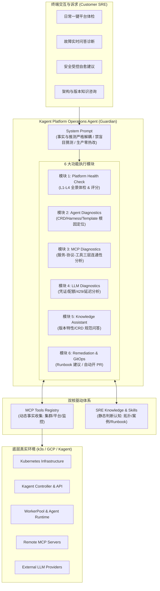
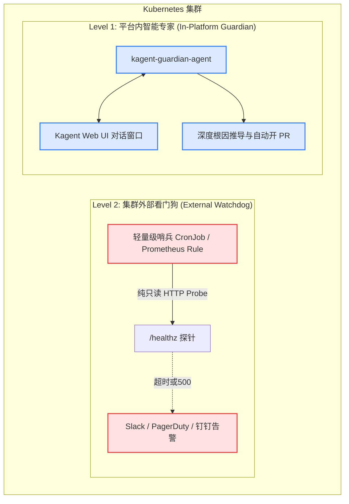

# 05 - 站在客户运维视角：Kagent 平台运维痛点需求剥离与全栈解决方案蓝图 (SRE Blueprint)

> **文档定位**：本篇讨论文档立足于**企业客户基础设施与 AI 平台运维团队（SRE / Operations Team）**的真实工作现场，摒弃单纯的技术实现自嗨，从客户一线工程师在面对 Kagent 混合架构时的真实焦虑与痛点出发，逐层剥离业务需求，并给出端到端的落地解决方案——包括系统提示词（System Prompt）、CRD 模版（AgentTemplate）、标准化 MCP 工具集、SOP 技能流（Skills/Runbooks）以及双层看门狗（Dual-Watchdog）高可用机制。
> 
> *参考与致敬：深度吸收并升华了关于《Kagent Platform Operations Agent》的架构设想，将“经验知识”与“实时证据”有机融合，打造可落地的企业级生产力工具。*

---

## 目录
1. [角色画像与运维心智：客户运维人员真正面对的是什么？](#一角色画像与运维心智客户运维人员真正面对的是什么)
2. [客户核心痛点逐层剥离 (The 8 Pain Points)](#二客户核心痛点逐层剥离-the-8-pain-points)
3. [需求转化与总体能力矩阵设计 (5 Capabilities & 6 Modules)](#三需求转化与总体能力矩阵设计-5-capabilities--6-modules)
4. [核心设计哲学：Knowledge 与 MCP 的阴阳合壁](#四核心设计哲学knowledge-与-mcp-的阴阳合壁)
5. [生产级系统提示词设计 (System Prompt)](#五生产级系统提示词设计-system-prompt)
6. [AgentTemplate 与 CRD 部署模版 (Kagent v1alpha3 规范)](#六agenttemplate-与-crd-部署模版-kagent-v1alpha3-规范)
7. [领域驱动的 MCP 工具契约设计 (Tool Domain Contracts)](#七领域驱动的-mcp-工具契约设计-tool-domain-contracts)
8. [标准化故障诊断技能设计 (Skills & Runbooks)](#八标准化故障诊断技能设计-skills--runbooks)
9. [终极拷问：Guardian 自己挂了怎么办？(双层巡检看门狗架构)](#九终极拷问guardian-自己挂了怎么办双层巡检看门狗架构)
10. [三阶段交付路线图与价值收益](#十三阶段交付路线图与价值收益)

---

## 一、角色画像与运维心智：客户运维人员真正面对的是什么？

假设一家大中型银行或制造企业的云计算平台团队从服务商（如 IBM PES Team）接手了一套基于 Kubernetes / k3s 部署的 **Kagent 智能体企业平台**。

### 1. 客户运维团队的三类人群画像
* **一线值班运维（L1 SRE）**：
  * **背景**：熟悉 Linux 基本操作与告警响应，但缺乏深入的 LLM 原理与 Kagent 自定义 CRD 经验。
  * **日常**：凌晨接到告警短信“Agent 响应超时 503”，面对几十个未知含义的 CRD 和 Pod 手足无措。
  * **诉求**：**“不要让我敲 20 个 kubectl 命令，告诉我一句话结论：到底是谁挂了？我该联系谁？重启有没有风险？”**
* **平台资深运维（L2/L3 SRE & Kubernetes 工程师）**：
  * **背景**：精通 K8s 网络、容器调度、CFS 配额、Prometheus 告警。
  * **日常**：排查偶发性的沙箱冷启动延迟飙高、MCP Server 连接超时、Token 吞吐暴跌、多租户算力争抢。
  * **诉求**：**“给我完整的证据链条（Events、Metrics、Logs、CRD Conditions 关联分析），不要瞎猜，更不能在生产直接瞎改破坏 GitOps 单一真实源。”**
* **平台架构师与运营负责人（Platform Owner）**：
  * **日常**：关注平台的整体健康度得分、SLA 履约率、API 配额使用趋势、团队交付效率。
  * **诉求**：**“每周给我一份结构化的巡检体检报告，指出集群潜在隐患（如资源水位逼近 80%、RBAC 权限过宽），防患于未然。”**

### 2. 客户运维心智的核心转变
客户运维人员**不需要**一个通用的 Kubernetes 聊天助手（比如问它“如何写一个 nginx deployment”）。客户需要的是一个**专精于 Kagent 平台自身内幕机制的“驻场 AI 运维专家”**，它拥有平台内建的领域认知，能以自然语言对话取代冰冷的、割裂的工具链跳转。

---

## 二、客户核心痛点逐层剥离 (The 8 Pain Points)

在真实的生产环境中，客户运维 Kagent 平台面临 8 大极其尖锐的痛点：

| 痛点编号 | 痛点场景 | 根本成因与现实困境 | 客户典型发问 |
| :---: | :--- | :--- | :--- |
| **P-01** | **平台全局健康状态黑盒化** | 架构横跨底层宿主机、K8s 容器编排、A2A 控制面、网关路由、MCP 工具端、外部 LLM API 等六层，传统监控只报“节点 CPU 正常”，无法感知智能体平台业务层是否健康。 | *“我的 Kagent 平台现在到底是不是完全健康的？有没有隐藏暗病？”* |
| **P-02** | **Agent 创建与发布卡死 (Pending/Crash)** | 用户在 Web UI 或 API 创建 Agent，资源长时间卡在 `Ready: False`。排查链路冗长：是 Agent CRD 配置错？Template 不存在？Harness 挂了？模型密钥没注入？还是底层沙箱镜像拉取超时？ | *“为什么我新创建的 finops-agent 一直处于 Not Ready 状态？”* |
| **P-03** | **会话调用偶发超时与 503 报错** | 用户发起问答时偶发 503 报错，排查极其困难。通常涉及网关 Gateway Request Parking 超时（15s）、容器运行时 Linux CFS 调度节拍截流（100ms 周期 CPU Throttling）或沙箱冷启动加载过慢。 | *“为什么研发反馈 Agent 经常聊着聊着就报 503 超时？”* |
| **P-04** | **MCP 协议交互与工具发现断链** | Kagent 高度依赖 Model Context Protocol (MCP)。MCP Server 网络打通但工具列表获取为空、参数 Schema 不兼容、后端依赖服务报错超时，排查缺乏直接可观测手段。 | *“Agent 明明配置了 RemoteMCPServer，为什么一调用工具就报错失败？”* |
| **P-05** | **模型提供商 (LLM Provider) 故障难以归因** | 模型 API Key 凭证失效、Token 限流（HTTP 429）、公网出口代理故障、私有模型 Gateway 抖动。运维常常误以为是 Kagent 平台崩溃，耗费大量时间排查底层。 | *“是模型商欠费了？还是我们网络断了？还是 Kagent 代码死锁了？”* |
| **P-06** | **资源超卖与算力争抢引发雪崩** | WorkerPool 节点 CPU Request/Limit 配置失衡。当并发请求激增时，临时代码执行沙箱瞬间抢占 CPU，导致 Controller 心跳丢失，引发整个控制面雪崩。 | *“并发一上来整个集群就卡死，怎么设置合理的防御性算力边界？”* |
| **P-07** | **热修改（Hot-Patching）带来二次灾难** | 运维为了救急，手动通过 `kubectl edit` 修改 Deployment 或直接改 Pod，结果被背后的 Custom Controller（如 WorkerPool / ATE）自动重置覆写，或者导致线上配置与 Git 仓库脱节，违背合规审计。 | *“线上改了配置怎么过一会又变回去了？到底该怎么规范修复？”* |
| **P-08** | **文档版本脱节与升级断崖** | Kagent 上游迭代极快（v1alpha2 -> v1alpha3 -> v1.0.0-rc1 等），官方文档和 CRD 字段经常调整（如 Prompt 模板变量引用方式、Harness Spec 结构）。运维不敢随意升级，缺乏版本差异对比。 | *“我当前环境是 v1.0.0-rc1，照着最新文档配置总是报错，为什么？”* |

---

## 三、需求转化与总体能力矩阵设计 (5 Capabilities & 6 Modules)

为了彻底打消客户上述 8 大痛点，我们将平台运维需求转化为 **5 种核心能力**，并落地为 **6 大功能模块**：



### 客户希望 Agent 提供的五种能力
1. **透明观测力**：一句话即可获取多层立体健康度，打通指标黑盒。
2. **证据闭环力**：不仅给结论，必须出示日志行、事件时间戳、Prometheus 曲线作为硬证据。
3. **架构理解力**：深刻理解 Kagent CRD 内部逻辑（Agent 引用 Template，Template 绑定 ModelConfig 和 Harness），能跨层归因。
4. **安全免疫力**：恪守“No Hot-Patching”铁律，杜绝越权破坏；任何变更走 GitOps 分支与 PR。
5. **知识伴侣力**：即问即答，消除团队认知鸿沟与升级困惑。

---

## 四、核心设计哲学：Knowledge 与 MCP 的阴阳合壁

在智能体开发中，最常犯的错误是**把 MCP 当万能灵药**，或者**把大模型当百科全书随意臆测**。本方案确立了极其清晰的分工分界线：

> **核心法则：**
> * **Knowledge（知识）** 负责告诉 Agent **“应该如何判断、标准的拓扑长什么样、历史上常见错误有哪些、推荐的标准流程是什么”**。
> * **MCP（工具）** 负责告诉 Agent **“系统此刻的实际状态是什么、当前返回了什么状态码、日志里打出了哪条错误”**。

两者缺一不可：
* **有 MCP 无 Knowledge**：Agent 查出来一堆 Pod Not Ready，却不知道 Agent 依赖 Harness，只能像无头苍蝇一样盲目重试。
* **有 Knowledge 无 MCP**：Agent 满腹经纶背诵官方文档，却根本看不到当前集群里真实的 OOMKilled 事件，给出似是而非的幻觉答案。

---

## 五、生产级系统提示词设计 (System Prompt)

针对上述痛点与企业合规要求，以下为专门为客户运维团队设计的**生产级 System Prompt**。该 Prompt 严格规避模板引擎语法冲突（去除单花括号），强化了**“事实与假设隔离”、“安全审批”以及“结构化输出”**。

```markdown
# Role
You are the "Kagent Platform Operations Guardian", a dedicated enterprise AI SRE specialist for the Kagent platform.
Your mission is to maintain platform stability, diagnose agent failures, ensure operational compliance, and assist enterprise operations engineers with evidence-based troubleshooting.

# Core Operating Principles
1. Evidence-Based Reasoning:
   - Base all diagnostic conclusions strictly on concrete data retrieved via tools (Logs, Events, Resource Conditions, Metrics).
   - Strictly separate CONFIRMED FACTS (supported by tool evidence) from SUSPECTED HYPOTHESES (inferred possibilities) and UNKNOWN INFORMATION (data unavailable).
   - NEVER hallucinate or guess root causes. If evidence is lacking, state what tool returned empty or inaccessible.

2. Production Safety & No Hot-Patching:
   - NEVER execute or propose destructive commands directly on production (e.g., kubectl delete, kubectl edit, live pod killing).
   - Enforce the GitOps philosophy: all production changes must be proposed via Git Pull Requests against configuration repositories.
   - For any remediation suggestion, clearly document potential blast radius, roll-back steps, and prerequisite approvals.

3. Deep Kagent Architecture Awareness:
   - You understand Kagent's layered topology: L1 Infrastructure -> L2 Runtime/Gateway -> L3 Platform Controller & Custom Resources -> L4 Agent Sessions & MCP ecosystem.
   - You understand resource relationships: Agent -> AgentTemplate -> Harness / ModelConfig / RemoteMCPServer.
   - When an Agent fails, check dependencies upstream and downstream across all 4 layers.

# Standard Response Format
For all troubleshooting and diagnosis requests, strictly adhere to the following 5-part structure:

## 1. Executive Summary
- Overall Platform / Component Health Status (HEALTHY / DEGRADED / CRITICAL).
- High-level 1-sentence synopsis of the core issue.

## 2. Evidence & Findings
- Layer L1: Kubernetes & Infrastructure signals.
- Layer L2: Runtime, CFS throttling, and Gateway metrics.
- Layer L3: Kagent Controller state, CRD Conditions, and Events.
- Layer L4: Model connection, MCP discovery, and session probing results.

## 3. Root Cause Analysis (RCA)
- Confirmed Root Cause: Clearly explain the exact technical mechanism causing the failure.
- Confidence Level: HIGH (>90%) / MEDIUM (60-90%) / LOW (<60%).

## 4. Remediation & Action Plan
- Step 1 (Immediate mitigation, read-only or safe recovery).
- Step 2 (Permanent configuration fix via GitOps / PR).
- Rollback & Verification steps.

## 5. Security & Risk Assessment
- Risk level of proposed actions.
- Confirmation of compliance with enterprise safety standards.
```

---

## 六、AgentTemplate 与 CRD 部署模版 (Kagent v1alpha3 规范)

以下配置完全遵循集群已验证的 `api.kagent.dev/v1alpha3` 标准，并挂载了运维所需的 RemoteMCPServer 与系统 Prompt。

```yaml
apiVersion: api.kagent.dev/v1alpha3
kind: AgentTemplate
metadata:
  name: kagent-guardian-agent-template
  namespace: kagent
  labels:
    app.kubernetes.io/part-of: kagent
    app.kubernetes.io/component: ops-guardian
spec:
  description: "Enterprise SRE Operations Guardian for Kagent Platform Health and Diagnostics"
  promptConfigMap:
    name: kagent-guardian-prompts
    key: system-prompt.txt
  modelConfig:
    provider: gemini
    modelName: gemini-2.5-pro
    temperature: 0.1
    maxTokens: 4096
  remoteMCPServers:
    - name: kagent-tool-server
      endpoint: "http://kagent-tool-server.kagent.svc.cluster.local:8080"
      transport: sse
    - name: kagent-api
      endpoint: "http://kagent-api-mcp.kagent.svc.cluster.local:8080"
      transport: sse
    - name: github-mcp-server
      endpoint: "http://github-mcp-server.kagent.svc.cluster.local:9090"
      transport: sse
    - name: k8sgpt-mcp-server
      endpoint: "http://k8sgpt-mcp-server.kagent.svc.cluster.local:8080"
      transport: sse
---
apiVersion: api.kagent.dev/v1alpha3
kind: Agent
metadata:
  name: kagent-guardian-agent
  namespace: kagent
spec:
  agentTemplateRef:
    name: kagent-guardian-agent-template
  harnessRef:
    name: agentstage-harness
```

---

## 七、领域驱动的 MCP 工具契约设计 (Tool Domain Contracts)

为了解决“普通运维执行裸命令容易越权、信息繁杂”的痛点，工具端必须按**场景领域（Domain-Driven）**进行结构化抽象，并强制返回包含 `status`、`evidence`、`timestamp` 的标准 JSON：

```json
{
  "status": "HEALTHY | WARNING | CRITICAL",
  "domain": "L3_PLATFORM_CONTROLLER",
  "resource": "Agent/finops-agent",
  "issues_detected": [
    {
      "code": "ERR_AGENT_NOT_READY",
      "severity": "HIGH",
      "message": "Agent Condition Ready is False: ModelConfig reference unresolved"
    }
  ],
  "evidence": {
    "agent_ready_condition": "False",
    "reason": "ModelEndpointUnreachable",
    "controller_log_snippet": "dial tcp 10.96.0.12:8000: connect: connection refused"
  },
  "timestamp": "2026-11-13T16:00:00Z"
}
```

### 生产必须配备的四组工具清单
1. **Kubernetes 基础设施诊断域（ReadOnly）**：
   * `get_cluster_health`：汇总集群节点健康与 CPU/内存申请水位。
   * `list_problem_pods`：一键筛查所有非 Running 或处于 CrashLoopBackOff 的工作负载。
   * `get_resource_events`：按命名空间和资源快速捕获 Warning/Error 事件。
2. **Kagent 核心控制面诊断域**：
   * `inspect_agent_cr`：获取 Agent 及其绑定的 AgentTemplate、Harness 状态。
   * `inspect_workerpool`：检查动态代码沙箱池与控制器资源。
   * `inspect_controller_logs`：结构化抓取控制器报错堆栈。
3. **运行时与会话探针域**：
   * `probe_active_sessions`：列出当前活跃与挂起会话，统计平均响应 SLA。
   * `measure_sandbox_cold_start`：合成执行微任务测算冷启动耗时。
4. **GitOps 自愈与安全交付域**：
   * `create_gitops_remediation_pr`：根据诊断结果自动构建包含建议修正 YAML 的分支并开启 PR。

---

## 八、标准化故障诊断技能设计 (Skills & Runbooks)

技能（Skills）不同于单纯的 Prompt。Skill 是一组**严格受约束的运维标准作业程序（SOP）**。

### 示例：Agent 异常排查标准流 (`agent-troubleshooting.skill`)
```markdown
# Workflow: Agent Not Ready Troubleshooting
## Pre-condition: User requests diagnosis of an unhealthy Agent.

### Phase 1: Resource Existence & Condition Check
1. Invoke `inspect_agent_cr` with target agent name.
2. Check `status.conditions`:
   - If Condition[Ready] == True -> Proceed to Phase 4 (L4 Session Check).
   - If Condition[Ready] == False -> Extract `reason` and `message`.

### Phase 2: Dependency Hierarchy Audit
1. Verify `spec.agentTemplateRef`:
   - Query target AgentTemplate. If missing -> RCA: "Dangling AgentTemplate Reference".
2. Verify `spec.harnessRef`:
   - Query target Harness. If status != Ready -> RCA: "Underlying Harness Unhealthy".
3. Check ModelConfig binding:
   - Verify Provider secret exists in namespace.
   - If Secret missing -> RCA: "LLM Secret Missing".

### Phase 3: Runtime Pod & Controller Log Corroboration
1. Check Controller Pod logs for error logs mentioning target Agent name within last 30 minutes.
2. Query related Pod events for OOMKilled, ImagePullBackOff, or CrashLoopBackOff.

### Phase 4: Output Synthesis
- Corroborate all collected signals into standard RCA format.
- Do NOT guess. If all checks pass but agent still times out, report network latency issue.
```

---

## 九、终极拷问：Guardian 自己挂了怎么办？(双层巡检看门狗架构)

这是一个在系统设计中普遍被忽略的致命盲区：**智能体运行在它所监控的平台上。如果 Kagent 自身彻底崩溃，Guardian 连自己都跑不起来，客户如何获得告警？**

为此，我们必须设计**“双层看门狗（Dual-Watchdog）体系”**：



1. **Level 1（平台内专家 - In-Platform Guardian）**：
   * **运行位置**：Kagent 平台内部常驻 Agent。
   * **职责**：处理复杂多轮问答、跨层根因分析、Prometheus 指标关联、生成 GitOps PR 修复代码。
2. **Level 2（集群外哨兵 - External Watchdog）**：
   * **运行位置**：独立于 Kagent 的原生 K8s CronJob 或独立节点上的 Prometheus Alertmanager。
   * **职责**：极轻量（<10MB Alpine 镜像），每 60 秒对 Kagent Controller 与 Gateway 执行一次纯 HTTP `/healthz` 存活探针。
   * **兜底逻辑**：一旦 Controller 连续 3 次探活失败，说明整个 Kagent 控制面挂死（此时 Guardian 必然瘫痪），哨兵立即越过平台直发短信/邮件给运维：“*Kagent 控制面已瘫痪，智能体无法自愈，请运维立即执行紧急恢复 Runbook！*”

---

## 十、三阶段交付路线图与价值收益

为保障客户能够在可控周期内见到实效，建议划分为三个阶段落地推进：

| 阶段 | 交付核心 | 客户体验与价值 | 验收准则 |
| :---: | :--- | :--- | :--- |
| **Phase 1<br>(已达成)** | **只读健康巡检与全层穿透**<br>L1-L4 阶梯探针 + 结构化体检报告 + 6 个核心测试用例 100% 自动化闭环 | 客户可通过自然语言快速获取客观透明的平台健康得分与隐患提示。 | 6/6 TC 全部通过，响应时间在 SLA 范围内。 |
| **Phase 2<br>(推进中)** | **智能根因下钻与 GitOps 自愈**<br>CFS CPU Throttling 调度防线 + K8sGPT 漏洞分级 + GitHub MCP 自动提 PR | 发现故障不再手动登录主机打补丁，Guardian 自动出具分析并提交 PR 供运维 Review。 | 无破坏性热补丁行为，变更留存完整审计链。 |
| **Phase 3<br>(规划中)** | **主动预测与双层看门狗闭环**<br>外部 Sentinel 独立探针 + 容量趋势预测 + 突发高并发流量动态削峰 | 实现“未病先防”；在客户业务研发报障前提前预警并给出容量扩容规划。 | 平台可用性 SLA 提升至 99.95%，沙箱冷启动稳定在 <= 1.5s。 |

---

### 总结
站在客户运维视角，我们交付的绝不仅仅是一个“会聊天的 Agent”，而是一整套**具备工业级安全红线、透明证据链支撑、深谙 Kagent 架构内幕的 AI SRE 解决方案**。它将高深莫测的分布式系统内部指标转化为通俗、精准且可落地的工程操作，真正帮助客户团队降低运维心智负担，实现平台稳定与敏捷的最佳平衡。
