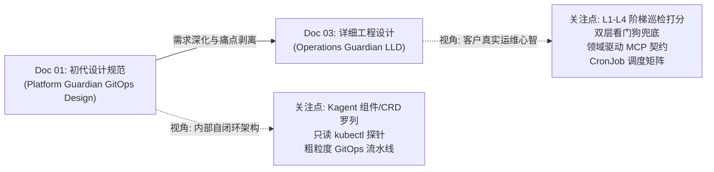

# 06 - 架构对比与演进辨析：Doc 01 与 Doc 03 的逐项审查、现存设计缺陷与优化改进建议

> **文档定位**：本篇讨论文档针对仓库中现有的两份核心设计文档——《01-PLATFORM_GUARDIAN_GITOPS_DESIGN.md》（早期初步设计规范，简称 **Doc 01**）与《03-OPERATIONS_GUARDIAN_LOW_LEVEL_DESIGN.md》（最新落地详细设计规范，简称 **Doc 03**）进行**逐条比对、深度审查与辩证推演**。
>
> 平台架构设计并非一蹴而就。通过系统性对比两版方案的思路变迁，深挖目前设计中依然存在的**不合理之处、潜在并发竞争、生产运维隐患与教条化设计**，并提出切实可行的演进改良方案，为后续 Guardian 系统的稳定落地提供战略参考。

---

## 一、对比背景与两版设计演进脉络

在 Guardian 的建设历程中，文档 01 与文档 03 代表了两个截然不同的设计成熟度阶段：



* **Doc 01 的时代特征**：诞生于项目初期，聚焦于“如何在 Kagent 内部挂载 AgentTemplate 并打通 ArgoCD 闭环”，更多体现的是**平台开发者的自内向外（Inside-Out）的技术设想**。
* **Doc 03 的时代特征**：深度吸收了现场运维痛点与真实业务反馈，站在**客户 SRE 的自外向内（Outside-In）视角**，补齐了领域模型 Schema、加权健康评分算法、动态 GitHub App 凭证和双层看门狗架构。

然而，对比并不意味着“Doc 03 完全替代 Doc 01 且完美无缺”。在深入推演实际生产运行后，我们发现**即使在 Doc 03 中，依然隐藏着若干未被充分论证的技术矛盾与设计不合理之处**。

---

## 二、逐项深度对比与现存设计不合理之处剖析 (Item-by-Item Gap Analysis)

下表对两份文档在 6 个核心技术维度的设计进行对比，并指出当前设计的缺陷与理由：

| 比较维度 | Doc 01 设计主张 | Doc 03 演化设计 | 目前设计的不合理之处与潜在风险 (Why & Gap) |
| :--- | :--- | :--- | :--- |
| **1. 监控存活性** | 假设 Agent 始终在平台内稳定常驻；无平台挂死应对机制。 | 引入 Level 2 外部哨兵 CronJob，每 60s 探活 Controller/Gateway `/healthz`。 | **【哨兵与告警风暴脱节】** 外部哨兵虽然解决了“自己挂了谁报警”，但直接调用 Webhook 发送报警，**缺乏告警收敛（Deduplication）与静默（Inhibition）机制**。若控制面波动 5 分钟，运维手机将被打爆。 |
| **2. 工具抽象粒度** | 粗粒度暴露原生工具：`kubectl get/describe/logs` 和 `kagent-api` 原生端点。 | 抽象为宏观领域工具：`inspect_platform_health`、`diagnose_agent_failure` 等。 | **【过度黑盒化限制灵活性】** 将所有排查逻辑收敛到大一统工具内部，导致 Agent 在遭遇未知非典型故障（如节点 CNI 丢包、DNS 熔断）时**丧失底层排障机动性**，无法按需临时只读下钻。 |
| **3. GitOps 自愈** | 给出 5 步基本流程，假设人工 Review 后 ArgoCD 自动完成调谐。 | 增加 GitHub App 动态签发、调优参数算法与五段式 PR 格式规范。 | **【缺乏并发锁与 PR 治理】** 定时巡检每 15m 运行一次，若前一个 PR 尚未被审核合入，后续巡检将**重复创建相同或冲突的 PR（PR 风暴）**；且缺乏自动回滚机制。 |
| **4. 提示词与交互** | 简单定义角色与原则，依赖 UI Prompts 动态注入。 | 强制事实三态分类（Facts/Hypotheses/Unknown）与 5 段式长篇 RCA 报告。 | **【死板教条导致会话疲劳】** 无论用户是问简单的“网关健康吗”还是严肃报障，Agent 一律输出数百行 5 段式报告，严重违背交互效率，未实现**情景自适应（Adaptive Response）**。 |
| **5. 性能归因判断** | 提出 CFS 截流指标与网关 15s Request Parking 等待。 | 固化公式：CFS Throttling Ratio > 20% 即断定容器配额过低并建议扩容。 | **【静态阈值导致误判扩容】** 突发沙箱冷启动或短时计算峰值经常导致瞬时 CFS 截流 > 20%，硬编码阈值会引发**虚假警报和过度资源分配**，增加不必要的算力成本。 |
| **6. 合成探针开销** | 每当需要时向测试 Agent 发送轻量 Ping 会话。 | 在调度矩阵中明确：每 30 分钟由 Guardian 触发一次真实端到端会话。 | **【资源泄漏与数据表膨胀】** 每 30 分钟创建一个真实会话并在 Substrate 启动容器，一天产生 48 个 Session。若未实现强制瞬态生命周期回收，将导致 **PostgreSQL 数据库表暴涨与 IP 枯竭**。 |

---

## 三、现存不合理设计深度剖析与原理解读 (Why are they Unreasonable?)

### 3.1 剖析一：外部哨兵（Sentinel）与告警收敛脱节的风险
* **现状设计**：Doc 03 设计了外部轻量 CronJob，每 60 秒对控制面探活，一旦超时即通过 curl 直接向企业外部 Webhook（PagerDuty/钉钉）发送告警。
* **为什么不合理？**：
  1. **告警风暴（Alert Storm）**：CronJob 缺乏状态记忆。当 Kagent Controller 经历常规的 Rolling Update 或 3 分钟的 GC 停顿期间，CronJob 每分钟都会触发一次报警。短短 10 分钟内值班手机将收到 10 条重复短信，造成严重的“告警疲劳”，最终导致运维忽视真实灾难。
  2. **缺少静默（Silencing）与抑制（Inhibition）机制**：在企业生产环境中，告警必须接入 Prometheus Alertmanager 或 PagerDuty 统一事件总线，支持基于标签的收敛和维护期静默，而不是裸奔调用 curl。

### 3.2 剖析二：MCP 工具过度抽象与底层排障死角的矛盾
* **现状设计**：
  - Doc 01 极端原始：直接让 Agent 跑 `kubectl logs`, `kubectl get`, `kubectl describe`。缺点是命令空间过大，输出非结构化文本，Token 消耗不可控。
  - Doc 03 极端收敛：将所有巡检封装为 `inspect_platform_health` 和 `diagnose_agent_failure` 两个宏观黑盒工具。
* **为什么不合理？**：
  1. **无法应对长尾非典型故障**：云原生分布式环境中，经常出现超出预设规则的故障（如：CoreDNS 跨节点解析超时、Calico/Flannel CNI iptables 规则丢失、Worker 节点磁盘 inode 耗尽）。当且仅当工具返回固定字段时，Agent 在面对预设规则之外的症状时会瞬间“失明”，失去现场抓取关键未知证据的能力。
  2. **实现载体模糊**：Doc 03 中定义的 `inspect_platform_health` 到底是运行在哪个 Pod 中的代码？如果是远端 MCP Server 实现，那么编写并维护这个复杂的大单体 MCP 服务将带来巨大的技术债务。

### 3.3 剖析三：自愈 PR 风暴、并发锁与 ArgoCD 调谐竞争
* **现状设计**：Doc 03 规定巡检每 15 分钟运行一次。当发现算力瓶颈时，通过 `create_gitops_remediation_pr` 发起修改 PR。
* **为什么不合理？**：
  1. **PR 泛滥与代码冲突**：假设在 10:00 巡检发现配额不足提了一个 PR；此时负责审批的 SRE 正在开会尚未 Merge。在 10:15 的下一次巡检中，系统再次扫描到亚健康指标，若无状态感知，它会基于 main 分支再次拉出一个新的分支并提交重复的 PR。这会导致仓库出现大量碎片分支与冲突 PR。
  2. **调谐延迟与“过早回访”竞争**：Doc 03 提出“PR 合并后延时 180s 触发复测”。但在真实生产中，ArgoCD 默认轮询周期为 180s，加上 RollingUpdate 容器拉取时间，系统状态调谐完成往往需要 240~300s。固定延时 180s 极易导致探针恰好在旧 Pod 正在下线、新 Pod 尚未 Ready 的中间态执行测试，引发“假阴性”报错。

### 3.4 剖析四：提示词死板教条与对话交互疲劳
* **现状设计**：Doc 03 严格约束 System Prompt 必须输出完整的五段式报告（Executive Summary, Evidence, RCA, Action Plan, Risk）。
* **为什么不合理？**：
  1. **日常交互心智负担重**：在 Web UI 场景中，许多时候运维人员只是想做一次简单的连通性问询（例如：“刚才有告警吗？”、“数据库连接正常吗？”）。此时如果 Guardian 机械死板地吐出一篇包含 5 大段、几百行、带有大量 Markdown 表格与推导链的报告，不仅白白耗费几十秒的 LLM 推理时间与 Token，更让运维必须在一大堆冗余文字中寻找答案，破坏了对话式运维的直观敏捷体验。
  2. **缺乏自适应应答机制**：没有根据用户 Intent（查询 vs 排障）做模式分流（Fast Mode vs Deep RCA Mode）。

### 3.5 剖析五：CFS 截流阈值僵化与误报扩容
* **现状设计**：Doc 03 将 `CFS Throttling Ratio > 20%` 设为固定阈值，一旦突破立即判定容器配额不足。
* **为什么不合理？**：
  1. **内核调度的客观特性**：Linux CFS 以 100ms 为一个周期（quota period）。Python 或 Java 应用在启动加载依赖、模型分词或编译正则时，会瞬间打满 CPU 周期触发限流，但持续时间可能只有 2-3 秒，对后续稳定运行并无持久影响。
  2. **误判扩容的财务成本**：若仅因为瞬时尖刺就建议将 CPU Limit 翻倍（如从 1000m 扩容至 2500m），不仅不能解决突发抖动，反而会导致节点 Pod 密度暴跌，大幅增加云厂商的计算账单。

### 3.6 剖析六：合成探针资源开销与持久层数据膨胀
* **现状设计**：Doc 03 规划每 30 分钟由内部调度器触发一次 L4 合成端到端会话（Ping-Pong 对话）。
* **为什么不合理？**：
  1. **无感资源泄漏**：Kagent 的底层架构为每一个 Session 维护完整的执行沙箱与数据库上下文。一个月内（30 天 × 48 次/天 = 1440 次合成会话），若缺乏严格的沙箱即刻销毁与数据表周期性软删除清理策略，`kagent.session` 表和关联上下文将迅速膨胀至数万行，造成 PostgreSQL 查询性能断崖式下跌。
  2. **冷启动污染**：探针如果频繁拉起并常驻沙箱，会抢占真实的业务 WorkerPool 槽位，影响真实终端用户的冷启动延迟。

---

## 四、关键改进方案与演进架构落地建议 (Evolutionary Enhancements)

针对上述 6 项设计缺陷，我们提出具体的演进优化方案：

### 建议 1：引入 GitOps PR 幂等去重与自愈租约锁 (Lease Lock)
* **实现机制**：
  1. 在调用 GitHub API 前，Guardian 必须先检查仓库中是否存在带有 `label: guardian-auto-remediation` 且处于 `state: open` 的 Pull Request。
  2. 若已有未闭环的 PR，系统**严禁创建新 PR**，而是仅在现有 PR 下以 Comment 形式追加最新巡检时序指标（如：“*10:15 巡检指标持续恶化，CFS 截流仍未恢复，请加速审批*”）。
  3. 引入基于 Kubernetes Lease（`coordination.k8s.io/v1`）的分布式锁，防止并发巡检导致的状态错乱。

### 建议 2：工具链实行“宏观组合工具 + 微观只读探针”双轨制 (Dual-Track Tooling)
* **架构重构**：
  - **上层（宏观）**：保留 `inspect_platform_health` 等高聚合工具，用于常规 15 分钟日常体检与标准化评分；
  - **下层（微观）**：保留并规范 `kagent-tool-server` 中的底层只读探针（只读执行经过白名单约束的 `get / describe / logs --tail 100`），作为兜底调试能力。
  - **赋能原则**：当宏观工具返回 `DEGRADED` 且预设根因无法解释时，允许 Agent 激活下层微观探针深入现场采集边缘证据。

### 建议 3：自适应情景提示词分流 (Adaptive Response Strategy)
* **意图识别与模式分流**：
  ```
  [用户输入] ──> 意图分类器
                  ├─ [日常状态咨询] ──> Fast Mode: 3行精炼回复 (状态 / 核心得分 / 正常依据)
                  └─ [报障或巡检指令] ──> RCA Mode: 严格标准五段式完整深度技术报告
  ```
  这样既保证了日常快速响应的灵动性，又守住了故障处置时的严谨与安全。

### 建议 4：基于滑动窗口与网关延时关联的动态 CFS 判定 (Sliding-Window Throttling)
* **复合判定条件**：
  摒弃单一的 `CFS Throttling > 20%` 静态阈值，修改为**滑动窗口双因子复合判定**：
  $$	ext{Condition} = (	ext{Avg Throttling Ratio}_{[15	ext{m}]} > 15\%) \;\land\; (	ext{Gateway P99 Latency}_{[15	ext{m}]} > 8	ext{s})$$
  只有在“截流持续存在”**且**“已经实质性拖慢网关响应时间”的双重条件满足时，才判定为有效性能瓶颈，避免因瞬时突发尖刺导致误判扩容。

### 建议 5：合成探针沙箱瞬态化与数据生命周期管理 (Ephemeral Probes)
* **探针闭环规范**：
  1. 探针 Agent 发起 Ping-Pong 会话后，在 `finally` 块中立即调用 `kagent-api` 的 `destroy_session` 接口主动释放底层沙箱 Pod，不占用 WorkerPool 常驻配额。
  2. 针对数据库数据，通过配置 Postgres 定时清理任务（如 `pg_cron` 或每日运维批处理），自动清理 `probe-synthetic-*` 生成的过期 Session 记录，保持存储轻量。

### 建议 6：外部哨兵接入 Alertmanager 统一治理
* **告警收敛方案**：
  外部哨兵探针（Sentinel）不再裸调 curl，而是将指标暴露为 Prometheus Metrics（如 `kagent_controlplane_up{component="controller"}`），或向 Alertmanager 投递标准告警。利用 Alertmanager 原生的 `group_wait`、`repeat_interval` 和静默期配置，彻底杜绝告警风暴。

---

## 五、演进后的设计分层蓝图 (Target Evolutionary Architecture)

结合 Doc 01 的轻量灵活性与 Doc 03 的工程严谨性，演进后的完整架构全景如下：

```mermaid
graph TB
    subgraph Watchdog_Plane["双层看门狗防线 (Watchdog & Resiliency)"]
        Sentinel["L2: 独立外部哨兵 (Alpine <10MB)<br>每 60s HTTP 探活 / healthz"]
        Alertmanager["企业 Alertmanager<br>(告警去重 / 静默 / 抑制)"]
        Sentinel -->|标准化告警| Alertmanager
        Alertmanager --> PagerDuty["PagerDuty / 钉钉 / 运维值班手机"]
    end

    subgraph Guardian_Core["Guardian 智能体核心 (In-Platform SRE)"]
        UI_Gateway["Web 控制台 (Prompts 解耦 / 意图识别)"]
        
        subgraph Prompt_Engine["自适应提示词引擎"]
            Fast["Fast Mode: 敏捷问答 (3行结论)"]
            Deep["RCA Mode: 5段式深度排障报告"]
        end
        UI_Gateway --> Fast
        UI_Gateway --> Deep

        subgraph Tool_Dual_Track["双轨制 MCP 工具箱"]
            MacroTools["宏观聚合工具<br>(全景巡检/加权打分/依赖遍历)"]
            MicroTools["微观只读探针<br>(K8s只读/日志下钻/网络排障)"]
        end
        Deep --> MacroTools
        MacroTools -.->|遇到边缘异常| MicroTools

        subgraph GitOps_Engine["声明式自愈与 PR 引擎"]
            LeaseLock["Kubernetes Lease 锁<br>(防止并发巡检踩踏)"]
            PR_Dedup["PR 状态机与幂等去重<br>(严禁重复发 PR)"]
            ArgoCD_Wait["ArgoCD 调谐就绪探测<br>(避免过早复测假失败)"]
        end
        Deep --> LeaseLock --> PR_Dedup --> ArgoCD_Wait
    end

    classDef sentry fill:#fee2e2,stroke:#ef4444,stroke-width:2px;
    classDef core fill:#dbeafe,stroke:#3b82f6,stroke-width:2px;
    classDef gitops fill:#dcfce7,stroke:#22c55e,stroke-width:2px;
    class Sentinel,Alertmanager,PagerDuty sentry;
    class UI_Gateway,Fast,Deep,MacroTools,MicroTools core;
    class LeaseLock,PR_Dedup,ArgoCD_Wait gitops;
```



---

## 六、总结与落地共识

通过对 Doc 01 与 Doc 03 的逐项对比与审视，我们清晰地看到：
- **Doc 01** 确立了 GitOps 闭环自愈与三层解耦的正确方向；
- **Doc 03** 赋予了系统生产级的加权评分、双层看门狗与严谨的 MCP Schema 契约；
- 本次**演进分析**进一步指出了“告警收敛脱节”、“PR 并发风暴”、“提示词死板疲劳”、“CFS 静态阈值误扩容”和“合成探针数据膨胀”五大隐蔽陷阱，并给出了具体补丁方案。

这标志着 Kagent Guardian 的架构设计由“功能完备”真正迈向了“工业级稳健与优雅”。
