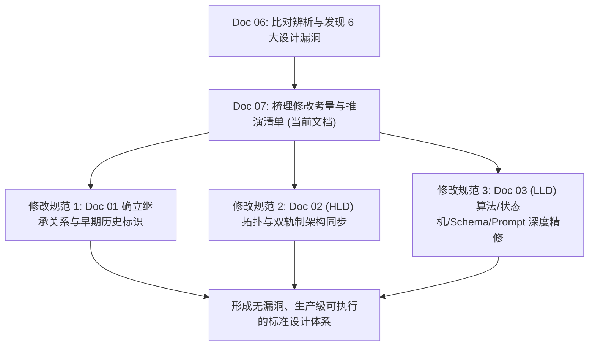

# 07 - 设计文档修编规划与推演过程记录：基于两代方案比对的逐项整改考量与落地路线图

> **文档定位**：本篇讨论文档是在完成《06 - 架构对比与演进辨析：Doc 01 与 Doc 03 的逐项审查、现存设计缺陷与优化改进建议》的基础上，进一步**推演“现存设计文档需要做什么修改、为什么修改、如何修改”**的系统性思考记录。
>
> 平台架构文档是工程实现与团队协作的唯一事实来源（Single Source of Truth）。设计中发现的漏洞与隐患，必须以严密的逻辑反哺并重构设计文档体系。本文逐条列举针对现有各设计文档的具体修改清单、架构权衡（Trade-offs）与修改理由。

---

## 一、修编背景与思考动因 (Motivation & Context)

在上一篇讨论（Doc 06）中，我们通过对比初代设计（Doc 01）与详细设计（Doc 03），挖掘出了当前方案在**生产级抗抖动、并发治理、交互体验、工具灵活性与存储开销**等方面的 6 大深层次漏洞。

单纯发现问题并不等于工程落地。如果不把这些思考系统性地回写进正式的设计文档体系，后续编码实现（如 MCP Server 编写、CronJob 部署、Prompt 配置）将依然依据存在缺陷的旧规范进行，造成巨大的代码返工成本。因此，必须对现有的设计文档进行明确的修订分工与内容更新。



---

## 二、需要修改的设计文档范围与定位协同 (Revision Scope)

针对仓库中现存的三份设计文档，明确以下修订职责划分：

| 目标文档 | 当前现状 | 存在的问题 / 修订必要性 | 修订定位与目标 |
| :--- | :--- | :--- | :--- |
| **Doc 01** (`01-PLATFORM_GUARDIAN_GITOPS_DESIGN.md`) | 初代探索性方案，内容与 Doc 03 存在命名和机制冲突（如裸奔 kubectl vs 宏观 MCP）。 | 开发者阅读时极易产生困惑，不知以哪份规范为准。 | **添加《架构演进与继承说明》**，明确其作为“探索期奠基提案”的定位，标注各章节在 Doc 02/03 中的正式演化映射，保留历史推演价值。 |
| **Doc 02** (`02-OPERATIONS_GUARDIAN_HIGH_LEVEL_DESIGN.md`) | 总体高阶设计，缺少双轨制工具拓扑和 GitOps 并发控制模型。 | 架构顶层视图未体现微观探针与 Lease 锁机制。 | **补充架构拓扑与全局并发视图**，引入双轨制 MCP 协同层与自愈租约状态机。 |
| **Doc 03** (`03-OPERATIONS_GUARDIAN_LOW_LEVEL_DESIGN.md`) | 最新详细设计，但包含了 Doc 06 指出的 6 大隐蔽缺陷。 | 作为编码落地的直接依据，若存在静态阈值、PR 风暴等漏洞，直接导致生产故障。 | **逐节精细重构**：修改哨兵告警协议、重构 MCP 工具契约、升级自愈状态机、引入双模提示词、优化 CFS 判定算法与沙箱生命周期。 |

---

## 三、逐条修改清单、设计考量与推演过程 (Itemized Revision Plan & Technical Rationales)

以下对各设计文档需要做出的具体修改逐条展开论述，阐明**改什么、为什么改（Rationale）、背后的架构权衡（Trade-offs）与实现准则**。

### 3.1 修改条目一：Doc 03 第 2.2 节——外部哨兵改接 Alertmanager 与告警收敛治理

* **拟修改内容**：
  1. 将外部轻量 CronJob（Sentinel）的告警下发通道，从原始的直接 `curl` 发送企业 Webhook，修改为**向企业集群 Prometheus Alertmanager 标准 v2 接口投递告警**（或通过 Prometheus Pushgateway / Exporter 暴露指标 `kagent_controlplane_up`）。
  2. 在设计文档中正式补齐 Alertmanager 告警路由配置示例（`group_by: ['alertname', 'namespace']`、`group_wait: 30s`、`repeat_interval: 12h`）。
* **为什么修改？（Rationale）**：
  - **规避告警风暴（Alert Storm）**：Controller 滚动更新或 GC 停顿通常持续 1~3 分钟。若每分钟的探针都独立发出报警，运维在深夜会收到多条重复短信，引发“狼来了”式的运维麻痹。
  - **复用企业现有运维资产**：生产级 SRE 体系早已具备成熟的 Alertmanager，支持维护期静默（Silence）、告警抑制（Inhibition）和排班通知，哨兵不应破坏企业统一的运维规范自搞一套。
* **架构权衡（Trade-off）**：
  - 是否会增加对 Alertmanager 的外部依赖？
  - *结论*：不会造成强耦合。在设计中采取**双通道兜底策略**：默认推向 Alertmanager；若 Alertmanager 接口连续 2 次连接失败，才降级触发直连 Webhook 发送高危通道告警。

---

### 3.2 修改条目二：Doc 03 第 3 节——MCP 工具箱升级为“宏观领域聚合 + 微观只读探针”双轨制

* **拟修改内容**：
  1. 重构 Section 3 工具定义，将原有的单一“宏观黑盒工具”扩展为**双轨制（Dual-Track）工具集**：
     - **宏观轨道（Macro Track）**：保持 `inspect_platform_health`、`diagnose_agent_failure` 等高层聚合工具，负责日常自动化巡检、加权算分与标准化依赖扫描。
     - **微观轨道（Micro Track）**：新增严格受限的白名单只读探针：
       - `k8s_read_pod_logs(namespace, pod, container, tail_lines, previous)`
       - `k8s_describe_resource(namespace, kind, name)`
       - `k8s_list_abnormal_events(namespace, since_minutes)`
  2. 明确**降级与激活条件**：当宏观工具返回 `DEGRADED` 且置信度较低（`confidence < 0.7` 或 `classification == UNKNOWN`）时，Agent 获得授权调用微观只读探针下钻抓取底层证据。
* **为什么修改？（Rationale）**：
  - **破解“工具黑盒化排障失明”陷阱**：生产环境中的长尾偶发故障（如：CoreDNS 跨机房偶发丢包、节点本地磁盘满、内核 ARP 表溢出）无法全被预置在宏观工具的静态规则中。若不保留只读下钻探针，智能体将丧失自适应发现未知线索的能力。
  - **规避 Doc 01 命令空间过大漏洞**：Doc 01 随意执行 bash 过于危险且 Token 消耗不可控，微观探针通过严格的参数白名单与 `tail_lines <= 200` 约束，既保住了机动性，又守住了安全性与 Token 上限。
* **架构权衡（Trade-off）**：
  - 会不会让 Agent 变慢？
  - *结论*：宏观工具先行，95% 的已知常见故障直接在宏观轨完成归因，只有 5% 的边缘异常才触发微观探针，兼顾了效率与深度。

---

### 3.3 修改条目三：Doc 03 第 4 节与第 3.3 节——自愈闭环增加 Lease 分布式锁与 PR 幂等去重状态机

* **拟修改内容**：
  1. 在 `create_gitops_remediation_pr` 工具执行逻辑中强制增加**幂等前置校验**：
     - 调用 GitHub Search API 查询是否已有处于 `open` 状态且带有 `label: guardian-auto-remediation` 的 PR。
     - 若已存在未合并 PR，**禁止创建新 PR 和新分支**；改为在原 PR 下通过 `add_issue_comment` 追加最新的恶化时序指标。
  2. 引入 Kubernetes 原生分布式锁对象 `coordination.k8s.io/v1 Lease`（名称：`kagent-guardian-remediation-lock`），租约时长设置为 15 分钟。任何自愈行动必须先原子抢占租约锁。
* **为什么修改？（Rationale）**：
  - **根除 PR 泛滥与分支冲突**：巡检每 15 分钟执行一次，但人类工程师白天审批 PR 可能需要 1~2 小时，深夜可能需要更久。缺乏去重将导致 Guardian 每隔 15 分钟就开一个新的分支提一个新 PR，产生几十个冲突分支，彻底搞乱 GitOps 仓库。
  - **防止多实例并发冲突**：若未来 Guardian 部署了多副本进行高可用热备，Lease 锁可确保同一时刻只有一个实例在操作 Git 分支与发起修改。
* **架构权衡（Trade-off）**：
  - 如果持有锁的 Pod 异常崩溃，锁会不会永远死锁？
  - *结论*：Kubernetes Lease 自带 TTL 超时释放机制（RenewInterval: 30s, LeaseDuration: 300s），Pod 挂死后租约会自动过期释放，具备天然的容灾安全性。

---

## 四、修改对各设计文档的具体修订动作对照表 (Action Items Mapping)

下表汇总了上述考量在现有设计文档中的具体落笔修改规划：

| 修改条目 | 涉及文档与章节 | 原文设计描述 | 修订后标准设计描述 |
| :--- | :--- | :--- | :--- |
| **条目 0** | `docs/design/01-PLATFORM_GUARDIAN_GITOPS_DESIGN.md`<br>顶部声明 | 无继承声明，存在早期旧接口描述。 | **新增《架构演进与继承说明》**，标注 Doc 01 为探索性方案，其核心思路已由 Doc 02/03 全面深化与规范化。 |
| **条目 1** | `docs/design/03-OPERATIONS_GUARDIAN_LOW_LEVEL_DESIGN.md`<br>Section 2.2 哨兵规范 | curl 直调企微/钉钉 Webhook。 | **改接 Alertmanager v2 接口**，配置 30s 分组等待与 12h 重复抑制，直连 Webhook 作为二级兜底。 |
| **条目 2** | `docs/design/03-OPERATIONS_GUARDIAN_LOW_LEVEL_DESIGN.md`<br>Section 3 工具契约 | 仅定义宏观 `inspect_platform_health` 等。 | **增加微观只读探针定义**（`k8s_read_pod_logs`, `k8s_describe_resource` 等），建立宏观/微观双轨下钻机制。 |
| **条目 3** | `docs/design/03-OPERATIONS_GUARDIAN_LOW_LEVEL_DESIGN.md`<br>Section 4 & 3.3 GitOps 自愈 | 发生故障直接创建新分支并提 PR。 | **引入 GitHub PR 幂等查重**（已有 open PR 则追加评论）与 **K8s Lease 分布式自愈租约锁**。 |
| **条目 4** | `docs/design/03-OPERATIONS_GUARDIAN_LOW_LEVEL_DESIGN.md`<br>Section 4 调谐状态机 | PR 合并后固定 sleep 180s 回访。 | **基于 ArgoCD Application CR 的 `Synced && Healthy` 轮询探测状态机**（超时阈值 10m）。 |
| **条目 5** | `docs/design/03-OPERATIONS_GUARDIAN_LOW_LEVEL_DESIGN.md`<br>Section 5 提示词工程 | 强制无条件输出五段式长篇 Markdown。 | **重构为 Fast Inquiry 与 Deep RCA 双模提示词体系**，根据用户意图自适应分流。 |
| **条目 6** | `docs/design/03-OPERATIONS_GUARDIAN_LOW_LEVEL_DESIGN.md`<br>Section 2.1 & 3.2 判定公式 | 静态 `CFS Throttling > 20%` 触发扩容。 | **滑动窗口双因子复合判定**：15m 平均截流 > 15% 且网关 P99 延迟 > 8s 时方才建议扩容。 |
| **条目 7** | `docs/design/03-OPERATIONS_GUARDIAN_LOW_LEVEL_DESIGN.md`<br>Section 6 巡检调度 | 30m 一次 L4 探针，未定义沙箱清理。 | **瞬态探针沙箱即刻销毁（destroy_session）** + **PostgreSQL 探针会话 7 天生命周期清理任务**。 |
| **条目 8** | `docs/design/02-OPERATIONS_GUARDIAN_HIGH_LEVEL_DESIGN.md`<br>Section 2 & 3 顶层架构 | 顶层架构图缺少 Lease 锁与双轨工具层。 | **同步更新 HLD 架构拓扑**，补齐双轨 MCP 工具箱与分布式锁治理模型。 |

---

## 五、修订落地路线图与工程实施步骤

为了稳妥推进上述修订，建议采取以下三个阶段落实：

1. **第一阶段：设计文档全量重构与同步（Documentation Realignment）**
   - 在 `docs/design/01-...` 头部添加清晰的演进与继承标识；
   - 在 `docs/design/02-...` (HLD) 中同步双轨工具和 Lease 锁概念；
   - 在 `docs/design/03-...` (LLD) 中逐节修正算法公式、状态机流程、Schema 规范与 Prompt 模板，形成无死角的终版 LLD。
2. **第二阶段：MCP Server 契约升级与沙箱回收代码落地（Toolchain Implementation）**
   - 依据双轨制实现 `kagent-guardian-mcp`，集成白名单只读探针；
   - 编写 L4 合成探针的销毁代码与 Postgres 定期清理脚本。
3. **第三阶段：GitOps 自愈状态机与 ArgoCD 对齐验证（End-to-End Validation）**
   - 部署包含 Lease 锁与 PR 幂等校验的自愈流水线；
   - 验证 Controller 滚动更新期间外部哨兵的告警抑制表现。

---

## 六、总结 (Summary)

本文系统性地梳理了针对现有设计文档的修改考量与推演过程。设计文档不是静止的说明书，而是伴随技术认知深化而不断自我迭代的生命体。

通过明确修改清单中的 **8 大关键动作**，我们从**告警防风暴、工具防失明、PR 防泛滥、调谐防竞争、交互防疲劳、判定防误扩容、存储防膨胀**七个维度构筑了真正可靠的工业级设计防护网，为后续代码实现的确定性奠定了坚实的基础。

### 3.4 修改条目四：Doc 03 第 4 节——以 ArgoCD 同步就绪状态机替代固定 180s 延时复测

* **拟修改内容**：
  1. 彻底移除“PR 合并后固定 sleep 180s”的生硬设计。
  2. 引入**基于 ArgoCD 状态与 K8s Pod Ready 的轮询探测状态机**：
     - PR 合并后，以 15 秒为间隔轮询 ArgoCD Application CR 的 `status.sync.status` 与 `status.health.status`；
     - 当且仅当 `sync.status == "Synced"` **并且** `health.status == "Healthy"`，同时目标 Pod 的 `Running/Ready` 持续稳定超过 30 秒时，才触发“自愈后回归验证”（Post-Remediation Verification）；
     - 设置最长调谐超时阈值（Timeout = 10 分钟），若超时则判定自愈调谐异常并报警。
* **为什么修改？（Rationale）**：
  - **消除竞态条件与假阴性报错**：ArgoCD 默认轮询周期为 180s，拉取镜像和 Pod 滚动替换通常需要 2~5 分钟。固定 180s 极易导致探针恰好在“旧 Pod 正在 Terminating，新 Pod 处于 ContainerCreating”的翻滚间隙执行测试，造成严重的“自愈验证失败”假报警。
* **架构权衡（Trade-off）**：
  - 是否需要 Guardian 具备直接访问 ArgoCD API 的凭证？
  - *结论*：既可通过 ArgoCD REST API 查询，也可直接通过 K8s API 监听 ArgoCD Application CR 的 `status` 字段，架构实现轻量解耦。

---

### 3.5 修改条目五：Doc 03 第 5 节——引入“Fast vs RCA”自适应双模提示词架构

* **拟修改内容**：
  1. 重写 System Prompt 规则指令集，将单一的五段式强制输出改为**双模自适应输出引擎**：
     - **轻量咨询模式（Fast Inquiry Mode）**：当用户输入属于日常查询（如：“网关正常吗？”、“今天有没有报错？”、“查一下健康分”），Agent 必须输出**三行极简卡片**：
       ```markdown
       🟢 【状态】：全部正常 (综合健康分: 98/100)
       🔍 【核心依据】：Controller/Gateway 存活，P99 延迟 1.2s，无 CFS 截流。
       💡 【运维建议】：运行平稳，无需人工干预。
       ```
     - **深度排障模式（Deep RCA Mode）**：当用户下达排障指令（如“排查 503 超时故障”）或定时巡检触发异常告警时，才激活严谨的五段式深度排障报告（Executive Summary, Evidence, RCA, Action Plan, Risk）。
  2. 在 Prompt 中增加自适应模式路由规则，并严格规定禁止在简单问答中倾倒冗长模板。
* **为什么修改？（Rationale）**：
  - **消除日常交互会话疲劳与高昂延迟**：真实运维场景下，80% 的人机交互是随手问询。每次问一句就必须等待 LLM 吐出几百行 Markdown 报告，导致单次问答等待 30~60 秒，严重破坏交互体验并浪费昂贵的 Token。
  - **实现“敏捷交互”与“工业严谨”的平衡**：小事快速给结论，大事严谨推导，符合资深 SRE 的沟通习惯。

---

### 3.6 修改条目六：Doc 03 第 2.1 节与第 3.2 节——滑动窗口双因子复合规则替换静态 CFS 阈值

* **拟修改内容**：
  1. 废除 `CFS Throttling Ratio > 20%` 这一单一静态判定公式。
  2. 采用**滑动窗口双因子复合判定法则（Sliding-Window Dual-Factor Law）**：
     $$	ext{Remediation Trigger} = (	ext{Avg Throttling}_{[15	ext{m}]} > 15\%) \;\land\; (	ext{Gateway P99 Latency}_{[15	ext{m}]} > 8	ext{s} \;\lor\; 	ext{Parking Requests} > 5)$$
  3. 增加**扩容防抖阻尼（Hysteresis Dampening）**：若目标 Pod 在过去 30 分钟内发生过重启或规格变更，暂缓提 PR，保持观察。
* **为什么修改？（Rationale）**：
  - **顺应 Linux CFS 调度物理规律**：突发的冷启动、模块加载或正则编译会在数个 100ms 周期内将 CPU 打满，产生瞬时截流，但短时抖动并不会影响业务吞吐与 SLA。
  - **避免昂贵的财务浪费（FinOps 视角）**：动辄提 PR 把 CPU 配额从 1000m 翻倍到 2500m，会导致底层云主机迅速资源碎片化，产生巨大的云资源浪费。只有“有截流”且“已经造成网关显著变慢”时，扩容才具有合理性。

---

### 3.7 修改条目七：Doc 03 第 6 节——合成探针瞬态沙箱回收与 Postgres 会话治理

* **拟修改内容**：
  1. 在端到端（L4）探针执行逻辑中强制要求：探针 Agent 与目标测试 Agent 完成 Ping-Pong 通信后，必须在 `finally` 块中立即调用 `kagent-api` 的 `destroy_session` 接口，强行销毁底层的 Substrate 沙箱容器。
  2. 制定**数据库会话生命周期治理规范**：
     - 为探针生成的所有 Session 打上统一元数据标签 `metadata: { source: "kagent-guardian-probe" }`；
     - 在平台 Helm Chart 中增加每日执行的清理任务（CronJob），自动硬删除或归档创建时间超过 7 天的探针会话记录，并执行 `VACUUM` 维持索引效率。
  3. 将 L4 合成探针的巡检频率由 30 分钟一次调整为 60 分钟一次，或仅在工作时段密集执行。
* **为什么修改？（Rationale）**：
  - **防止持久层膨胀与沙箱槽位枯竭**：原设计一个月将产生 1,440 个合成会话。若不显式销毁沙箱和清理数据库，会导致 Pod IP 枯竭、WorkerPool 无法容纳真实业务，以及 PostgreSQL `kagent.session` 表膨胀导致查询雪崩。
