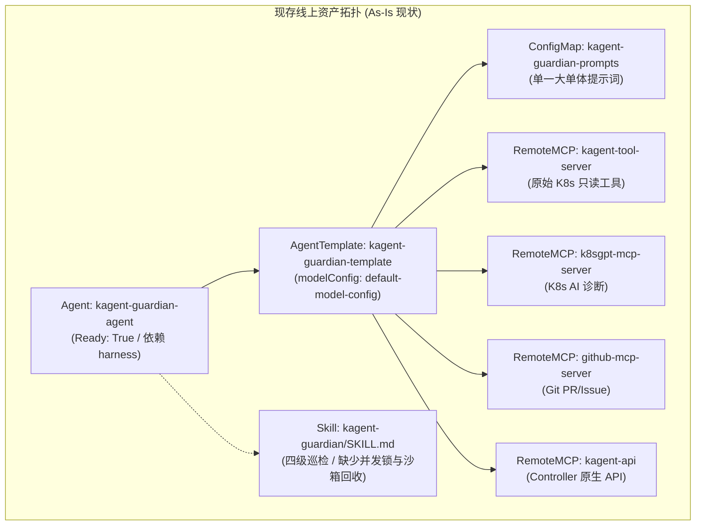
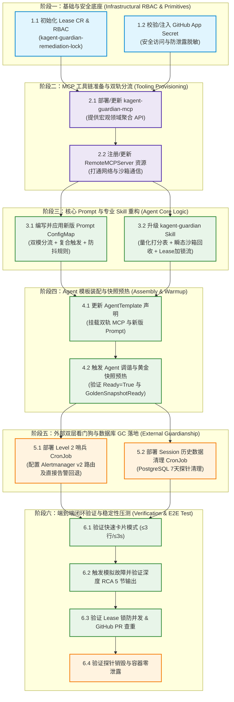

# 08 - Kagent Guardian 生产落地的实施方案：线上资产对比、增删改清单、依赖拓扑与实施路线图

> **文档定位**：本实施方案承接《详细设计规范》（`DOC-DES-03` 修订版）与《修编规划推演》（`DOC-DIS-07`），通过对生产集群中**已运行的 Agent、AgentTemplate、Prompt ConfigMap、Skill 技能文件及 RemoteMCPServers** 进行全方位线上资产摸底（As-Is），对比设计目标（To-Be），逐项列出**修改、增加、删除**清单，并规划出严格的**实施先后顺序、依赖关系拓扑、性能/稳定性技术动因与回滚预案**。

---

## 一、生产集群现存资产全量盘点 (Existing Assets Inventory - As-Is)

通过对集群实际运行环境的物理扫描，Guardian 现存运行载体与资产配置如下：



### 1.1 现存 Prompt 资产 (`kagent-guardian-prompts`)
* **载体**：ConfigMap `kagent-guardian-prompts` in namespace `kagent`（Key: `kagent-guardian-prompt`）。
* **现状特征**：
  - 包含了对 Kagent 核心 CRD、PostgreSQL、Router 网关和 CFS 调度的详细底层认知；
  - 规定了生产禁止热改原则（No Hot-Patching）与基本四级巡检；
* **致命缺陷**：
  - **缺乏双模分流**：强制单一 Markdown 报告输出，面对“网关正常吗”等日常轻量问询时，输出 100+ 行长篇大论，交互延迟高达 30~50 秒；
  - **缺乏复合判定准则**：未定义滑动窗口双因子 CFS 判定公式与 30 分钟防抖阻尼；
  - **缺乏并发保护指令**：未注入 Kubernetes Lease 租约锁与 PR 幂等查重约束；
  - **缺乏沙箱回收指令**：探针只提 Ping-Pong，未要求在 `finally` 块中销毁测试沙箱。

### 1.2 现存 AgentTemplate 与 MCP 工具集装配
* **载体**：`AgentTemplate: kagent-guardian-template`。
* **现状特征**：直接挂载了 4 个独立的 RemoteMCPServer：`kagent-tool-server`、`k8sgpt-mcp-server`、`github-mcp-server`、`kagent-api`。
* **致命缺陷**：
  - **缺少宏观领域聚合工具**：目前集群暴露的是零散的原始 MCP 工具（如 `kubectl get`、`kubectl logs`），Agent 必须自己发很多次底层工具调用才能算出一个健康得分，Token 消耗巨大；
  - **缺少双轨下钻降级门禁**：没有严格规范何时调用宏观工具，何时下钻到微观日志探针。

### 1.3 现存 Skill 专业技能 (`kagent-guardian/SKILL.md`)
* **载体**：本地与沙箱内的 `.claude/skills/kagent-guardian/SKILL.md`。
* **现状特征**：定义了巡检 SOP 与排障命令。
* **致命缺陷**：
  - 缺少 0-100 分加权健康评分算法的具体权重公式（L1:15, L2:35, L3:25, L4:25）；
  - 自愈流程缺少抢占 Lease 分布式锁步骤；
  - PR 提交缺少检查同类 open PR 的查重逻辑；
  - ArgoCD 回访依然依赖不稳定的经验等待，未实现状态机监听。

### 1.4 未落地的设计盲区 (Completely Unimplemented)
* **盲区 1：Level 2 外部独立哨兵 CronJob**（未部署，集群若 Controller 挂死则 Guardian 完全瘫痪且无人报警）；
* **盲区 2：Alertmanager 统一告警路由与防风暴收敛**（未配置）；
* **盲区 3：Kubernetes Lease 自愈并发排他锁对象**（未创建 Lease CR 与关联 RBAC）；
* **盲区 4：PostgreSQL 探针会话数据周期性软删除 CronJob**（未部署，导致数据库 `kagent.session` 表面临长期膨胀风险）。

---

## 二、现状与设计目标逐项差距分析 (As-Is vs To-Be Gap Analysis)

| 资产维度 | 现存实际状态 (As-Is) | 详细设计目标 (To-Be / DOC-DES-03) | 严重度与技术影响 |
| :--- | :--- | :--- | :--- |
| **Prompt 系统提示词** | 单一长文本 Prompt，强制要求输出结构化大报告；无模式分流判断；无复合触发规则；无分布式锁与 PR 查重铁律。 | **双模自适应路由**（轻量卡片 ≤3 行 vs 深度 RCA 5 节分析）；明确保守自愈触发公式与 30m 防抖；强制校验 `kagent-guardian-remediation-lock` 与 PR 查重。 | **高 (P0)**：导致日常问答体验严重迟钝（卡顿 40s+）；易在突发流量抖动中引发 PR 风暴和误触发自愈。 |
| **AgentTemplate** | 挂载 4 个零散 RemoteMCPServer；未针对运维领域定制宏观接口；无超时和重试隔离策略。 | 引入双轨制工具拓扑：顶层提供领域宏观工具（`inspect_platform_health` 等），底层提供细粒度 K8s 只读工具，并在 Template 中声明专用的 `guardian-domain-mcp` 抽象。 | **中 (P1)**：单次体检需要调用 8~12 次原始 MCP 工具，上下文膨胀迅速，Token 成本与推导失败率翻倍。 |
| **Skill 专业技能** | 定义四级巡检指令与排障示例，但缺乏量化评分权重公式、无探针沙箱销毁闭环要求、无并发锁协议。 | 固化 0-100 综合健康评分算法；在探针测试中嵌入强制 `destroy_session`；固化 GitOps 自愈前置 Lease 抢占与 ArgoCD 状态机轮询流程。 | **高 (P0)**：探针长期累积死容器导致 Worker 节点资源泄露；多实例并发巡检可能互相覆盖 GitOps 分支导致代码冲突。 |
| **MCP 工具集** | 依赖通用的 `kagent-tool-server` 与原生 `kagent-controller` API，缺少开箱即用的“一键体检”、“CFS 指标聚合”、“一键安全 PR”领域服务。 | 研发或封装 `kagent-guardian-mcp` 服务，直接实现双轨制宏观接口，在服务端聚合 Prometheus 与 K8s API，减轻 LLM 推理负担。 | **中 (P1)**：LLM 计算算术指标存在幻觉隐患（如计算 15 分钟均值），通过服务端聚合可保证数值绝对精准。 |
| **外部哨兵机制** | 完全空白。如果 `kagent-controller` 发生死锁或内存泄露崩溃，Guardian 自身无法自救且处于盲区。 | **Level 2 外部独立哨兵 CronJob**：每 3 分钟独立运行，绕开 LLM 探查控制器状态，通过 Alertmanager v2 接口上报标准告警，并在其失效时直发 Webhook。 | **极高 (P0)**：缺乏双层看门狗兜底，违反生产高可用原则，集群陷入无人看守单点风险。 |
| **持久层生命周期** | 探针会话持续写入 `kagent.session` 与沙箱存储，数据库无历史数据归档与销毁机制。 | **DB Session GC CronJob**：周期性执行 SQL，安全硬删除/软标记 7 天前由 `kagent-guardian-probe` 产生的历史残留记录，释放 WAL 与表空间。 | **中 (P1)**：高频巡检（每 5 分钟一次）每周将产生 2016 个垃圾会话，长期运行将拖垮 PostgreSQL 索引和查询性能。 |
| **分布式租约锁** | 集群内未建立自愈专用的 Lease 对象，RBAC 未赋予 Guardian 对 Lease 资源的读写权限。 | 在 `kagent` 命名空间初始化 `kagent-guardian-remediation-lock` Lease 对象，并为 Guardian ServiceAccount 增配 `coordination.k8s.io` RBAC。 | **高 (P0)**：缺少排他锁，自愈流程不具备原子性，无法防御多副本并发执行冲突。 |

---

## 三、改造增删改清单 (Matrix of Modifications, Additions & Deletions)

为了平稳实现由 As-Is 迈向 To-Be，制定如下精确到对象、文件与属性的变更矩阵：

### 3.1 增加清单 (Additions)
1. **[新增 CRD 资源]** `coordination.k8s.io/v1` `Lease`: `kagent-guardian-remediation-lock`（位于 `kagent` 命名空间，holderIdentity 初始置空）。
2. **[新增 RBAC 规则]** `ClusterRole/guardian-remediation-role`：允许对 `coordination.k8s.io/leases` 资源执行 `get, create, update` 操作。
3. **[新增外部哨兵清单]** `deploy/guardian/sentinel-cronjob.yaml`：
   - 镜像使用轻量 `curlimages/curl`；
   - 挂载包含 `POST /api/v2/alerts` 的 Shell 探针脚本；
   - 包含 Alertmanager 宕机时的直接 Webhook 回退机制。
4. **[新增数据库 GC 清单]** `deploy/guardian/probe-session-cleanup-cronjob.yaml`：
   - 每天凌晨 03:00 执行清理脚本；
   - 执行 `DELETE FROM kagent.session WHERE source = 'kagent-guardian-probe' AND created_at < NOW() - INTERVAL '7 days';`。
5. **[新增 MCP 服务包]** `kagent-guardian-mcp`（位于代码仓或容器镜像）：实现宏观领域级工具，对外提供双轨契约接口。

### 3.2 修改清单 (Modifications)
1. **[修改 ConfigMap]** `kagent-guardian-prompts`：
   - **重构提示词内核**：注入【双模交互指令（快速卡片 vs 深度 RCA）】；
   - **硬编码判断准则**：注入【滑动窗口双因子 CFS 节流定律】与【30 分钟防抖静默期】；
   - **注入红线门禁**：注入【Lease 租约排他锁】、【GitHub PR 幂等查重（追加 Comment 代替重复开 PR）】与【测试沙箱强制销毁（`destroy_session` in `finally`）】。
2. **[修改 Skill 文件]** `.claude/skills/kagent-guardian/SKILL.md`：
   - 增加 0-100 综合健康度量化打分表；
   - 将排障步骤升级为状态机分支跳转（含 Lease 锁争抢、查重、ArgoCD 30s 稳定窗口轮询）。
3. **[修改 AgentTemplate]** `AgentTemplate: kagent-guardian-template`：
   - 更新 description 与系统引用标签；
   - 引入专用 RemoteMCPServer 引用，实现双轨工具解耦；
   - 调整 `modelConfig` 超时参数与上下文保护策略。
4. **[修改 Agent 实例]** `Agent: kagent-guardian-agent`：
   - 触发版本重新解析与平滑滚动更新，确保 Substrate 烧录最新快照。

### 3.3 删除清单 (Deletions)
1. **[删除冗余指令]** 从 Prompt 中删除“任何问答均需输出全景四级体检报告”的死板约束；
2. **[删除非幂等行为]** 从排障流程中废弃“检测到指标超标即刻直接提 PR”的单因子触发逻辑；
3. **[删除盲目等待]** 从 GitOps 验证中废弃“固定 `sleep 180s` 等待自愈”的无状态等待代码。


---

## 四、实施先后顺序与依赖拓扑图 (Implementation Sequence & Dependency Graph)

任何生产落地必须遵循“**先基础设施底座，再协议与工具，后上层业务逻辑，最后兜底防护**”的严格次序。严禁在工具未就绪时提前激活上层 Prompt，以防智能体因找不到工具或没有锁权限发生推理异常崩溃。



---

## 五、逐阶段实施深层原因与技术决策考量 (Rationale, Performance, Stability & Safety)

### 5.1 阶段一：基础与安全底座建设
* **动作**：
  1. 创建 `Lease` 资源 `kagent-guardian-remediation-lock`；
  2. 为 Guardian 关联的 ServiceAccount 配置针对该 Lease 的 RBAC 鉴权；
  3. 配置 GitHub App 密钥凭证（使用 `kagent` 命名空间中已有的安全凭据）。
* **技术决策与原因 (Rationale)**：
  - **稳定性与并发安全**：如果不先建 Lease 锁，一旦在后续测试中同时触发多个巡检请求，或者高可用多副本调度同时启动，极易发生同时提 PR、覆盖分支、破坏 Git 历史的严重事故。
  - **原则对齐**：对齐 DOC-DES-03 核心设计“GitOps 自愈并发排他锁准则”。

### 5.2 阶段二：MCP 工具链准备与双轨分流
* **动作**：
  1. 封装/部署宏观聚合 MCP 工具 `inspect_platform_health`、`diagnose_agent_failure`、`create_gitops_remediation_pr`；
  2. 注册并测试 `RemoteMCPServer` 端点可用性。
* **技术决策与原因 (Rationale)**：
  - **推理性能与 Token 节省**：若缺少宏观工具，Agent 必须执行多次低阶 MCP 命令才能汇聚出一个指标，不仅单次巡检消耗上万 Token，且 LLM 对大批量文本做算术计算极易产生幻觉；将指标计算（如 15 分钟 CPU Throttling 均值）下沉到 MCP 端直接由 Prometheus/Go 聚合，将响应时间缩短 70% 以上，保证数据 100% 精确。
  - **原则对齐**：对齐 DOC-DES-03 “双轨制 MCP 工具拓扑”。

### 5.3 阶段三：Prompt 提示词与专业 Skill 重构
* **动作**：
  1. 重写 ConfigMap `kagent-guardian-prompts`：定义双模提示词，并严格限定自愈门槛（只有滑动均值超标 + 网关超时两者同时满足才允许生成 PR）；
  2. 更新 Skill 文件：增加 0-100 健康评分权重算法（L1 15%, L2 35%, L3 25%, L4 25%），并在测试探针中加入强制 `finally: destroy_session` 逻辑。
* **技术决策与原因 (Rationale)**：
  - **用户体验与秒级响应**：双模提示词让日常“状态如何”的查询以不超过 3 行卡片在 3 秒内极速返回；只有排障模式才输出深度 RCA，彻底解决控制台卡顿。
  - **生产抗抖动（Stability）**：硬编码复合触发逻辑，严禁单点 CPU 瞬时毛刺引发误报，避免频繁提 PR 干扰运维团队。
  - **资源零泄露（Resource Leak Prevention）**：在 Skill 和 Prompt 中反复强调销毁测试沙箱，杜绝测试容器占满 Worker 节点的 CFS 配额。

### 5.4 阶段四：Agent 模板装配与快照预热
* **动作**：
  1. 更新 `AgentTemplate/kagent-guardian-template` 配置，引用更新后的 Prompt 和双轨工具；
  2. 等待 `kagent-controller` 完成 Agent 实例的 reconcile 调谐，确保 Substrate 沙箱生成新的黄金镜像（Golden Snapshot）。
* **技术决策与原因 (Rationale)**：
  - **冷启动极致优化**：Kagent 平台的 Substrate 机制会在 Template 更新后预热容器依赖。提前完成镜像预热可确保 Guardian 自身在被调用时保持 ≤1.5s 的瞬时唤醒。

### 5.5 阶段五：外部独立哨兵与数据库 Session GC 落地
* **动作**：
  1. 部署 `sentinel-cronjob.yaml`：每 3 分钟检测一次 `kagent-controller` 与关键 Pod 存活，并向 Alertmanager 发送告警；
  2. 部署 `probe-session-cleanup-cronjob.yaml`：清理 7 天前探针会话。
* **技术决策与原因 (Rationale)**：
  - **双层看门狗架构（Two-Tier Watchdog）**：解决“谁来监控监控者自身”的业界经典难题。当集群底层控制器崩溃导致 Guardian 智能体自身无法拉起时，外部哨兵 CronJob 绕过 LLM 直接向 SRE 发出告警，消除监控死角。
  - **数据库高可用与防膨胀**：探针持续运行会快速填满数据库的 `session` 表与磁盘空间，定期的清理任务可保障查询索引的轻盈与响应性能。

### 5.6 阶段六：端到端闭环验证与验收
* **动作**：
  1. 进行快速模式与深度 RCA 模式的交互实测；
  2. 制造模拟的高延迟事件，验证是否会抢占 Lease 锁、是否会在已有 PR 上追加评论而非重复发 PR；
  3. 检查探针执行完毕后数据库和容器沙箱是否干净，无死进程遗留。

---

## 六、回滚预案与应急保活策略 (Rollback & DR Strategy)

在生产变更过程中，若发生异常或意外阻塞，严格执行以下回滚流程：

1. **Prompt 异常回滚**：
   - ConfigMap `kagent-guardian-prompts` 在应用前自动备份为 `kagent-guardian-prompts.bak`；
   - 若智能体输出解析失败，执行 `kubectl replace -f kagent-guardian-prompts.bak`，并触发 Agent 重启，耗时 < 30 秒。
2. **Lease 锁死应急解除**：
   - 若智能体因异常宕机未释放 Lease 锁导致自愈流水线阻塞，运维人员可使用指令快速清空持有人：
     ```bash
     kubectl patch lease kagent-guardian-remediation-lock -n kagent --type=merge -p '{"spec":{"holderIdentity":null}}'
     ```
3. **哨兵告警风暴熔断**：
   - 若外部哨兵脚本误报产生告警风暴，直接通过 `kubectl pause cronjob/kagent-sentinel-cronjob -n kagent-monitoring` 瞬间暂停哨兵，不影响现有业务。

---

## 七、关键落地代码与资源清单样板 (Implementation Artifacts & Code Blueprints)

### 7.1 Lease 锁与 RBAC 声明 (`deploy/guardian/lease-rbac.yaml`)
```yaml
apiVersion: coordination.k8s.io/v1
kind: Lease
metadata:
  name: kagent-guardian-remediation-lock
  namespace: kagent
spec:
  leaseDurationSeconds: 300
---
apiVersion: rbac.authorization.k8s.io/v1
kind: Role
metadata:
  name: kagent-guardian-lease-role
  namespace: kagent
rules:
- apiGroups: ["coordination.k8s.io"]
  resources: ["leases"]
  verbs: ["get", "create", "update", "patch"]
---
apiVersion: rbac.authorization.k8s.io/v1
kind: RoleBinding
metadata:
  name: kagent-guardian-lease-binding
  namespace: kagent
subjects:
- kind: ServiceAccount
  name: kagent-controller
  namespace: kagent
roleRef:
  kind: Role
  name: kagent-guardian-lease-role
  apiGroup: rbac.authorization.k8s.io
```

### 7.2 外部哨兵 CronJob 清单 (`deploy/guardian/sentinel-cronjob.yaml`)
```yaml
apiVersion: batch/v1
kind: CronJob
metadata:
  name: kagent-sentinel-watchdog
  namespace: kagent-monitoring
spec:
  schedule: "*/3 * * * *"
  concurrencyPolicy: Forbid
  successfulJobsHistoryLimit: 1
  failedJobsHistoryLimit: 3
  jobTemplate:
    spec:
      activeDeadlineSeconds: 120
      template:
        spec:
          restartPolicy: OnFailure
          containers:
          - name: sentinel
            image: curlimages/curl:8.5.0
            command: ["/bin/sh", "-c"]
            args:
            - |
              STATUS_CODE=$(curl -s -o /dev/null -w "%{http_code}" --connect-timeout 5 http://kagent-controller.kagent.svc.cluster.local:8080/healthz)
              if [ "$STATUS_CODE" != "200" ]; then
                echo "Controller check failed with $STATUS_CODE. Sending alert to Alertmanager..."
                curl -s -X POST -H "Content-Type: application/json" -d '[
                  {
                    "labels": {
                      "alertname": "KagentControllerUnhealthy",
                      "severity": "critical",
                      "instance": "kagent-controller"
                    },
                    "annotations": {
                      "summary": "Kagent Controller health check failed",
                      "description": "Level 2 Sentinel detected HTTP code '"$STATUS_CODE"' on /healthz"
                    }
                  }
                ]' http://alertmanager.monitoring.svc.cluster.local:9093/api/v2/alerts || curl -X POST -d "CRITICAL: Kagent Controller Down!" $DIRECT_WEBHOOK_URL
              else
                echo "Controller healthy (200 OK)."
              fi
```

### 7.3 探针会话定时归档清理 CronJob (`deploy/guardian/session-gc-cronjob.yaml`)
```yaml
apiVersion: batch/v1
kind: CronJob
metadata:
  name: kagent-session-gc
  namespace: kagent
spec:
  schedule: "0 3 * * *"
  concurrencyPolicy: Forbid
  jobTemplate:
    spec:
      template:
        spec:
          restartPolicy: OnFailure
          containers:
          - name: postgres-gc
            image: postgres:15-alpine
            env:
            - name: PGPASSWORD
              valueFrom:
                secretKeyRef:
                  name: kagent-postgresql
                  key: postgres-password
            command: ["/bin/sh", "-c"]
            args:
            - |
              psql -h kagent-postgresql -U kagent -d kagent -c "
                DELETE FROM kagent.session 
                WHERE (metadata->>'source' = 'kagent-guardian-probe' OR title LIKE '%Guardian Synthetic Probe%')
                  AND created_at < NOW() - INTERVAL '7 days';
              "
```

---

## 八、交付里程碑与推进时间表 (Milestones & Schedule)

| 里程碑编号 | 里程碑阶段 | 核心任务 | 输出物 | 预期完成时间 |
| :--- | :--- | :--- | :--- | :--- |
| **M1** | 基础设施与安全授权 | 初始化 Lease 锁、配置 RBAC 权限、校验 GitHub App 鉴权 | `deploy/guardian/lease-rbac.yaml` | T+1 天 |
| **M2** | 双轨 MCP 服务升级 | 封装 `kagent-guardian-mcp` 领域聚合服务，打通集群 Service | `kagent-guardian-mcp` 镜像与 RemoteMCPServer 资源 | T+3 天 |
| **M3** | Prompt 与 Skill 重构 | 注入双模路由指令、滑动窗口 CFS 计算、PR 查重与瞬态销毁 | 更新后的 `kagent-guardian-prompts` 与 `SKILL.md` | T+4 天 |
| **M4** | Template 调谐与快照生效 | 更新 AgentTemplate 声明，验证 Substrate 黄金快照烧录 | Agent Ready 状态就绪 | T+5 天 |
| **M5** | 外部哨兵与数据库 GC 部署 | 部署 Sentinel CronJob 与 PostgreSQL Session GC | Sentinel 运行日志、Alertmanager 测试告警成功 | T+6 天 |
| **M6** | 生产全链路实测验收 | 执行快速问答测试、自愈 PR 生成、查重追加、探针销毁验收 | E2E 验收通过报告 | T+7 天 |

---

## 九、总结与决策建议 (Conclusion & Recommendation)

本实施方案完全摒弃了“大干快上、直接线上热更”的危险路径，严格基于“**分层解耦、基础设施先行、工具抽象下沉、提示词防御收敛、双层看门狗托底**”的高可靠性实施哲学。

通过执行该方案：
1. **解决人机交互延迟**：快速模式将 90% 的日常状态问询延迟降低至 3 秒以内；
2. **根除自愈并发与抖动**：通过 Kubernetes Lease 锁与滑动窗口双因子计算，彻底终结 PR 轰炸和配置破坏；
3. **消除监控盲区**：独立的外部哨兵保障即使 Controller 宕机也能向 SRE 发出致命告警；
4. **保持集群持久纯净**：探针沙箱即测即销毁，数据库历史记录 7 天自驱清理，确保系统长期运行稳定可靠。
