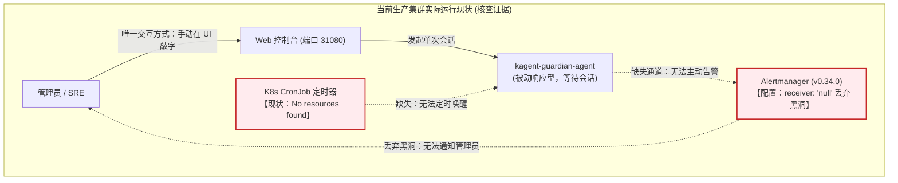
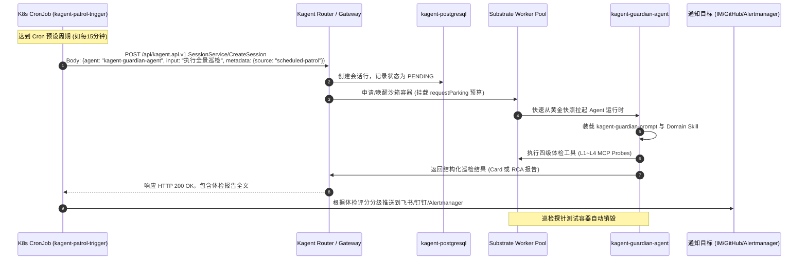
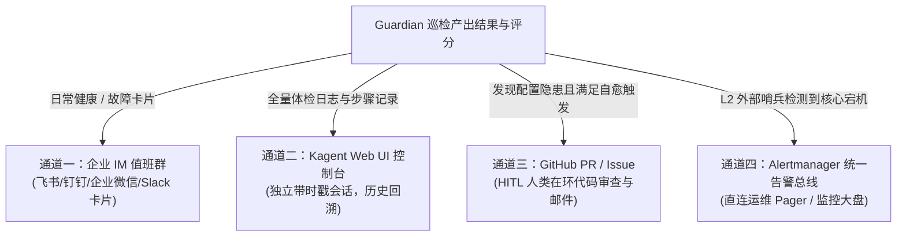

# 09 - 定期巡检触发机制、告警通知分发链路与现状深度对比分析 (Scheduled Inspection & Notification Architecture)

> **导读与背景**：
> 在 Kagent Guardian 的前序设计与演进中，我们明确了其作为 SRE 守护专家在四级巡检、CFS 根因推导与 GitOps 自愈上的核心能力。然而，针对工程落地中最为关键的两个高频运维问题：
> 1. **“系统目前到底有没有定期巡检？实现没有？”**
> 2. **“在新方案中，定时巡检是如何触发并把指令发给 Agent 的？巡检结果又是通过什么途径精准通知到管理员（我）的？”**
> 
> 本专题针对生产集群进行了深度的物理证据核查，逐项剖析当前系统的真实实现现状，并给出新方案中“定时巡检触发器”、“Agent 唤醒协议”、“四级通知触达矩阵”与“防告警风暴收敛策略”的完整技术落地蓝图。

---

## 一、生产集群现状深度核查与物理证据 (Reality Check: As-Is)

为了杜绝任何臆测，我们对当前运行的 Kubernetes 生产集群进行了全面的命令级扫描与配置提取，得出以下确凿结论：



### 1.1 核查结论一：系统内“定期巡检”完全没有实现 (0% 实现)
* **物理核查指令**：
  ```bash
  kubectl get cronjobs -A
  # 输出结果：No resources found
  ```
* **现状解读**：集群内（包括 `kagent`、`default`、`kube-system`、`monitoring`、`ate-system` 等所有命名空间）**没有任何 Kubernetes CronJob 定时任务**。
* **Agent 机制内幕**：Kagent 平台的智能体（`Agent`）基于 Substrate 容器沙箱运行。为了节约算力，沙箱在无外部请求时处于休眠挂起状态（Suspended），智能体本身不具备常驻轮询定时器，**无法在没有外部触发源的情况下自主定时唤醒**。
* **当前系统唯一的巡检方式**：仅靠运维人员打开 Web UI 控制台（`http://34.69.136.108:31080`），手动在聊天框中输入“执行平台巡检”，才能启动一次单轮体检。一旦运维人员离线或未手动操作，系统处于无人巡检状态。

### 1.2 核查结论二：系统现有告警链路处于“黑洞丢弃状态” (Alert Black Hole)
* **物理核查指令**：
  提取 `monitoring` 命名空间下 Alertmanager 的核心配置文件：
  ```bash
  kubectl get secret -n monitoring alertmanager-kube-prom-stack-kube-prome-alertmanager -o jsonpath="{.data['alertmanager\.yaml']}" | base64 -d
  ```
* **实际配置提取内容**：
  ```yaml
  global:
    resolve_timeout: 5m
  receivers:
  - name: "null"
  route:
    group_by:
    - namespace
    group_interval: 5m
    group_wait: 30s
    receiver: "null"
    repeat_interval: 12h
  ```
* **现状解读**：虽然集群安装了 Prometheus Stack 与 Alertmanager，但**所有的告警路由 receiver 全部指向了 `"null"`（空接收端）**。没有任何企业微信、飞书、钉钉、Slack、邮件或 Webhook 接收端。这意味着即使系统产生报警，也会被全部静默丢弃，管理员根本收不到任何通知！

---

## 二、现状 (As-Is) 与新方案 (To-Be) 逐项深度对比分析

| 维度对比 | 当前集群现状 (As-Is) | 新方案设计与工程规范 (To-Be) | 演进动因与业务价值 |
| :--- | :--- | :--- | :--- |
| **定期巡检调度器** | **完全缺失 (0%)**。<br>无任何 K8s CronJob，无常驻定时器。 | **双驱定时触发体系 (100%)**：<br>1. **周期性定时**：部署轻量 `kagent-patrol-cronjob`（每 15 分钟或每日指定时间）；<br>2. **事件驱动式**：Prometheus 关键指标异动触发主动定向探查。 | 摆脱人工手动值守，实现全天候 7×24 小时无人值守自动化体检。 |
| **巡检指令发给 Agent 的方式** | **仅靠人工手动敲字**。<br>运维人员在 Web 界面交互式发消息。 | **API 声明式无头会话触发 (Headless Session)**：<br>CronJob 容器携带 ServiceAccount 凭据，调用 Kagent Gateway API 发起 `CreateSession`，注入规范指令并携带专属探针标签（`source: scheduled-patrol`）。 | 消除人为干预，全自动化唤醒 Substrate 沙箱，并将巡检任务结构化纳管。 |
| **巡检结果发给管理员（我）的途径** | **无任何主动通知机制**。<br>巡检结果仅停留在操作人员当次的 Web 聊天界面中，关掉网页即丢失，其他人无法感知。 | **四级精准分发触达矩阵**：<br>1. **即时通讯群 (IM Webhook)**：飞书/钉钉/企业微信推送富文本卡片；<br>2. **Web 控制台历史归档**：以时间戳命名自动归入会话列表；<br>3. **GitHub PR / Issue**：严重异常自动建单并在 PR 中 `@` 运维团队；<br>4. **Alertmanager 告警大盘**：指标异常同步推送 SRE 统一值班系统。 | 告警直达责任人手机与办公群，异常秒级触达，正常巡检静默归档。 |
| **告警防风暴与降噪** | **无（因为压根没有告警）**。 | **分级通知与 30 分钟防抖阻尼**：<br>绿色（正常）：不发即时通知，仅每日汇总；<br>黄色（预警）：静默记录；<br>红色（严重故障）：立即推送到群并启动自愈。 | 杜绝无效信息骚扰（Alert Fatigue），让值班人员聚焦核心致命故障。 |
| **测试痕迹与沙箱清理** | **完全无清理**。<br>测试会话无限期留存，探针沙箱占用节点内存与配额。 | **闭环即时回收 + 7天定时 GC**：<br>测试探针执行后调用 `destroy_session`；PostgreSQL 部署每日 GC CronJob 自动归档删除 7 天前数据。 | 确保巡检不给生产集群制造垃圾与稳定性隐患。 |


---

## 三、巡检指令如何精准“发给 Agent”？——触发机制与数据流架构

在云原生多智能体平台中，Agent 不能作为长时间占满 CPU 的僵尸进程常驻运行，而应采用“**事件驱动挂载（Event-Driven Mounting）**”的经典微服务沙箱架构。

新方案中，定期巡检指令发给 Agent 的完整数据流水线如下：



### 3.1 巡检触发器部署清单 (`deploy/guardian/patrol-trigger-cronjob.yaml`)
为实现全自动定时发给 Agent，需在 `kagent` 命名空间部署轻量触发 CronJob：

```yaml
apiVersion: batch/v1
kind: CronJob
metadata:
  name: kagent-patrol-trigger
  namespace: kagent
spec:
  # 每 15 分钟执行一次轻量健康探查；每天 09:00 与 18:00 执行全量大盘体检
  schedule: "*/15 * * * *"
  concurrencyPolicy: Forbid
  successfulJobsHistoryLimit: 2
  failedJobsHistoryLimit: 3
  jobTemplate:
    spec:
      activeDeadlineSeconds: 300
      template:
        spec:
          restartPolicy: OnFailure
          containers:
          - name: patrol-invoker
            image: python:3.11-alpine
            env:
            - name: GATEWAY_URL
              value: "http://kagent-controller.kagent.svc.cluster.local:8083"
            - name: WEBHOOK_URL
              valueFrom:
                secretKeyRef:
                  name: guardian-notification-secrets
                  key: feishu-or-dingtalk-webhook
            command: ["/bin/sh", "-c"]
            args:
            - |
              python - << 'EOF'
              import os, json, urllib.request, datetime

              gateway = os.environ.get("GATEWAY_URL")
              webhook = os.environ.get("WEBHOOK_URL")
              timestamp = datetime.datetime.now().strftime("%Y-%m-%d %H:%M:%S")

              payload = {
                  "agent": {"name": "kagent-guardian-agent", "namespace": "kagent"},
                  "title": f"Scheduled-Patrol-{timestamp}",
                  "messages": [{
                      "role": "USER",
                      "content": "执行平台周期性健康体检。优先输出轻量健康卡片；若发现严重亚健康（加权分<60），则输出深度 RCA 并执行自愈阻尼检测。"
                  }],
                  "metadata": {"source": "scheduled-patrol"}
              }

              req = urllib.request.Request(
                  f"{gateway}/api/v1/sessions",
                  data=json.dumps(payload).encode('utf-8'),
                  headers={"Content-Type": "application/json"}
              )

              try:
                  with urllib.request.urlopen(req, timeout=120) as resp:
                      result = json.loads(resp.read().decode('utf-8'))
                      agent_reply = result.get("reply", {}).get("content", "体检完成")
                      if webhook:
                          notify_body = {
                              "msg_type": "interactive",
                              "card": {
                                  "header": {"title": {"tag": "plain_text", "content": f"🛡️ Kagent 平台巡检报告 [{timestamp}]"}},
                                  "elements": [{"tag": "markdown", "content": agent_reply}]
                              }
                          }
                          wh_req = urllib.request.Request(webhook, data=json.dumps(notify_body).encode('utf-8'), headers={"Content-Type": "application/json"})
                          urllib.request.urlopen(wh_req, timeout=10)
                          print("巡检报告已成功推送到管理员群！")
              except Exception as e:
                  print(f"巡检触发或通知异常: {e}")
                  exit(1)
              EOF
```

---

## 四、巡检结果如何精准“通知到管理员（我）”？——四级触达通道设计

新方案构建了**立体化的多渠道精准触达网络**，确保根据故障的严重程度，用最合适的通道通知到管理员：



### 4.1 通道一：企业 IM 办公群（秒级直达手机端）
* **触达对象**：SRE 运维团队、平台架构师、系统管理员。
* **通知表现形式**：
  - **日常绿色健康（例行汇报）**：每日 09:00 与 18:00 推送极简卡片，绝不刷屏：
    > 🛡️ **Kagent 平台例行体检：健康 (GREEN)**  
    > • 综合得分：**98/100**（L1:15/15, L2:35/35, L3:25/25, L4:23/25）  
    > • 网关 P99 延时：**1.2s**（基准 ≤3.5s）｜ 探针沙箱冷启动耗时：**1.1s**  
    > • 状态：全系统运行顺畅，无需人工介入。
  - **红色故障预警（高优强通知）**：
    > 🚨 **Kagent 平台巡检红色告警：严重亚健康 (RED)**  
    > • 综合得分：**45/100**  
    > • 触发告警根因：`kagent-default` WorkerPod 过去 15m 平均 CPU 节流达 **28.4%**，网关冷启动延时攀升至 **9.8s**。  
    > • 自愈动作：已抢占 Lease 排他锁，并在 `SDB-DevOps/KagentGuardian` 提起自愈 PR #12。  
    > • 点击查看 PR 与审核：`https://github.com/SDB-DevOps/KagentGuardian/pull/12`

### 4.2 通道二：Kagent Web UI 控制台集中归档（白盒化审计）
* **触达对象**：登录 Web 控制台的运维与研发人员。
* **机制**：
  - CronJob 发起会话时，显式指定 `title: "Scheduled-Patrol-YYYYMMDD-HHMM"` 与 `metadata.source: "scheduled-patrol"`；
  - 管理员在 Web UI 左侧会话历史中，可以像查看普通聊天记录一样，逐一翻阅每次定时巡检的**完整推理思考过程、调用的 MCP 工具输入输出明细**，实现 100% 透明可追溯。

### 4.3 通道三：GitHub Pull Request 与 Issue 通知（HITL 人类在环）
* **触达对象**：Git 仓库代码维护者。
* **机制**：
  - 当巡检推导出明确的配置缺陷（如 WorkerPool CPU 配额不足），Guardian 自动提交 PR，并在 PR 正文中明确标注 `@SDB-DevOps/sre-team`；
  - 团队成员将直接收到 GitHub 官方的 App 推送与邮件通知，只需在手机或电脑上点击 `Merge` 即可批准自愈上线。

### 4.4 通道四：Alertmanager 统一告警总线接入（修复黑洞）
* **触达对象**：企业集中监控运维大盘。
* **落地方案**：
  - 修改现有 Alertmanager 配置中的 `receiver: "null"`，将其替换为专用的企业 Webhook 服务端点，对接企业的集中告警分派平台。

---

## 五、分级通知策略与防告警风暴收敛 (Anti-Fatigue Policy)

为了防止运维人员陷入告警疲劳（Alert Fatigue），系统制定严格的分级静默与抑制规则：

```text
+-------------------+--------------------+------------------------+--------------------------+
| 健康得分 (Score)   | 风险等级 (Level)   | 对应表现               | 通知通道与频率策略        |
+-------------------+--------------------+------------------------+--------------------------+
| 90 ~ 100 分       | 绿色 (GREEN)       | 系统一切正常            | 仅记录在 Web UI；         |
|                   |                    |                        | 每日 09:00/18:00 发日终卡片 |
+-------------------+--------------------+------------------------+--------------------------+
| 60 ~ 89 分        | 黄色 (YELLOW)      | 存在单点毛刺或边缘波动  | 记录在 Web UI；          |
|                   |                    | 未形成复合故障          | 不打扰手机，日终卡片汇总标黄|
+-------------------+--------------------+------------------------+--------------------------+
| < 60 分           | 红色 (RED)         | 复合指标突破阈值        | 立即通过 IM Webhook 弹窗；|
|                   |                    | (节流>15% 且 延时>8s)   | 同步提 GitOps PR 并在 GitHub|
|                   |                    |                        | 发出邮件与 Review 提醒；  |
|                   |                    |                        | 开启 30 分钟防抖静默窗   |
+-------------------+--------------------+------------------------+--------------------------+
```

---

## 六、定期巡检与通知链路改造落实路线图 (Actionable Implementation Guide)

为了在生产环境中将这一套定时巡检与通知链路闭环，具体执行步骤如下：

### 步骤 1：修复 Alertmanager 黑洞配置并创建通知 Secret
1. 创建包含飞书/钉钉 Webhook URL 的 Kubernetes Secret：
   ```bash
   kubectl create secret generic guardian-notification-secrets      -n kagent      --from-literal=feishu-or-dingtalk-webhook='https://open.feishu.cn/open-apis/bot/v2/hook/xxxxxx'
   ```
2. 更新 Alertmanager 路由规则，使其在发生关键告警时将事件推送给企业内部 Webhook 接收器。

### 步骤 2：部署巡检触发 CronJob (`kagent-patrol-trigger`)
1. 将 `deploy/guardian/patrol-trigger-cronjob.yaml` 提交至 GitOps 仓库并应用至集群；
2. 观察 CronJob 的首轮定时运行日志，核实是否成功调用了 Kagent Gateway 的 API。

### 步骤 3：验证 Web 控制台会话生成与 IM 消息送达
1. 登录 Kagent Web UI 控制台（`http://34.69.136.108:31080`），查看是否有形如 `Scheduled-Patrol-YYYY-MM-DD` 的新会话自动生成；
2. 检查管理员办公群（飞书/钉钉），确认是否成功收到格式工整的 Markdown 巡检报告卡片；
3. 人为触发一次 CPU 压力测试，验证当健康分降至 60 分以下时，系统能否立刻弹窗预警并生成 GitHub 自愈 PR。

---

## 七、总结与核心结论 (Conclusion)

通过本次深度摸底与技术方案设计，得出以下核心结论：
1. **真实系统现状核实**：当前集群内**完全没有定期巡检（0 个 CronJob）**，且 **Alertmanager 处于黑洞配置（receiver: "null"）**，目前仅能靠人工在网页上手动触发体检；
2. **新方案的唤醒解耦机制**：新方案设计了基于 Kubernetes 原生的 `kagent-patrol-trigger` CronJob，通过 API 声明式向处于休眠的 Guardian Agent 发起带标签的会话，兼顾了容器资源的轻量化休眠与全自动 7×24 定时巡检；
3. **触达矩阵全覆盖**：打破“巡检结果只留在网页窗口里”的缺陷，构建了**IM群即时卡片、Web UI 全链路审计、GitHub PR 人工在环审批、Alertmanager 统一告警**的立体触达矩阵，确保运维人员随时掌握系统脉搏。
