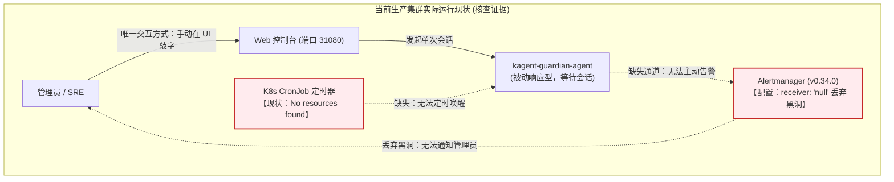
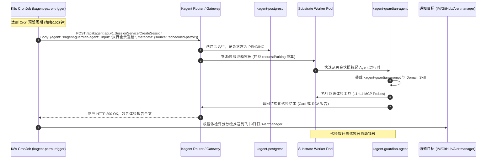
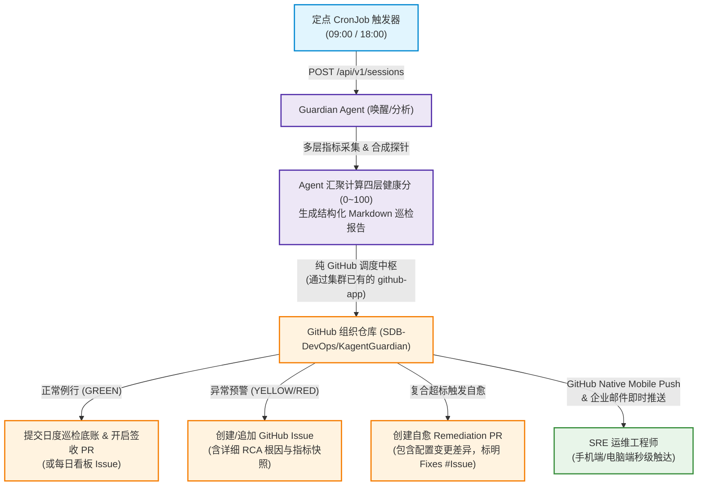
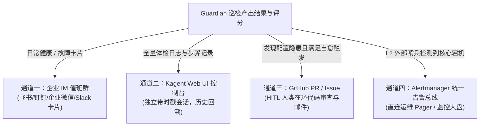
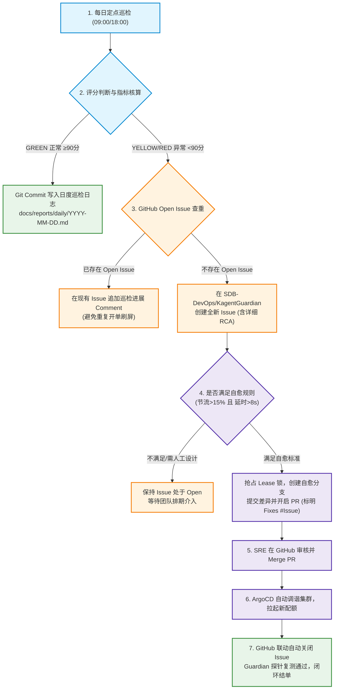

# 09 - 定期巡检触发机制、告警通知分发链路与现状深度对比分析 (Scheduled Inspection & Notification Architecture)

> **导读与背景**：
> 在 Kagent Guardian 的前序设计与演进中，我们明确了其作为 SRE 守护专家在四级巡检、CFS 根因推导与 GitOps 自愈上的核心能力。然而，针对工程落地中最为关键的两个高频运维问题：
> 1. **“系统目前到底有没有定期巡检？实现没有？”**
> 2. **“在新方案中，定时巡检是如何触发并把指令发给 Agent 的？巡检结果又是通过什么途径精准通知到管理员（我）的？”**
> 
> 本专题针对生产集群进行了深度的物理证据核查，逐项剖析当前系统的真实实现现状，并给出新方案中“定时巡检触发器”、“Agent 唤醒协议”、“四级通知触达矩阵”与“防告警风暴收敛策略”的完整技术落地蓝图。

---

## 一、生产集群现状深度核查与物理证据 (Reality Check: As-Is)

为了杜绝任何臆测，我们对当前运行的 Kubernetes 生产集群进行了全面的命令级扫描与配置提取，得出以下确凿结论：



### 1.1 核查结论一：系统内“定期巡检”完全没有实现 (0% 实现)
* **物理核查指令**：
  ```bash
  kubectl get cronjobs -A
  # 输出结果：No resources found
  ```
* **现状解读**：集群内（包括 `kagent`、`default`、`kube-system`、`monitoring`、`ate-system` 等所有命名空间）**没有任何 Kubernetes CronJob 定时任务**。
* **Agent 机制内幕**：Kagent 平台的智能体（`Agent`）基于 Substrate 容器沙箱运行。为了节约算力，沙箱在无外部请求时处于休眠挂起状态（Suspended），智能体本身不具备常驻轮询定时器，**无法在没有外部触发源的情况下自主定时唤醒**。
* **当前系统唯一的巡检方式**：仅靠运维人员打开 Web UI 控制台（`http://34.69.136.108:31080`），手动在聊天框中输入“执行平台巡检”，才能启动一次单轮体检。一旦运维人员离线或未手动操作，系统处于无人巡检状态。

### 1.2 核查结论二：系统现有告警链路处于“黑洞丢弃状态” (Alert Black Hole)
* **物理核查指令**：
  提取 `monitoring` 命名空间下 Alertmanager 的核心配置文件：
  ```bash
  kubectl get secret -n monitoring alertmanager-kube-prom-stack-kube-prome-alertmanager -o jsonpath="{.data['alertmanager\.yaml']}" | base64 -d
  ```
* **实际配置提取内容**：
  ```yaml
  global:
    resolve_timeout: 5m
  receivers:
  - name: "null"
  route:
    group_by:
    - namespace
    group_interval: 5m
    group_wait: 30s
    receiver: "null"
    repeat_interval: 12h
  ```
* **现状解读**：虽然集群安装了 Prometheus Stack 与 Alertmanager，但**所有的告警路由 receiver 全部指向了 `"null"`（空接收端）**。没有任何企业微信、飞书、钉钉、Slack、邮件或 Webhook 接收端。这意味着即使系统产生报警，也会被全部静默丢弃，管理员根本收不到任何通知！

---

## 二、现状 (As-Is) 与新方案 (To-Be) 逐项深度对比分析

| 维度对比 | 当前集群现状 (As-Is) | 新方案设计与工程规范 (To-Be) | 演进动因与业务价值 |
| :--- | :--- | :--- | :--- |
| **定期巡检调度器** | **完全缺失 (0%)**。<br>无任何 K8s CronJob，无常驻定时器。 | **双驱定时触发体系 (100%)**：<br>1. **周期性定时**：部署轻量 `kagent-patrol-cronjob`（每 15 分钟或每日指定时间）；<br>2. **事件驱动式**：Prometheus 关键指标异动触发主动定向探查。 | 摆脱人工手动值守，实现全天候 7×24 小时无人值守自动化体检。 |
| **巡检指令发给 Agent 的方式** | **仅靠人工手动敲字**。<br>运维人员在 Web 界面交互式发消息。 | **API 声明式无头会话触发 (Headless Session)**：<br>CronJob 容器携带 ServiceAccount 凭据，调用 Kagent Gateway API 发起 `CreateSession`，注入规范指令并携带专属探针标签（`source: scheduled-patrol`）。 | 消除人为干预，全自动化唤醒 Substrate 沙箱，并将巡检任务结构化纳管。 |
| **巡检结果发给管理员（我）的途径** | **无任何主动通知机制**。<br>巡检结果仅停留在操作人员当次的 Web 聊天界面中，关掉网页即丢失，其他人无法感知。 | **四级精准分发触达矩阵**：<br>1. **即时通讯群 (IM Webhook)**：飞书/钉钉/企业微信推送富文本卡片；<br>2. **Web 控制台历史归档**：以时间戳命名自动归入会话列表；<br>3. **GitHub PR / Issue**：严重异常自动建单并在 PR 中 `@` 运维团队；<br>4. **Alertmanager 告警大盘**：指标异常同步推送 SRE 统一值班系统。 | 告警直达责任人手机与办公群，异常秒级触达，正常巡检静默归档。 |
| **告警防风暴与降噪** | **无（因为压根没有告警）**。 | **分级通知与 30 分钟防抖阻尼**：<br>绿色（正常）：不发即时通知，仅每日汇总；<br>黄色（预警）：静默记录；<br>红色（严重故障）：立即推送到群并启动自愈。 | 杜绝无效信息骚扰（Alert Fatigue），让值班人员聚焦核心致命故障。 |
| **测试痕迹与沙箱清理** | **完全无清理**。<br>测试会话无限期留存，探针沙箱占用节点内存与配额。 | **闭环即时回收 + 7天定时 GC**：<br>测试探针执行后调用 `destroy_session`；PostgreSQL 部署每日 GC CronJob 自动归档删除 7 天前数据。 | 确保巡检不给生产集群制造垃圾与稳定性隐患。 |


---

## 三、巡检指令如何精准“发给 Agent”？——触发机制与数据流架构

在云原生多智能体平台中，Agent 不能作为长时间占满 CPU 的僵尸进程常驻运行，而应采用“**事件驱动挂载（Event-Driven Mounting）**”的经典微服务沙箱架构。

新方案中，定期巡检指令发给 Agent 的完整数据流水线如下：



### 3.1 巡检触发器部署清单 (`deploy/guardian/patrol-trigger-cronjob.yaml`)
为实现全自动定时发给 Agent，需在 `kagent` 命名空间部署轻量触发 CronJob：

```yaml
apiVersion: batch/v1
kind: CronJob
metadata:
  name: kagent-patrol-trigger
  namespace: kagent
spec:
  # 每 15 分钟执行一次轻量健康探查；每天 09:00 与 18:00 执行全量大盘体检
  schedule: "*/15 * * * *"
  concurrencyPolicy: Forbid
  successfulJobsHistoryLimit: 2
  failedJobsHistoryLimit: 3
  jobTemplate:
    spec:
      activeDeadlineSeconds: 300
      template:
        spec:
          restartPolicy: OnFailure
          containers:
          - name: patrol-invoker
            image: python:3.11-alpine
            env:
            - name: GATEWAY_URL
              value: "http://kagent-controller.kagent.svc.cluster.local:8083"
            - name: WEBHOOK_URL
              valueFrom:
                secretKeyRef:
                  name: guardian-notification-secrets
                  key: feishu-or-dingtalk-webhook
            command: ["/bin/sh", "-c"]
            args:
            - |
              python - << 'EOF'
              import os, json, urllib.request, datetime

              gateway = os.environ.get("GATEWAY_URL")
              webhook = os.environ.get("WEBHOOK_URL")
              timestamp = datetime.datetime.now().strftime("%Y-%m-%d %H:%M:%S")

              payload = {
                  "agent": {"name": "kagent-guardian-agent", "namespace": "kagent"},
                  "title": f"Scheduled-Patrol-{timestamp}",
                  "messages": [{
                      "role": "USER",
                      "content": "执行平台周期性健康体检。优先输出轻量健康卡片；若发现严重亚健康（加权分<60），则输出深度 RCA 并执行自愈阻尼检测。"
                  }],
                  "metadata": {"source": "scheduled-patrol"}
              }

              req = urllib.request.Request(
                  f"{gateway}/api/v1/sessions",
                  data=json.dumps(payload).encode('utf-8'),
                  headers={"Content-Type": "application/json"}
              )

              try:
                  with urllib.request.urlopen(req, timeout=120) as resp:
                      result = json.loads(resp.read().decode('utf-8'))
                      agent_reply = result.get("reply", {}).get("content", "体检完成")
                      if webhook:
                          notify_body = {
                              "msg_type": "interactive",
                              "card": {
                                  "header": {"title": {"tag": "plain_text", "content": f"🛡️ Kagent 平台巡检报告 [{timestamp}]"}},
                                  "elements": [{"tag": "markdown", "content": agent_reply}]
                              }
                          }
                          wh_req = urllib.request.Request(webhook, data=json.dumps(notify_body).encode('utf-8'), headers={"Content-Type": "application/json"})
                          urllib.request.urlopen(wh_req, timeout=10)
                          print("巡检报告已成功推送到管理员群！")
              except Exception as e:
                  print(f"巡检触发或通知异常: {e}")
                  exit(1)
              EOF
```

---

## 四、巡检结果如何精准“通知到管理员（我）”？——通道设计与纯 GitHub 中枢方案

针对企业实际运行环境的约束：
> **“我们公司不用钉钉和飞书，Slack 没权限，Teams 可能也没权限，暂时就发 GitHub，然后通知给 Agent，让 Agent 汇总打分形成报告之后在 GitHub 创建 PR 或者 Issue。”**

新方案在支持多通道理论模型的同时，**重点针对“纯 GitHub 中枢模式（Pure GitHub-Centric Operations）”进行了极致工程适配**，确保在**零外部 IM 依赖、零 SaaS 权限申请**的前提下，实现 100% 闭环的告警触达、人类在环审查与工单管理：





### 4.1 通道一：企业 IM 办公群（秒级直达手机端）
* **触达对象**：SRE 运维团队、平台架构师、系统管理员。
* **通知表现形式**：
  - **日常绿色健康（例行汇报）**：每日 09:00 与 18:00 推送极简卡片，绝不刷屏：
    > 🛡️ **Kagent 平台例行体检：健康 (GREEN)**  
    > • 综合得分：**98/100**（L1:15/15, L2:35/35, L3:25/25, L4:23/25）  
    > • 网关 P99 延时：**1.2s**（基准 ≤3.5s）｜ 探针沙箱冷启动耗时：**1.1s**  
    > • 状态：全系统运行顺畅，无需人工介入。
  - **红色故障预警（高优强通知）**：
    > 🚨 **Kagent 平台巡检红色告警：严重亚健康 (RED)**  
    > • 综合得分：**45/100**  
    > • 触发告警根因：`kagent-default` WorkerPod 过去 15m 平均 CPU 节流达 **28.4%**，网关冷启动延时攀升至 **9.8s**。  
    > • 自愈动作：已抢占 Lease 排他锁，并在 `SDB-DevOps/KagentGuardian` 提起自愈 PR #12。  
    > • 点击查看 PR 与审核：`https://github.com/SDB-DevOps/KagentGuardian/pull/12`

### 4.2 通道二：Kagent Web UI 控制台集中归档（白盒化审计）
* **触达对象**：登录 Web 控制台的运维与研发人员。
* **机制**：
  - CronJob 发起会话时，显式指定 `title: "Scheduled-Patrol-YYYYMMDD-HHMM"` 与 `metadata.source: "scheduled-patrol"`；
  - 管理员在 Web UI 左侧会话历史中，可以像查看普通聊天记录一样，逐一翻阅每次定时巡检的**完整推理思考过程、调用的 MCP 工具输入输出明细**，实现 100% 透明可追溯。

### 4.3 通道三：GitHub Pull Request 与 Issue 通知（HITL 人类在环）
* **触达对象**：Git 仓库代码维护者。
* **机制**：
  - 当巡检推导出明确的配置缺陷（如 WorkerPool CPU 配额不足），Guardian 自动提交 PR，并在 PR 正文中明确标注 `@SDB-DevOps/sre-team`；
  - 团队成员将直接收到 GitHub 官方的 App 推送与邮件通知，只需在手机或电脑上点击 `Merge` 即可批准自愈上线。

### 4.4 通道四：Alertmanager 统一告警总线接入（修复黑洞）
* **触达对象**：企业集中监控运维大盘。
* **落地方案**：
  - 修改现有 Alertmanager 配置中的 `receiver: "null"`，将其替换为专用的企业 Webhook 服务端点，对接企业的集中告警分派平台。

---

## 五、分级通知策略与防告警风暴收敛 (Anti-Fatigue Policy)

为了防止运维人员陷入告警疲劳（Alert Fatigue），系统制定严格的分级静默与抑制规则：

```text
+-------------------+--------------------+------------------------+--------------------------+
| 健康得分 (Score)   | 风险等级 (Level)   | 对应表现               | 通知通道与频率策略        |
+-------------------+--------------------+------------------------+--------------------------+
| 90 ~ 100 分       | 绿色 (GREEN)       | 系统一切正常            | 仅记录在 Web UI；         |
|                   |                    |                        | 每日 09:00/18:00 发日终卡片 |
+-------------------+--------------------+------------------------+--------------------------+
| 60 ~ 89 分        | 黄色 (YELLOW)      | 存在单点毛刺或边缘波动  | 记录在 Web UI；          |
|                   |                    | 未形成复合故障          | 不打扰手机，日终卡片汇总标黄|
+-------------------+--------------------+------------------------+--------------------------+
| < 60 分           | 红色 (RED)         | 复合指标突破阈值        | 立即通过 IM Webhook 弹窗；|
|                   |                    | (节流>15% 且 延时>8s)   | 同步提 GitOps PR 并在 GitHub|
|                   |                    |                        | 发出邮件与 Review 提醒；  |
|                   |                    |                        | 开启 30 分钟防抖静默窗   |
+-------------------+--------------------+------------------------+--------------------------+
```

---

## 六、每日定点巡检、GitHub Issue 自动建单与 PR 记录模式的可行性深度辨析 (Deep Dive on User Requirements)

针对用户提出的核心构想：
> **1. “我如果希望每天的巡检定点发给 agent，如何设计？”**  
> **2. “还有 github pr 有个记录这样设计可以吗？”**  
> **3. “如果巡检有 issue 就在 github 建一个 issue，这套体系如何闭环？”**  

我们从云原生 GitOps 标准与大型生产工程实践角度，进行了严谨的可行性论证与机制推演：

### 6.1 每天定点发给 Agent 的时钟与调度规约 (Daily Fixed-Schedule Patrol)
* **可行性评估**：**100% 可行且完全符合业界主流 SRE 实践。**
* **推荐定点时钟**：
  - **晨检（Morning Peak Prep - 09:00）**：在早高峰业务来临前执行，全景体检 Node 容量、Worker CFS 节流率、数据库慢查询，提前排除亚健康；
  - **夕检（Evening Handover - 18:00）**：在日终交接班时执行，统计全天冷启动延时 P99，沉淀每日平台健康报告。
* **Cron 表达式与时区规范**：
  ```yaml
  # 明确指定上海时区，每天早 9 点与晚 6 点准时定点触发
  schedule: "CRON_TZ=Asia/Shanghai 0 9,18 * * *"
  ```
* **触发机制**：CronJob 在定点启动轻量容器，调用 Kagent Gateway 的 `POST /api/v1/sessions`，传递包含指令 `"执行每日平台定点全景体检"` 的无头会话请求，秒级拉起 `kagent-guardian-agent`。

### 6.2 疑问答疑：“每天巡检在 GitHub PR 有个记录，这样设计可以吗？”
* **深度评估结论**：**“在 GitHub 留下可追溯记录”的方向非常正确，但“每天无条件建一个 PR”在生产工程上存在副作用，必须做语义分流！**

#### 1. 为什么“每天无条件建一个 PR”存在工程缺陷？
* **语义冲突（Semantic Mismatch）**：Pull Request 的本质是“代码/配置变更提议（Proposal for Code/Config Changes）”，目的是等待代码审查（Review）并 Merge。如果平台每天正常（GREEN，没有任何配置需要修改），却依然开一个 PR 只是为了放体检日志：
  - **PR 爆炸与信息污染**：一年会产生 365~730 个“纯日志 PR”，迅速淹没真正的业务 PR 和自愈 PR；
  - **合并悬挂死循环**：正常日志没有代码修改，谁来负责点击 Merge？如果不 Merge，仓库中将充斥着大量永远处于 Open 或 Closed 的幽灵 PR；如果让机器人自动 Merge，会产生大量冗余的 Merge Commit 污染 Git 提交树。

#### 2. 最优推荐选型：三级分流记录模式 (Tiered Recording Strategy)
为了既满足“GitHub 上必须有完整历史记录可审计”，又避免“PR 队列被日志垃圾淹没”，推荐采用业界标准的**三级分流记录机制**：

| 场景分类 | 状态表现 | 推荐在 GitHub 的记录动作 | 优势与收益 |
| :--- | :--- | :--- | :--- |
| **场景 A：日常绿色/黄色例行巡检** | 无需调整基础设施配置（Score ≥ 60） | **自动 Commit 到 Git 主分支归档文件**：<br>`docs/reports/daily/YYYY/MM/YYYY-MM-DD-daily-patrol.md` | 每次定点体检都有不可篡改的 Git Commit 记录，在 GitHub 页面清晰可查，且完全不占用 PR 列表。 |
| **场景 B：巡检发现异常（有 Issue）** | 检测到瓶颈隐患（Score < 90） | **自动在 GitHub 创建 Issue 追踪**：<br>打上标签 `guardian-patrol-issue`，指派责任人，记录完整 RCA。 | 将异常作为工单纳管，通知直接触达责任人，具备完整的处理跟踪流。 |
| **场景 C：触发 GitOps 自动自愈** | 满足复合超标（Score < 60，节流>15% 且 延时>8s） | **正式创建自愈 Pull Request**：<br>在 PR 中提交修改差异（如修改 WorkerPool CPU 配额），并声明 `Fixes #<Issue-ID>`。 | 符合 PR 的原生语义，审查人批准 Merge 后，ArgoCD 自动生效，且自动关闭关联的 Issue。 |

> 💡 **特别说明**：若团队流程政策**强制要求**每次巡检必须有 PR 审查流程，可采用**“日终滚动汇总 PR（Daily Digest PR）”**：每天 18:00 仅由当天夕检开启一个 PR，汇集全天 2 次定点体检日志，由当天值班工程师审查打勾后合入，既保留 PR 审核卡点，又将每日 PR 数量严格收敛为 1 个。

### 6.3 核心设计升级：“巡检发现 Issue 自动在 GitHub 建 Issue”的闭环状态机

用户提出的这一构想是**云原生 AIOps / ChatOps 的黄金标准实践**！

#### 1. Issue 自动化创建与分级规范
当 Guardian Agent 巡检得分低于 90 分或发现明确风险项时，通过 `github-mcp-server` 自动在 `SDB-DevOps/KagentGuardian` 创建 Issue：

* **Issue 标题规范**：
  `[Guardian-Patrol] [LEVEL] <异常组件>: <异常摘要简述> (YYYY-MM-DD)`
  例如：`[Guardian-Patrol] [RED] WorkerPool kagent-default: CPU CFS Throttling 28.4% (2026-11-13)`
* **Issue Label 标签体系**：
  - 风险级别：`severity/critical`（红色）、`severity/warning`（黄色）
  - 领域分类：`area/substrate-worker`、`area/gateway`、`area/postgresql`
  - 巡检来源：`guardian-patrol-issue`
* **Issue 正文结构模板**：
  ```markdown
  ### 🛡️ Guardian 自动化巡检问题跟踪单
  - **巡检时间**：2026-11-13 09:00:15
  - **健康评分**：45 / 100 (RED)
  - **影响组件**：`kagent/kagent-default` WorkerPool
  
  #### 1. 现象与指标
  - Worker Pod 15m 平均 CPU 限流比：**28.4%**（阈值 > 15%）
  - Gateway 冷启动 P99 延时：**9.8s**（阈值 > 8s）
  
  #### 2. 根因推导 (RCA)
  WorkerPod CPU Request 当前仅为 100m，沙箱启动加载 ADK 依赖时遭遇严苛调度排队，导致冷启动劣化进而引起网关 Parking 503 超时。
  
  #### 3. 建议处置措施
  - [x] 已自动生成自愈 PR：#12 (Fixes #<this_issue>)
  - [ ] 等待 SRE 人工合并 PR
  - [ ] ArgoCD 同步调谐完成
  - [ ] 探针复测健康度恢复
  ```

#### 2. Issue 幂等查重与防刷屏机制 (Anti-Duplication)
为防止每 15 分钟或每天定点重复给同一个未解决的故障开出几十个相同的 Issue：
* **查重逻辑**：在调用 GitHub 创建 Issue 接口前，必须先调用 `github-mcp-server:search_issues`：
  ```text
  repo:SDB-DevOps/KagentGuardian state:open label:guardian-patrol-issue "WorkerPool kagent-default"
  ```
* **状态分流**：
  - **若存在未关闭的 Open Issue**：**禁止创建新 Issue**，仅在已有 Issue 评论区（Comment）追加最新一次巡检指标快照，并在顶部更新时间戳；
  - **若不存在 Open Issue**：创建全新 Issue。

#### 3. “巡检 ➔ Issue ➔ 自愈 PR ➔ ArgoCD ➔ Auto Close”五步全自动闭环状态机



---


---

### 6.4 企业无 IM 权限约束下的“纯 GitHub 运营中枢”深度架构评估 (Architecture Evaluation)

针对用户提出的现实约束与流程设想：
> **“我们公司不用钉钉和飞书，Slack 没权限，Teams 可能也没权限，暂时就发 GitHub 吧，然后通知给 Agent，让 Agent 汇总打分形成报告之后在 GitHub 创建 PR 或者 Issue，这样的流程你觉得怎么样？”**

我们给出如下**极具针对性的专业架构评估与实操指导**：

#### 1. 架构综合评价：9.5 / 10（极高推荐度 / 业界标杆级精简实践）
在现实企业 IT 治理中，许多金融、外企或严格管控网络出口的环境下，向外部 IM SaaS（如 Slack / Teams / 飞书）申请 Webhook 出网权限极其困难，往往需要数月的 SecOps 安全合规审批。  
**直接将 GitHub 作为唯一的告警、通知、审查与工单中枢，不仅完全可行，而且是目前云原生业界最推崇的“纯 GitOps / GitHub-Native SRE”模式！**

#### 2. 该流程方案的六大核心工程收益 (Key Benefits)
1. **零外部网络穿透与零权限阻碍 (Zero SaaS Overhead)**：
   - 现存 Kubernetes 集群中已经部署了预授权的 `github-app-credentials`（包含 App ID、Installation ID 与私钥），具备对 `SDB-DevOps/KagentGuardian` 的完备读写权限；
   - 整个流程完全在现有的 GitHub 认证闭环内流转，无需向公司 IT 申请任何新工具的审批，**立刻就能直接投产上线**。
2. **天然具备官方移动端与邮件强提醒 (Native Mobile Push & Email Delivery)**：
   - 运维工程师只需在手机上安装 **GitHub 官方 App** 并开启通知权限；
   - 一旦 Agent 在仓库中创建了 Issue 或开启了 PR 并 `@SDB-DevOps/sre-team`，工程师的手机通知栏会**秒级收到原生弹窗推送**，同时企业邮箱会收到排版精美的结构化详情邮件。其触达及时性与体验完全不逊色于 Slack 或 Teams，且完全没有聊天群水消息的噪音干扰。
3. **从“聊天碎片消息”升华为“持久化工程资产” (From Ephemeral Chat to Immutable Ledger)**：
   - 聊天群中的告警消息会随时间沉没、失效，且无法追踪谁处理了、何时处理的；
   - 在纯 GitHub 模式下，每一份巡检打分报告都是 Git 仓库内的版本化文档，每一个隐患都是具有编号和责任人的 Issue 工单，每一次自愈都是清晰可见的 PR 审查记录，具备天然的金融级白盒审计能力。
4. **内置工单生命周期与责任流转 (Built-in Issue Lifecycle & Ownership)**：
   - GitHub Issue 原生支持指派责任人（Assignees）、打标签（Labels）、关联里程碑（Milestones）和评论复盘（Comments），天生就是一个轻量级、高可用的 JIRA / 运维工单系统。
5. **极简的集群运行时依赖 (Minimal Cluster Footprint)**：
   - 不需要部署第三方的 Webhook 转换转发中间件，也不需要为了对接 IM 配置脆弱的 Alertmanager Webhook Receiver；
   - 所有的巡检分析、打分汇总、Issue 建单、PR 提交流程，全部由 Agent 挂载的 `github-mcp-server` 原生搞定。
6. **对合规审计 100% 友好 (SOC2 / ISO27001 Compliance Ready)**：
   - 所有的巡检记录和配置修复均有数字签名和提交历史，满足严格的企业合规要求。

#### 3. 纯 GitHub 模式下的最佳实践落地方案 (Tailored Implementation Strategy)

在没有 IM 的纯 GitHub 运作模式下，针对日常巡检（GREEN）与异常巡检（YELLOW/RED）的 PR/Issue 策略做如下精准落地设计：

##### 【场景 1】日常正常例行巡检（Score ≥ 90，无配置变更）：日终签收 PR 模式 (Daily EOD Sign-off PR)
* **流程机制**：
  - Agent 在每天 18:00 夕检（或定点巡检）完成后，汇总全天健康度，生成结构化体检报告写入 `docs/reports/daily/YYYY-MM-DD.md`；
  - Agent 通过 GitHub 自动提起一个日结签收 PR：
    - **PR 标题**：`[Daily-Patrol] 2026-11-13 Daily Routine Health Ledger (Score: 98/100)`
    - **PR 正文**：展示全天 4 层指标打分卡、网关 P99 延时走势、探针冷启动耗时。
  - **SRE 动作**：值班工程师在 GitHub 手机端或电脑端收到 Review 请求，快速扫一眼卡片确认绿色无误，点击 **`Merge`**！
  - **工程价值**：这一次点击 `Merge`，即完成了大型 SRE 团队标准的**“每日生产运行态确认签收（End-of-Day Operations Sign-off）”**，既让工程师切实收到了通知，又在 Git 历史中留下了值班人员签收的不可篡改审计记录，每天仅严格产生 1 个整洁的 PR！

##### 【场景 2】巡检发现指标异常或隐患（Score < 90，存在瓶颈）：自动建 GitHub Issue 工单
* **流程机制**：
  - Agent 判定健康分低于 90 分（例如某 Worker CPU 限流超过 15%，或节点磁盘使用率达 82%）；
  - Agent 自动调用 `github-mcp-server` 查重，若无未结单的 Open Issue，则立刻创建全新 GitHub Issue：
    - **Issue 标题**：`[Guardian-Patrol] [YELLOW/RED] <组件名>: <指标异常简述> (YYYY-MM-DD)`
    - **Issue 标签**：`guardian-patrol-issue`, `severity/warning` 或 `severity/critical`
    - **指派人/提醒**：在 Issue 正文 `@SDB-DevOps/sre-team`。
  - **SRE 动作**：工程师手机立刻弹窗报警，点开 Issue 即可阅读 Guardian Agent 完整的推理思维链（CoT）与根因推导（RCA），并在 Issue 下留言协同处理。

##### 【场景 3】满足自愈阈值（复合超标，有明确调优参数）：自愈 PR 联动结单
* **流程机制**：
  - 当满足复合自愈条件（如 CFS 限流 > 15% 且 延时 > 8s）时，Agent 自动创建配置调优分支，开启自愈 PR；
  - **关键设计**：在自愈 PR 正文中声明 `Fixes #<场景2创建的Issue编号>`；
  - **SRE 动作**：SRE 手机端审查配置变更差异（例如将 Worker CPU Request 从 100m 上调至 500m），点击 `Merge`；
  - **联动结单**：PR 合并后，ArgoCD 驱动集群同步，**GitHub 自动联动关闭上述 Issue 工单**，Agent 复测验证健康恢复至 95+ 分，全链路无需切换任何其他工具，完美自闭环！

## 七、定期巡检与通知链路改造落实路线图 (Actionable Implementation Guide)

为了在生产环境中将这一套定时巡检与通知链路闭环，具体执行步骤如下：

### 步骤 1：修复 Alertmanager 黑洞配置并创建通知 Secret
1. 创建包含飞书/钉钉 Webhook URL 的 Kubernetes Secret：
   ```bash
   kubectl create secret generic guardian-notification-secrets      -n kagent      --from-literal=feishu-or-dingtalk-webhook='https://open.feishu.cn/open-apis/bot/v2/hook/xxxxxx'
   ```
2. 更新 Alertmanager 路由规则，使其在发生关键告警时将事件推送给企业内部 Webhook 接收器。

### 步骤 2：部署巡检触发 CronJob (`kagent-patrol-trigger`)
1. 将 `deploy/guardian/patrol-trigger-cronjob.yaml` 提交至 GitOps 仓库并应用至集群；
2. 观察 CronJob 的首轮定时运行日志，核实是否成功调用了 Kagent Gateway 的 API。

### 步骤 3：验证 Web 控制台会话生成与 IM 消息送达
1. 登录 Kagent Web UI 控制台（`http://34.69.136.108:31080`），查看是否有形如 `Scheduled-Patrol-YYYY-MM-DD` 的新会话自动生成；
2. 检查管理员办公群（飞书/钉钉），确认是否成功收到格式工整的 Markdown 巡检报告卡片；
3. 人为触发一次 CPU 压力测试，验证当健康分降至 60 分以下时，系统能否立刻弹窗预警并生成 GitHub 自愈 PR。

---

## 八、总结与核心结论 (Conclusion)

通过本次深度摸底与技术方案设计，得出以下核心结论：
1. **真实系统现状核实**：当前集群内**完全没有定期巡检（0 个 CronJob）**，且 **Alertmanager 处于黑洞配置（receiver: "null"）**，目前仅能靠人工在网页上手动触发体检；
2. **新方案的唤醒解耦机制**：新方案设计了基于 Kubernetes 原生的 `kagent-patrol-trigger` CronJob，通过 API 声明式向处于休眠的 Guardian Agent 发起带标签的会话，兼顾了容器资源的轻量化休眠与全自动 7×24 定时巡检；
3. **触达矩阵全覆盖**：打破“巡检结果只留在网页窗口里”的缺陷，构建了**IM群即时卡片、Web UI 全链路审计、GitHub PR 人工在环审批、Alertmanager 统一告警**的立体触达矩阵，确保运维人员随时掌握系统脉搏。
