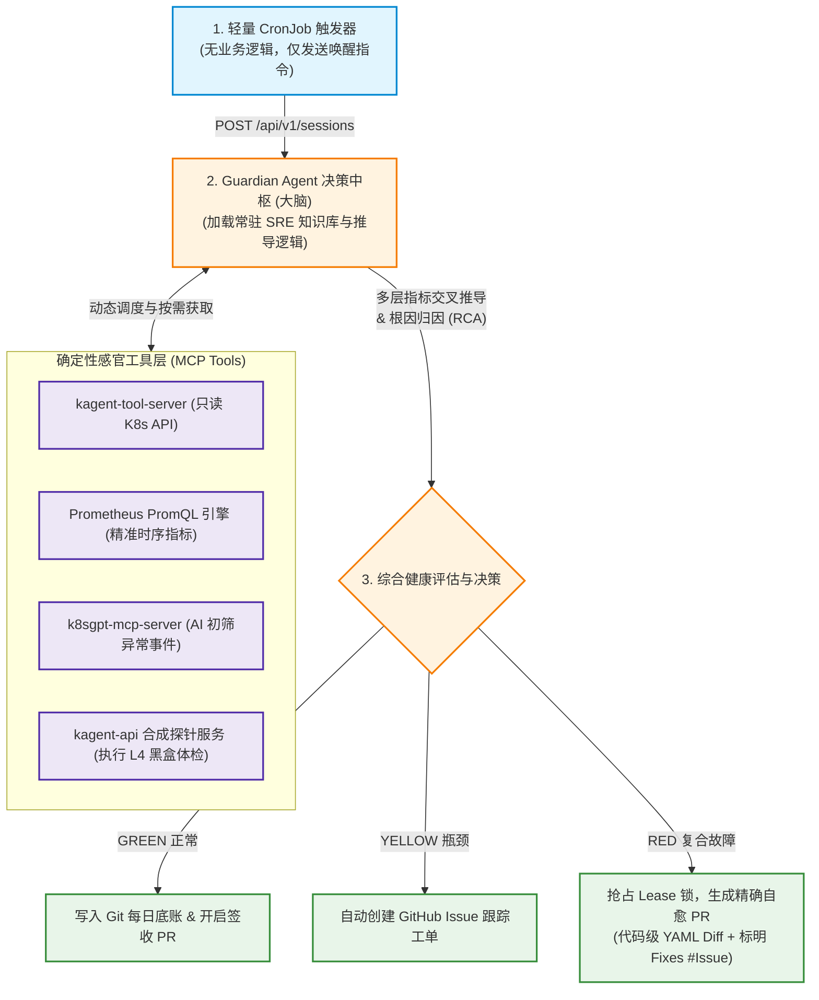
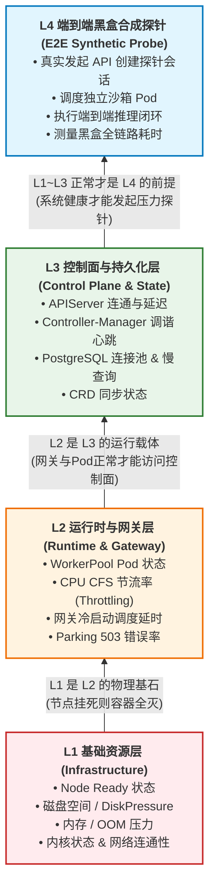
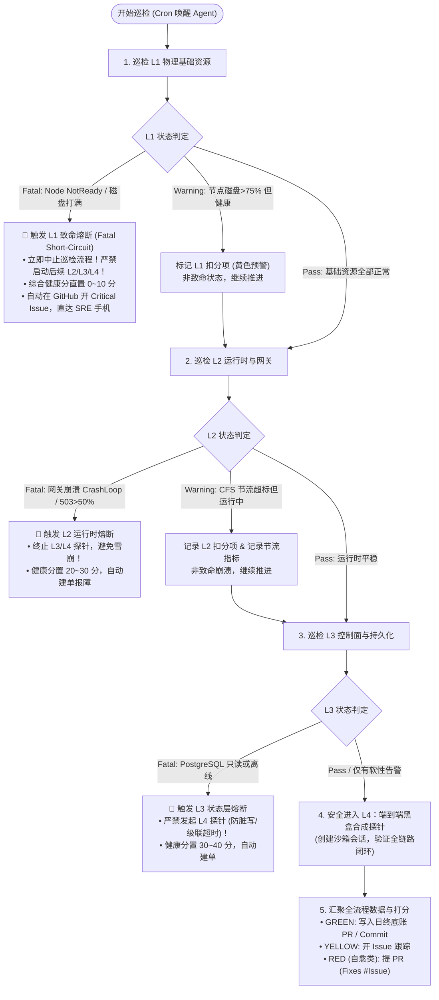
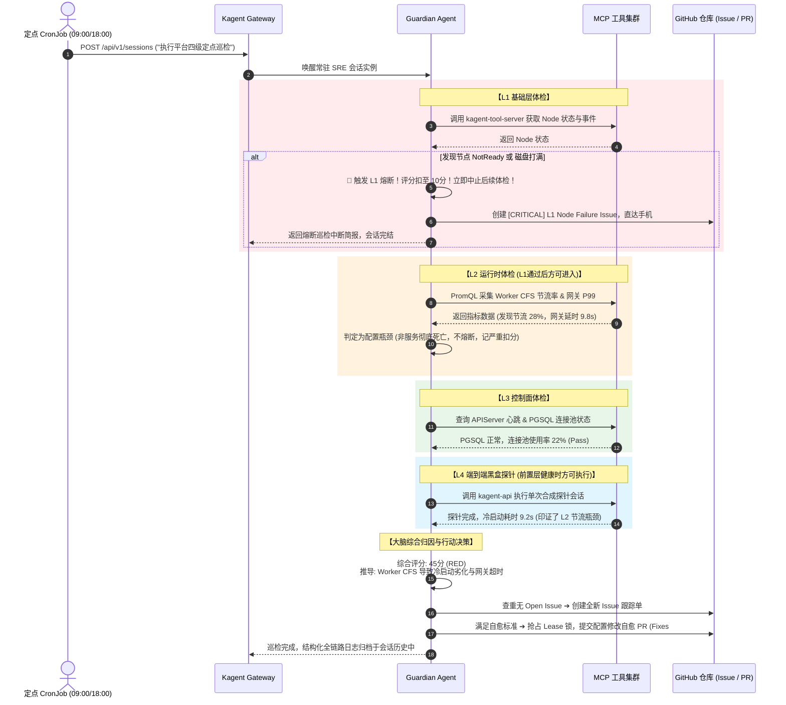

# 10 - L1-L4 巡检执行内核设计：脚本与 Agent 角色定位、阶梯依赖拓扑与熔断短路机制 (Inspection Engine, Agent Role & Circuit-Breaker Architecture)

## 讨论背景与核心论题 (Context & Core Questions)

在深化生产落地实施方案时，运维架构团队提出了两个关乎系统底座命脉的本质问题：
> **论题一（角色与定位）**：“定时的 L1-L4 级别巡检，是不是就是一个 CronJob 自动化脚本，跟大模型/Agent 没关系，只是最后把巡检结果对接给 Agent，让它解读一下形成报告？”  
> **论题二（依赖与熔断）**：“L1 到 L4 巡检有先后顺序吗？有依赖关系吗？比如 L1 物理基础设施 (Infra) 层面就挂了，后面的巡检是不是就直接停了、短路报警了，不再跑后面的检查了？”

本文针对上述问题进行彻底的解构与技术定调，阐明**自动化脚本与大模型 Agent 的能力分工边界**，并给出**严格的四级依赖拓扑与熔断短路机制设计**。

---

## 一、核心论题一：L1-L4 巡检本质是脚本还是 Agent？——三流派辨析与系统定位

很多工程师初次接触 AgentOps 时，往往容易产生两种极端误区：
1. **极端一（虚无主义）**：“Agent 无用论，就是一堆 Bash 脚本跑完，最后丢给 ChatGPT 润色成漂亮的 Markdown 报告。”
2. **极端二（激进主义）**：“Agent 万能论，什么都靠大模型自己写 Prompt 动态去查，底层不用任何确定性工具。”

为了在生产环境中取得**极致的稳定性、低成本与真正的智能推理**，我们对比业界三种架构流派：

| 维度 | 流派 A：静态脚本 + 后置大模型润色 (Script-Probe & LLM-Summarizer) | 流派 B：纯 Agent 动态自主探查 (Pure Autonomous ReAct Agent) | 流派 C (本方案采用)：分层确定性探针 + Agent 深度推理决策引擎 (Hybrid Tiered Probe & Agent Decision Brain) |
| :--- | :--- | :--- | :--- |
| **触发方式** | CronJob 执行大段硬编码 Python/Bash | CronJob 仅作为极简“唤醒闹钟” (POST API) | **CronJob 仅作为极简“唤醒闹钟”** (发送巡检会话指令) |
| **数据采集者** | 硬编码脚本通过 curl/promql 拉取固定指标 | Agent 每一轮通过思维链自主调用工具获取指标 | **确定性 MCP 工具集** (`kagent-tool-server`, `k8sgpt`, `kagent-api`) |
| **动态下钻能力** | ❌ **完全无动态能力**。指标异常时无法自主追查具体 Pod/事件 | ✅ 极强。能像侦探一样按需深度追查 | ✅ **按需自适应下钻**。发现指标异常时，Agent 自主追加调用深层诊断工具 |
| **因果推导 (RCA)**| ❌ 无法做跨层关联。只能罗列孤立数据 | ✅ 具备关联推导，但多轮 Agentic 循环耗时较长 | ✅ **跨层因果图谱关联**。将 L1 资源、L2 节流、L3 数据库与 L4 探针结合推导 |
| **自愈代码生成** | ❌ 只能报错，无法智能生成修复 YAML Diff | ⚠️ 自由发挥可能格式漂移或出现幻觉 | ✅ **严守契约的代码生成**。结合当前状态与历史基准，直接输出合规自愈 PR |
| **Token 消耗** | 极低（仅最后一次总结） | 较高（每一步均消耗 Reasoning Tokens） | **优选平衡**（结构化上下文输入，关键节点高密度推理） |

### 1.1 结论定调：Agent 绝不仅仅是“后置报告解读员”
如果只用脚本跑完丢给大模型写报告，那系统充其量只是一个带皮肤的 Prometheus 告警器。在 Guardian 架构中，**脚本与 Agent 各司其职，形成了“感官神经”与“大脑中枢”的有机协同**：

* **MCP 探针工具是“手和眼”（确定性采集）**：底层指标计算（如 PromQL 计算 15 分钟节流率、Kubernetes API 获取 Pod 状态）绝不能交给大模型去脑补，必须由确定性的 MCP 服务严格执行；
* **Agent 大模型是“中枢大脑”（因果推导与行动决策）**：
  1. **跨层多维因果关联**：脚本只能并列输出“Worker 限流 28%”和“网关 503 超时”两条孤立日志；只有 Agent 能通过知识库理解“*这是由于冷启动排队造成网关 Parking 等待超时*”，并明确指出根因在 Worker Request 配置过小；
  2. **自适应动态补盲**：当发现某指标边缘异常时，Agent 能自主决定追加调用 `get_events` 或 `describe_pod` 进一步收集证据；
  3. **精确的代码合成（Code Synthesis）**：Agent 在判定需要自愈时，能基于当前运行的 CRD Spec，精准生成修改后的 GitOps YAML Diff 并提起 Pull Request。这是任何静态脚本无法灵活做到的。

---

## 二、核心论题二：L1 到 L4 的先后顺序、拓扑依赖与熔断短路机制

关于“L1 到 L4 是否有顺序？底层挂了后面的巡检是不是直接停了？”，答案非常明确：  
**L1 到 L4 存在严格的自底向上拓扑依赖关系，必须执行严格的“短路熔断机制（Short-Circuit / Circuit-Breaker Pattern）”！**

### 2.1 四级巡检的物理依赖链 (Strict Bottom-Up Dependency)

### 2.2 为什么必须短路？——严防“火上浇油（Cascading Failure）”
如果底层 L1 节点已经发生 `DiskPressure`、CPU 100% 锁死或大量 Pod 处于 Evicted 状态：
* **短路的必要性一（避免数据失真与误判）**：底座断裂时，上层 L2/L3/L4 的所有失败（如探针 503 超时、沙箱拉起失败）都是 L1 故障的**次生衍生现象**。如果不加短路，告警系统会瞬间涌出数十个涵盖 L2、L3、L4 的并发假告警，掩盖真实的 L1 宿主机故障；
* **短路的必要性二（严防加剧系统雪崩）**：**L4 探针是主动出击的黑盒测试**（会调用 API 创建真实的临时 Agent 会话与沙箱容器）。当底层宿主机或网关已经接近宕机时，继续强行执行 L4 探针，等于向濒临崩溃的集群强行注入新的调度与内存负载，形成致命的**级联击穿（Thundering Herd / Cascading Failure）**！

---

## 三、三级熔断短路状态机设计 (Circuit-Breaker State Machine)

### 3.1 熔断分级与处置矩阵 (Short-Circuit Policy Matrix)

| 巡检层级 | 触发熔断的硬性条件 (Fatal Breakers) | 熔断动作 (Action) | 跳过后续层级 | 最终分值区间 | 自动化处置动作 |
| :--- | :--- | :--- | :---: | :---: | :--- |
| **L1 基础资源层** | • 任意核心 Node 处于 `NotReady` • 节点存在 `DiskPressure` 或根分区爆满 • 核心网络组件 (CoreDNS) 全灭 | **强制熔断** | **跳过 L2, L3, L4** | **0 ~ 15 分** | 立即通过 GitHub 提 Critical Issue；手机端强推送；绝不启动合成探针。 |
| **L2 运行时层** | • Gateway Pod 处于 `CrashLoopBackOff` • 网关 503 错误率 > 50% 且无法恢复 • 宿主机 Cgroup 驱动崩溃 | **强制熔断** | **跳过 L3, L4** | **15 ~ 30 分** | 判定网关不可用，跳过探针防止积压死连接；自动建单追踪。 |
| **L3 控制面层** | • PostgreSQL 宕机或变为只读 • K8s APIServer 响应超时率 > 60% | **强制熔断** | **跳过 L4** | **30 ~ 45 分** | 严禁发起 L4 探针（防止写入脏会话和引发级联锁超时）；建单报障。 |
| **L4 黑盒探针层** | • 合成探针沙箱冷启动超时 (>15s) • 探针执行返回非 200 状态码 | **常规判定** | 无后续层级 | **45 ~ 60 分** | 判定系统可用性受损；触发根因追查；根据规则创建自愈 PR 或 Issue。 |

---

## 四、生产巡检交互时序完整拓扑 (Sequence Topology)

---

## 五、总结与核心共识 (Summary & Consensus)

1. **角色界限清晰明确**：
   - **自动化脚本 / CronJob**：仅仅是“没有思维的定时闹钟”，负责准点发出一条唤醒指令；
   - **MCP 工具集**：是“感官与手脚”，负责执行确定性的 PromQL 和 Kubernetes API 调用，保证底层数据的精确无误；
   - **Guardian Agent**：是“决策中枢与侦探大脑”，负责**因果链关联（RCA）、动态追查补盲、工单 Issue 生成、自愈代码合成与 PR 提交**。
2. **阶梯依赖与短路熔断坚如磐石**：
   - 严格遵循 `L1 ➔ L2 ➔ L3 ➔ L4` 的自底向上依赖链；
   - 遭遇底层致命故障（如物理节点故障或网关宕机）时，**无条件触发短路熔断（Fast-Fail）**，严禁触发 L4 黑盒探针，既保护故障集群不发生二次击穿雪崩，又确保报警精准直击根本原因。
