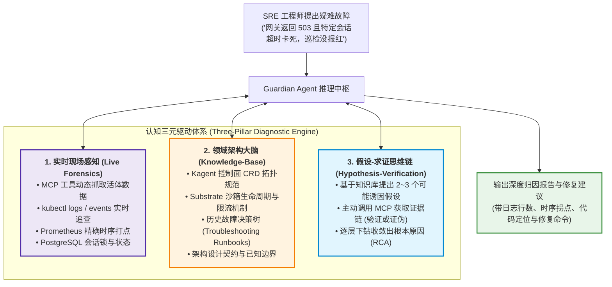
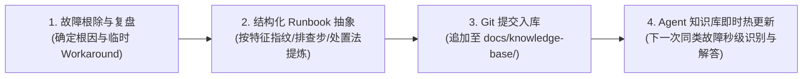
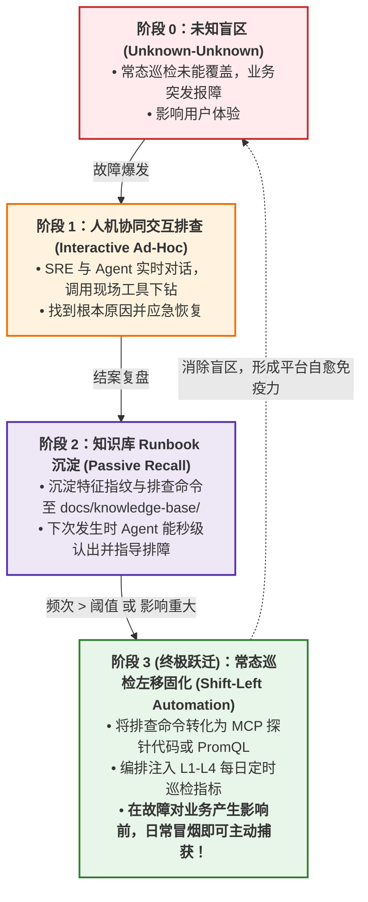
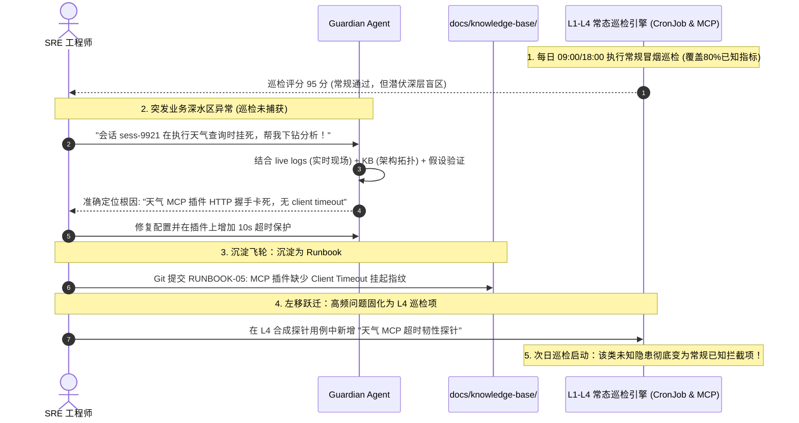

# 11 - 交互式深度排障机制、知识沉淀飞轮与“被动排障向常态巡检左移”演进体系 (Interactive Diagnosis, Knowledge Flywheel & Shift-Left Evolution)

## 讨论背景与核心论题 (Context & Core Inquiries)

在探讨了 L1-L4 定点巡检的自动化内核与短路机制后，运维架构团队进一步提出了关乎日常突发排障与系统长期进化的三大深层问题：
> **议题一（排障支撑机制）**：“定点巡检就像是日常的冒烟测试（Smoke Test），只能覆盖标准通病。如果遇到了巡检没发现的长尾、未知或复杂深水区问题，SRE 主动向 Agent 提问求助时，Agent 究竟是通过什么来进行分析的？是单纯依靠 `knowledge-base` 里的文档知识吗？”  
> **议题二（知识沉淀闭环）**：“当我们与 Agent 协同解决了这个疑难问题之后，是不是就可以把解决过程和经验沉淀追加到 `knowledge-base` 中，供后续参考？”  
> **议题三（常态巡检左移）**：“某些常见问题如果发生频率变高了，是不是也可以总结沉淀，进而反哺修改 L1-L4 的巡检流程，让日常巡检就能直接把这类问题提前捕获出来？”

本文对上述问题进行系统化拆解，给出 **交互式深度排障的“认知三元驱动”机制**、**故障知识沉淀飞轮**，以及 **“从被动交互排障向主动常态巡检左移（Shift-Left）”的工程化落地演进规范**。

---

## 一、议题一：巡检之外的疑难杂症，Agent 究竟靠什么进行深度分析？

**核心结论：Agent 绝对不是只对着 `knowledge-base` 里的静态文档“读死书”！**  
单纯靠文档的大模型只是一个离线聊天机器人；而作为原生 SRE 的 Guardian，其深度排障能力由**“实时现场感知”、“领域认知大脑”与“假设求证思维链”三位一体驱动**：



### 1.1 认知三元驱动的职能解耦

1. **第一支柱：实时现场感知（Live Forensics via MCP Tools - 证据链来源）**
   - 静态文档绝不可能知道“当前集群哪个 Pod 刚才发生了 OOM”、“会话 ID `sess-8891` 在 14:22:01 打印了什么堆栈”。
   - 当工程师提问时，Agent 会立即通过 `kagent-tool-server`、`k8sgpt` 或 Prometheus 工具：
     - 拉取目标 Pod 最近 200 行实时日志；
     - 检索对应时段的 Kubernetes Warning Events；
     - 查询 PostgreSQL 中对应 `session_id` 的状态流转时间戳与报错详情。
2. **第二支柱：领域架构大脑（Domain Knowledge-Base - 判定基准与心智模型）**
   - 现场抓到的日志通常晦涩冗长。大模型之所以能看懂，依赖于 `docs/knowledge-base/` 中的结构化知识：
     - 它知道 Kagent Gateway 的 `Parking Mechanism`（网关等待 Worker 调度的挂起机制）最大超时时间是多少；
     - 它知道 Substrate 沙箱如何挂载 Cgroup，以及 CFS 节流是如何影响 Python 进程 GIL 锁释放的；
     - 它知道特定错误日志（如 `failed to acquire actor lease`）对应哪个 CRD 控制器的调谐行为。
3. **第三支柱：假设-求证思维链（Hypothesis-Driven CoT Reasoning - 侦探式下钻）**
   - 资深 SRE 排障不是漫无目的地乱看，而是先提出假设再验证。Agent 亦是如此：
     - *假设 A*：数据库死锁？-> 调用工具查 PG 锁等待 -> 发现无锁，**排除假设 A**；
     - *假设 B*：Worker 内存溢出触发 Linux OOM Killer？-> 调用工具查 dmesg 和 exit code -> 发现容器状态正常退出码非 137，**排除假设 B**；
     - *假设 C*：第三方模型上游接口偶发 Reset 导致流式读取 Hanging？-> 查网关 Socket 状态 -> 发现大量 `CLOSE_WAIT` -> **命中真实根因**！

---

## 二、议题二：解决疑难问题后，如何将经验沉淀到 Knowledge-Base 形成持久资产？

**答案是：完全正确，必须严格将排障成果沉淀为规范化的 Runbook，并归档至 `docs/knowledge-base/`！**  
这构成了系统从“一次性人工救火”向“平台永久性数字免疫力”转化的**知识沉淀飞轮（Knowledge Accumulation Flywheel）**。

### 2.1 故障复盘沉淀标准四步法 (Post-Mortem Runbook Pipeline)



### 2.2 标准排障手册模板规范 (Runbook Schema)
当团队解决了一个巡检未捕获的棘手问题后，应严格按照统一规范（如追加到 `docs/knowledge-base/03-TROUBLESHOOTING_RUNBOOKS.md`）进行沉淀：

```markdown
### RUNBOOK-04: [故障简短命名，例：网关流式响应挂起导致 CLOSE_WAIT 泄露]

- **故障特征指纹 (Symptom Signatures)**:
  - 外部现象：客户端会话无规律超时报 504，网关内存缓慢爬升；
  - 巡检盲区：常规 L1-L3 CPU 与内存水位未触碰告警线，L4 探针因单次短会话未能捕捉长流式泄露。
- **快速诊断排查步 (Diagnostic Commands)**:
  1. 调用 `kubectl exec` 检查网关网络连接：`ss -s | grep CLOSE_WAIT`，若连接数 > 200 则命中；
  2. 检索网关日志中特定正则：`grep "upstream connection reset by peer" | grep "stream_transport"`。
- **根因机制剖析 (Root Cause Mechanism)**:
  - 当大模型推理服务断开连接时，Gateway 的 TCP Socket 未能触发析构，导致连接池句柄泄露与内存锁死。
- **应急处置措施 (Emergency Workaround)**:
  - `kubectl rollout restart deployment/agentgateway -n kagent`。
- **根本根治方案 (Permanent GitOps Fix)**:
  - 在网关配置中增加 `read_timeout: 60s` 与 `tcp_keepalive: true`。
```

沉淀之后，当下一次任何工程师或调度机制出现类似报错现象时，Guardian Agent 会在毫秒级从知识库中检索并匹配到该指纹，立刻向工程师输出标准诊断建议，排障时间从数小时缩短至 2 分钟！

---

## 三、议题三：高频常见故障如何“左移”，反哺升级 L1-L4 常态巡检流程？

沉淀到知识库只是**“被动防御（Passive Defense）”**——必须等故障发生、有人提问时，Agent 才会去解答。  
**生产工程的最高境界是“主动防御（Shift-Left Active Prevention）”：当某个问题发生频率较高（如一个月出现 2 次以上）或业务影响严重时，必须启动“左移机制”，将其从知识库的排查条目，直接升级为 L1-L4 巡检流水线中的常规指标或探针项！**

### 3.1 从“事后排障”向“常态巡检”的四级左移演进模型 (Four-Stage Evolution Model)



### 3.2 故障如何具体落实到 L1-L4 巡检项的改造？(Concrete Shift-Left Mapping)

当团队决定将某个高频问题“左移”至常态巡检时，应根据故障发生层级，将其编排进对应的巡检阶梯：

| 故障历史形态 (案例) | 原排查方式 (知识库阶段) | 左移目标层级 | 自动化改造动作 (Engineering Implementation) |
| :--- | :--- | :---: | :--- |
| **内核 conntrack 连接表打满导致偶发丢包** | 工程师提问 Agent -> Agent 执行 `dmesg \| grep conntrack` 确认 | **L1 基础资源层** | 在 `kagent-tool-server` 中增加宿主机内核 conntrack 使用率指标探查（若使用率 > 80% 计黄色预警，>90% 计红色扣分）。 |
| **网关长连接泄漏 (CLOSE_WAIT 激增)** | 工程师提问 Agent -> Agent 查网关 Socket 状态排查 | **L2 运行时层** | 在 Prometheus 巡检指标中，新增 PromQL：`node_sockstat_TCP_close_wait` 或在网关健康检查中增加连接数阈值判定。 |
| **PG 事务挂起死锁 (idle in transaction)** | 工程师报障会话变慢 -> Agent 查数据库活动视图 | **L3 控制面与持久化层** | 在 L3 巡检中追加确定性 MCP 工具查询：`SELECT count(*) FROM pg_stat_activity WHERE state = 'idle in transaction' AND state_change < now() - INTERVAL '5 min'`。若 > 0 直接开单报警。 |
| **特定长文本/高并发 Tool Calling 超时挂死** | 业务反馈特定场景无响应 -> Agent 分析 Trace 链条 | **L4 黑盒端到端探针** | 在 `kagent-api` 的单次合成探针用例库中，**新增一个对应的“复杂工具调用”黑盒用例**，作为定点巡检的必测场景！ |

---

## 四、全生命周期演进闭环总结 (End-to-End Lifecycle Summary)



### 4.1 核心价值定调
1. **Agent 的排障能力是立体的**：`现场活体遥测 (MCP Tools) + 领域知识基座 (Knowledge-Base) + 假设验证思维链 (Reasoning CoT)`，三者缺一不可；
2. **知识库是动态进化的活资产**：日常排查解决的问题，必须通过统一的 Runbook 规范回写进 `docs/knowledge-base/`；
3. **巡检流水线是自愈生长的**：知识库中的高频或高危问题，通过“左移机制”转化为 L1-L4 的代码化指标与黑盒测试用例，推动平台数字免疫力螺旋式上升！
