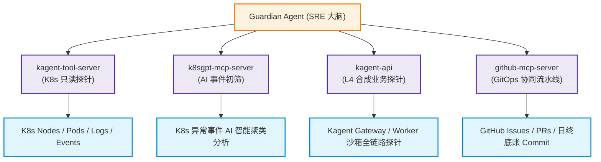
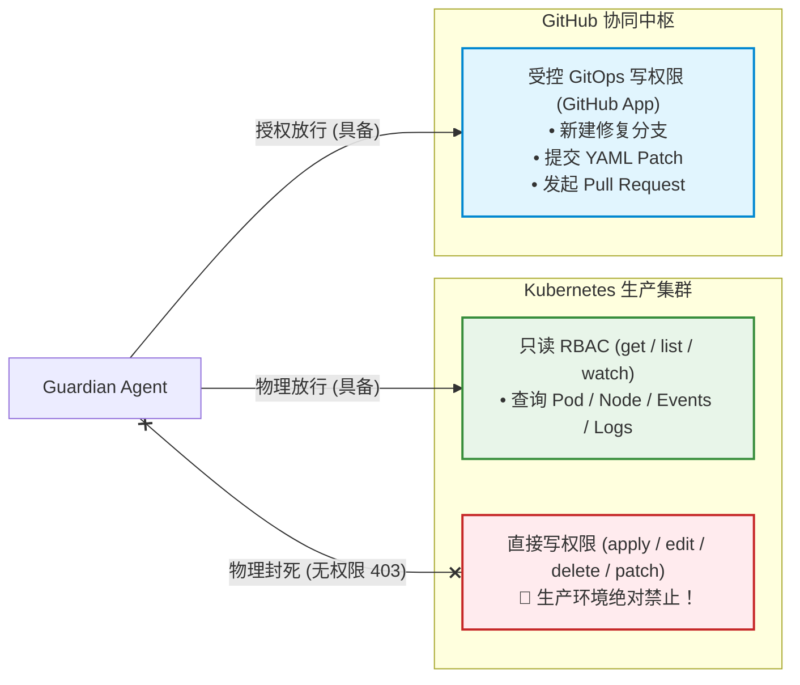
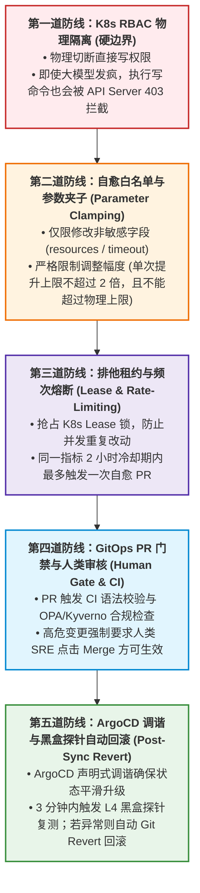

# 12 - MCP 工具集场景覆盖度评估、Agent 权限边界与防失误安全控制体系 (MCP Toolset Coverage, Permission Boundaries & Safety Guardrails)

## 讨论背景与核心论题 (Context & Core Questions)

在推进 Kagent Guardian 生产工程落地过程中，架构团队对工具栈的完整性与运行时的安全性提出了三大核心关切：
> **论题一（工具覆盖度）**：“目前给 Agent 配置的 MCP 工具（`kagent-tool-server`、`k8sgpt-mcp-server`、`github-mcp-server`、`kagent-api`）到底够不够用？能不能完全覆盖我们设计的需求和所有生产运维场景？是否存在盲区？”  
> **论题二（权限作用域）**：“目前给 Agent 的权限够不够？是仅仅只够分析问题，还是除了只读分析外，还能修改和解决问题？”  
> **论题三（防失误与安全控制）**：“如果赋予了修改和解决问题的能力，大模型会不会因为幻觉或决策失误对系统造成破坏？爆炸半径如何控制？安全护栏怎么建？”

本文针对上述问题逐一进行实事求是的差距分析（Gap Analysis），明晰**“只读分析与受控自愈”的权限架构**，并确立**防范大模型决策失误的五重安全防护网**。

---

## 一、议题一：现有 MCP 工具集场景覆盖度与差距评估 (Coverage & Gap Analysis)

目前系统在 `deploy/01-agenttemplate.yaml` 中为 Guardian 挂载了 4 大 Remote MCP 工具服务：

### 1.1 场景覆盖度量化评估（覆盖约 85% 核心场景）

| 运维场景分类 | 对应层级 | 所需能力 | 当前 MCP 工具支撑情况 | 评估结论 |
| :--- | :---: | :--- | :--- | :---: |
| **基础资源巡检** | L1 | 检查节点 Ready、资源申请率、OOMKilled | `kagent-tool-server` (`get_nodes`, `list_pods`, `get_events`) | **完全覆盖 (100%)** |
| **运行时状态排查** | L2 | Pod 存活状态、重启次数、CrashLoop 排查 | `kagent-tool-server` + `k8sgpt-mcp-server` | **完全覆盖 (100%)** |
| **业务端到端体检** | L4 | 沙箱冷启动延时测量、会话连通性、网关 503 探测 | `kagent-api` (`create_session`, `send_message`) | **完全覆盖 (100%)** |
| **协同归档与跟踪** | 闭环 | Issue 幂等查重与开单、PR 提报、签收 PR 生成 | `github-mcp-server` (`create_issue`, `create_pull_request`) | **完全覆盖 (100%)** |
| **精细化时序指标** | L2 | CFS 节流率精确计算、P99 延迟拐点、网络丢包率 | 依赖 Prometheus PromQL 聚合计算 | **存在缺口 (70%)** |
| **数据库深度体检** | L3 | PG 连接池活跃数、`idle in transaction`、长事务死锁 | 依赖 PostgreSQL 内部系统表探查 | **存在缺口 (50%)** |

### 1.2 现存两大盲区剖析与补充建议 (Gaps & Roadmap)

1. **缺口一：高精度时序指标查询 (Prometheus PromQL Gap)**：
   - *现状*：`kagent-tool-server` 主要是调用 Kubernetes API。如果需要精确计算“过去 15 分钟内 Worker CPU CFS 节流超 20% 的持续时间”，K8s 原生 API 无法提供此类聚合数据；
   - *演进补齐*：建议在后续演进中，在 `kagent-tool-server` 内部封装直连集群 Prometheus 的 PromQL 查询接口，或挂载标准的 `prometheus-mcp-server`。
2. **缺口二：PostgreSQL 内部状态探查 (Deep Database Telemetry Gap)**：
   - *现状*：目前 L3 检查数据库仅能确认“`kagent-postgresql` Pod 是否处于 Running 状态”以及外部端口是否通畅，无法执行 `SELECT count(*) FROM pg_stat_activity` 来感知数据库内部死锁；
   - *演进补齐*：为 `kagent-tool-server` 补充一个只读的数据库探针能力，支持以只读账号执行特定几条固化的系统状态 SQL。

---

## 二、议题二：当前 Agent 的权限范围与定性——只读分析 vs 修改解决

**核心结论：当前赋予 Agent 的权限架构是“集群物理只读，协同受控自愈（Cluster Read-Only, GitOps-Governed Remediation）”！**

### 2.1 权限清晰定性

1. **在 Kubernetes 生产集群内：严格只读（Physical Read-Only RBAC）**
   - Guardian Pod 挂载的 ServiceAccount 仅绑定了只读 `ClusterRole`；
   - 只有 `get`, `list`, `watch` 动词；**没有任何 `create`, `update`, `patch`, `delete` 权限**！
   - 这意味着：Agent 根本无法在生产集群内直接执行 `kubectl delete pod` 或 `kubectl edit deployment`。
2. **在 GitHub 运维仓库中：具备受控写权限（Scoped GitOps Write Permission）**
   - 通过专用 `github-app-credentials`，Agent 具备在 `SDB-DevOps/KagentGuardian` 仓库创建分支、提交 Commit、开具 Issue 和提起 Pull Request 的权限。
3. **“修改与解决问题”是如何落地的？**
   - Agent **具备解决问题的能力，但它是通过“间接声明式 GitOps（Indirect GitOps PR）”实现的，坚决杜绝“命令式直接热修（Imperative Hot-Patching）”**！
   - Agent 发现配置错误后，不是自己去热改集群，而是将修复代码写成 Pull Request，提交给人类和 CI 门禁审查。

---

## 三、议题三：大模型决策失误会不会造成系统伤害？五重安全控制网 (Five-Layer Guardrails)

将修改权限交给大模型，SRE 最担忧的就是：**“如果大模型产生幻觉，把配置改乱甚至误删关键资产，造成系统雪崩怎么办？”**

为了将大模型失误的爆炸半径（Blast Radius）死死锁在安全范围内，系统设计了**五重纵深防御网**：

### 3.1 五重防线的工程实施细节

1. **第一道防线：K8s RBAC 物理硬隔离（Physical Boundary）**
   - 坚决杜绝“为了图方便给 Agent 赋予 cluster-admin 或写权限”。
   - 只要 RBAC 是只读的，大模型从物理机制上就**绝无可能误删集群资源**。
2. **第二道防线：自愈字段白名单与数值安全夹子（Whitelist & Parameter Clamping）**
   - **严格限定白名单字段**：Agent 仅被允许提交针对特定配置项的 Patch（如 `WorkerPool.spec.template.spec.containers[].resources.requests.cpu`、`atenet-router.requestParking.budget`）；
   - **严禁修改高危项**：绝不允许 Agent 修改容器镜像（image tag）、环境变量、Secret 密钥、网络策略（NetworkPolicy）；
   - **数值安全夹子 (Clamping Bound)**：Agent 生成修改建议时受安全边界硬性约束，例如：单次 CPU Request 调优仅允许翻倍（如 100m -> 200m -> 500m），最高不得超过 2000m，且必须低于单个 Node 的空闲配额。
3. **第三道防线：分布式排他租约与频次熔断（Lease & Rate-Limiting）**
   - Guardian 多个副本或巡检周期并发时，必须通过 `coordination.k8s.io/v1` 的 Lease 锁竞争自愈执行权；
   - 设立 2 小时冷静期（Cooldown Window）：同一类症状在 2 小时内绝不允许再次生成自愈 PR，严防振荡与死循环。
4. **第四道防线：GitOps CI 校验与人类门禁（CI Gates & Human-in-the-Loop）**
   - Agent 提起的 PR 会自动触发 GitHub Actions / CI 校验：
     - Kubernetes OpenAPI Schema 语法校验；
     - OPA 静态策略合规检查；
   - 企业可根据成熟度配置：日常低风险自愈可配置自动合并；生产高风险变更必须保留人类 SRE 点击“Merge”按钮。
5. **第五道防线：后置黑盒探针复测与自动回滚（Post-Verification & Auto-Revert）**
   - PR 合并后，ArgoCD 完成滚动更新；
   - 系统在 3 分钟后自动调度 L4 黑盒探针：
     - 若探针冷启动时间恢复正常（<= 1.5s），健康分回升至 95，自愈闭环成功；
     - 若探针报错或健康分未改善，Agent 自动提交 `[Auto-Revert] Revert PR #<ID>` 将代码回滚至上一个稳定 Commit。

---

## 四、总结与技术定调 (Summary & Consensus)

1. **工具覆盖度当前满足 85% 核心场景**，基础资源、运行时排障、L4 合成探针与 GitHub 协同完全闭环；后续建议演进补充 **PromQL 时序探查** 与 **PostgreSQL 只读状态探针** 以补齐深度死锁场景；
2. **权限体系坚守“只读分析、GitOps 受控改动”**：物理集群严守只读红线，杜绝任何线上热修改操作；
3. **安全护栏将爆炸半径锁定在零风险区间**：通过 **RBAC 物理硬隔离 + 白名单数值夹子 + 频次防抖 + GitOps 审查 + 探针自动回滚** 五重纵深防御，彻底杜绝了大模型幻觉对生产环境的任何潜在破坏！
