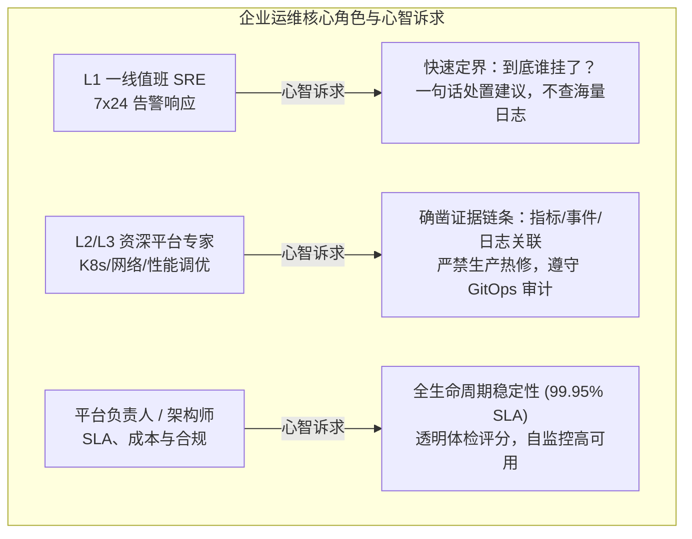

# Kagent 平台客户需求与运维痛点深度分析报告

> **文档标识**：`DOC-REQ-01`  
> **所属项目**：Kagent Guardian 平台运维与自愈智能体  
> **面向对象**：企业基础设施架构师、云计算平台团队、SRE / 运维负责人、AI 平台运营团队  
> **核心宗旨**：站在大中型企业（金融、制造、运营商等）私有化或混合云落地 Kagent 智能体平台的真实生产视角，剖析一线运维心智与运维困境，提炼高可用运维的关键业务需求与技术指标。

---

## 一、客户背景与角色心智模型

随着生成式 AI（GenAI）与智能体系统（Agentic System）从实验室原型走向企业核心业务链，客户对平台的要求已经从“能跑通 Demo”转变为“具备生产级稳定性、可解释性与可运维性”。

在典型的企业客户组织架构中，Kagent 平台交付后主要涉及三类关键运维角色，其关注视角与痛点心智存在显著差异：



### 1.1 角色画像与核心诉求拆解

| 角色画像 | 核心职责 | 典型运维动作 | 最强烈的诉求与心智壁垒 |
| :--- | :--- | :--- | :--- |
| **L1 一线值班运维 (First-Line SRE)** | 7×24 监控值班、应急响应、工单初筛与流转。 | 查看仪表盘红绿灯、响应短信/PagerDuty 告警、执行基础重启。 | **“别让我去记 20 多个底层 CRD 名字和 kubectl 级联参数！直接告诉我哪个组件坏了、该联系算法团队还是平台团队、重启有没有丢数据风险？”** |
| **L2/L3 平台运维专家 (Senior SRE / DevOps)** | 故障深挖（RCA）、底层性能调优、容量规划、网络与沙箱排障。 | 深度分析日志、Prometheus 指标关联、排查 CFS 调度截流、排查 MCP 连通性。 | **“不要给我大模型模棱两可的推测！给我硬证据（指标、日志行、错误码、时间戳）；更不要直接在生产里瞎改，必须符合 GitOps 规范！”** |
| **企业 AI 平台负责人 (Platform Owner)** | 平台 SLA 达成、安全合规、算力成本控制、研发团队满意度。 | 审查架构稳定性、防范安全越权、应对审计检查、规划扩容。 | **“平台要有透明可量化的健康体检体系；绝不能出现平台全瘫了监控却无动于衷的事故；运维动作必须 100% 留痕合规。”** |

---

## 二、生产现场 8 大运维痛点深度剥离 (The 8 Operational Pain Points)

在对客户生产与 POC 真实排障场景进行复盘后，我们梳理出企业运维 Kagent 时最为痛楚的 8 个核心盲区与难点：

```
┌────────────────────────────────────────────────────────────────────────┐
│                        8 大客户核心运维痛点全景图                      │
├────────────────────────────────────────────────────────────────────────┤
│ [P-01 黑盒不可见] 资源表面健康 vs 业务会话全面瘫痪 (L1-L4 脱节)       │
│ [P-02 级联链路长] Agent 卡在 Ready:False 难以逆向定位四大 CRD 与沙箱   │
│ [P-03 偶发超时谜] 503 超时背后 CFS 截流、网关排队与冷启动多因素交织   │
│ [P-04 MCP 生态碎] MCP Server 进程存活但工具调用链路静默断裂           │
│ [P-05 故障归属混] 外部 LLM 限流 (429/500) 导致平台“代人受过”         │
│ [P-06 突发并发崩] 多租户临时代码沙箱抢占导致 Controller 心跳丢失雪崩 │
│ [P-07 临时热改乱] 手工热打补丁导致配置漂移并破坏 GitOps 单一源        │
│ [P-08 监控自盲区] Agent 运行在被监控平台上，自身挂死导致报警全瘫痪    │
└────────────────────────────────────────────────────────────────────────┘
```

### P-01：黑盒不可见——“基础监控全绿，业务 Agent 却全面宕机”
* **现场再现**：客户基础监控（Node Exporter、K8s Dashboard）显示 CPU 占用 15%、内存 30%、所有 Pod 均为 `Running`。然而前端研发报告业务助手全部报错 500/503。
* **痛点本质**：**基础资源层（L1）与业务应用层（L4）严重脱节**。Kagent 运行高度依赖内部 Substrate 沙箱调度、A2A 协议总线与 Gateway 会话保活。Pod 处于 `Running` 状态绝不等于其内部的 Actor 已经就绪并能响应 RPC。
* **影响后果**：L1 SRE 误认为底层无恙，故障在研发与运维之间反复推诿，平均故障定位时间（MTTD）长达 2 小时以上。

### P-02：级联链路长——“新建 Agent 长期卡在 Ready: False，翻遍手册无从下手”
* **现场再现**：在 Kagent 控制台或提交 YAML 创建 Agent，状态持续显示 `Ready: False`，无任何用户友好的提示。
* **痛点本质**：Kagent 采用了高度分层的领域模型（`Agent -> AgentTemplate -> Harness/Runtime -> ModelConfig/Secrets`）。任何一个节点配置错误（如 ModelConfig 中的 Secret 名称拼错、Harness 镜像拉取超时、Template 引用的 Tool 不存在），都会导致状态机挂起，但错误信息深埋在 Controller Manager 几万行控制流日志或底层 K8s Event 中。
* **影响后果**：企业开发人员频繁抱怨平台不可用，对 Kagent 产生信任危机。

### P-03：偶发超时谜——“会话时常报 503 超时，抓不到必然复现路径”
* **现场再现**：用户在聊天界面提问，偶发性出现 15 秒转圈后弹出 503 网关错误。过几分钟再次提问却又恢复正常。
* **痛点本质**：这是典型的**混合微架构资源竞争连锁反应**：
  1. Linux 内核 CFS（Completely Fair Scheduler）对沙箱容器分配了过低的 `cpu.cfs_quota_us`，导致密集运行时 CPU 被硬件级限流（CFS Throttling）；
  2. 网关层（AgentGateway）默认配置了 15 秒请求驻留等待超时（Request Parking）；
  3. 若恰逢沙箱冷启动（Cold-start Pull）或长文本上下文加载，总时延突破 15 秒阈值，网关强制中断连接，返回 503。
* **影响后果**：偶发故障无法稳定复现，传统 APM 工具抓取不到端到端跨进程延迟链条，资深运维被迫花费数天抓包分析。

### P-04：MCP 生态碎——“MCP Server 显示 Running，但业务工具调用一律失败”
* **现场再现**：运维查看 `k8sgpt-mcp-server`、`github-mcp-server` Pod 均运行正常，但智能体在执行工具调用时返回“Tool call failed or empty response”。
* **痛点本质**：MCP（Model Context Protocol）是基于 JSON-RPC 的动态协议，涉及多层契约：
  1. MCP 网关鉴权 Token 是否过期；
  2. MCP 暴露的工具 Schema 是否与当前大模型上下文窗口或格式约束兼容；
  3. MCP 依赖的下游后端服务（如 GitHub API 限流、K8s API 限速）出现异常。
  单纯监控进程存活性（Liveness Probe）无法反映 MCP 工具链的真实健康度。
* **影响后果**：智能体退化为只能打字聊天的废柴，无法执行任何企业自动化动作。

### P-05：故障归属混——“外部模型提供商波动，企业平台背黑锅”
* **现场再现**：业务大面积报“Agent 响应极慢甚至无输出”，各业务线群起质问平台运维团队为何平台又崩了。
* **痛点本质**：外部上游模型服务商（如 OpenAI、Azure OpenAI、Anthropic、Google Cloud）遭遇限流（HTTP 429 Rate Limit）或服务端降级（HTTP 500/504），甚至是 API Key 额度耗尽。由于平台缺乏前置网络隔离指标与外部链路合成探针，导致内部网络与外部依赖故障混为一谈。
* **影响后果**：平台运维人员疲于奔命排查本地集群，最终发现是公网第三方供应商故障，造成极大的人力浪费。

### P-06：突发并发崩——“高并发任务激增，直接拖垮 Kagent 控制面”
* **现场再现**：多个研发团队同时批量触发长耗时任务，平台瞬间创建数十个 Substrate 临时沙箱容器，随后不仅新建任务失败，连已有的巡检和 Web 控制台也失去响应。
* **痛点本质**：沙箱池缺乏严密的并发队列与配额硬隔离机制。突发算力需求耗尽了 Node 节点的 CPU/内存，导致 Kagent Controller Manager、Gateway 甚至 Kubelet 的保活探针因无法获得 CPU 周期而超时，K8s 判定其死亡并触发震荡驱逐（Pod Eviction），引发系统雪崩。
* **影响后果**：单租户的突发滥用破坏了全平台的可用性，违背企业多租户安全与 SLA 保障原则。

### P-07：临时热改乱——“运维紧急 kubectl edit，后续变更全打架”
* **现场再现**：半夜排障时，资深运维登录节点直接通过 `kubectl edit` 修改了 Pod 资源配额或环境变量以恢复业务。次日 CI/CD 或 ArgoCD 重新同步时，未被记录的配置被自动覆盖，故障再度爆发；或者导致开发环境与生产环境配置永久漂移。
* **痛点本质**：缺乏声明式自愈机制。在生产环境直接进行手工“热补丁（Hot-Patching）”违背了现代 GitOps（单一事实源）规范，丢失了配置审计、变更回溯与安全 Review 流程。
* **影响后果**：生产环境黑盒化，配置难以复现，严重触犯金融与大型企业的生产变更合规红线。

### P-08：监控自盲区——“平台自身挂了，跑在平台里的巡检 Agent 如何报警？”
* **现场再现**：Kagent 核心控制器挂死或数据库崩溃，此时用户向运维助手发消息，界面因通信中断根本无响应。值班人员未能收到任何警报，直到业务领导打来质询电话。
* **痛点本质**：**自监控与自诊断架构的内生悖论**。当巡检智能体完全寄宿于它所监护的平台本身时，一旦平台发生全局瘫痪，智能体自身也将被“连坐”致死，彻底丧失报警和自愈能力。
* **影响后果**：平台失去第一时间的灾难预警机制，SRE 处于完全盲目状态。

---

## 三、客户需求转化矩阵 (Functional & Non-Functional Requirements)

基于上述 8 大运维痛点，我们将企业客户的核心痛点逐一映射为可落地的系统功能需求（FR）与非功能需求（NFR）：

### 3.1 功能需求矩阵 (FR)

| 需求编号 | 对应痛点 | 需求名称 | 核心能力描述 | 验收与落地载体 |
| :--- | :--- | :--- | :--- | :--- |
| **FR-01** | P-01, P-05 | **L1-L4 阶梯式全景巡检** | 具备从物理资源、容器状态、平台控制面到端到端会话合成探针（Synthetic Probing）的分级体检能力。 | `inspect_platform_health` MCP 工具 + 四级健康度巡检流。 |
| **FR-02** | P-02 | **CRD 拓扑逆向依赖下钻** | 给定异常 Agent 名称，自动递归遍历提取 Template、Harness、ModelConfig 与 Secret，精确定位阻断环节。 | `diagnose_agent_failure` MCP 工具 + CR 依赖图谱解析。 |
| **FR-03** | P-03, P-06 | **CFS 算力与调度性能分析** | 实时采集容器 CFS 截流比率（`container_cpu_cfs_throttled_periods_total`），关联网关延时与冷启动耗时。 | `kagent-tool-server` 指标抓取 + 瓶颈参数调优决策树。 |
| **FR-04** | P-04 | **MCP 生态链路健康探测** | 支持对所有注册的 MCP Server 进行动态握手连通性、Schema 校验与底层网络状态探测。 | `kagent-api` 探针 + MCP 网关状态审计。 |
| **FR-05** | P-05 | **外部模型依赖隔离归因** | 独立监测模型供应商的响应延时、HTTP 状态码及 429 限流情况，明确区分“自身集群故障”与“外部上游故障”。 | Model Endpoint 独立健康监测规则与归因报告。 |
| **FR-06** | P-07 | **GitOps 闭环声明式自愈** | 严禁生产热打补丁；发现配置瓶颈后，自动在 GitHub 上生成分支、变更 Diff，发起 PR，交由人工审查后由 ArgoCD 调谐。 | `github-mcp-server` 提交流水线 + No Hot-Patching 铁律。 |
| **FR-07** | P-08 | **双层看门狗 (Dual-Watchdog)** | 引入外部独立轻量哨兵（Level 2 External Watchdog），在平台内 Guardian 瘫痪时代替其发出灾难告警。 | 外部独立 K8s CronJob / Prometheus 规则 + 外部通知通道。 |

### 3.2 非功能性与体验要求 (NFR)

1. **确定性与无幻觉（Zero-Hallucination & Evidence-First）**：
   - Agent 输出的每一项结论必须具有硬事实支持（例如具体的日志行、Event 时间戳、Prometheus 指标数值）。
   - 严禁在大模型未能调取证据时脑补原因；输出需明确区分 `CONFIRMED FACTS`、`HYPOTHESES` 与 `UNKNOWN`。
2. **客户心智分级呈现（Tiered Output）**：
   - 必须兼顾 L1（一句话定界与行动建议）与 L2/L3（完整技术细节与证据审计链）。
3. **安全合规与权限收敛（Least Privilege）**：
   - 生产环境探针与 MCP 工具严格遵循**只读（Read-Only）原则**。
   - 修改权限严格收敛于 Git 仓库的 Pull Request 提交流程，必须支持人工 Review 门禁（Human-in-the-Loop）。
4. **低开销与轻量化（Resource Efficiency）**：
   - 巡检探针与提示词设计必须严格控制上下文 Token 消耗，杜绝粗暴堆叠源码，保障单次响应低延时（<= 5 秒）。

---

## 四、总结与后续推进结论

企业客户需要不是一个“会背诵 Kubernetes 术语的聊天机器人”，而是一个**深谙 Kagent 内核内幕、遵循严格工业安全规范、具备透明证据链支撑的 AI SRE 伙伴**。

该需求分析报告直接指引了 Kagent 运维智能体的设计方向：**以知识库为推导大脑、以只读 MCP 为事实探针、以 GitOps 为自愈桥梁、以双层看门狗为兜底防线**。具体的系统架构设计与设计原则将在配套的《Kagent 巡检运维智能体总体设计规范 (High-Level Design)》中全面展开。
