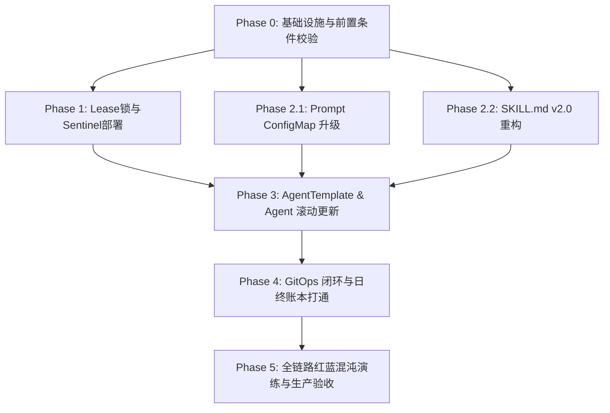

# Kagent Guardian 生产级部署与存量 Agent 迁移升级实施方案
## (Production Agent Deployment and Migration Implementation Guide)

- **版本**: v2.0
- **纳管仓库**: `https://github.com/SDB-DevOps/KagentGuardian`
- **目标组件**: `kagent-guardian-agent` / `kagent-guardian-template` / `kagent-guardian-prompts` / `kagent-guardian (Skill v2.0)`
- **基准架构**: HLD (`DOC-DES-02` v2.0) & LLD (`DOC-DES-03` v2.0)
- **文档编号**: `DOC-IMP-01`

---

## 一、实施背景与改造动因 (Context & Drivers)

Kagent Guardian 现存实例（v1.0）已在集群 `kagent` 命名空间中常态化运行，但随着微服务规模扩增与企业 SRE 深度运维要求的落地，现存架构暴露出数项严重制约生产安全的瓶颈：
1. **MCP 网关缺失与越权风险**：旧版 Agent 直连各类工具，未经过统一的 Policy Enforcement Point (PEP) 网关过滤，写操作未受 HITL（人机协同审批）拦截；
2. **纯 LLM 巡检高昂成本**：每 15 分钟触发一次 LLM 巡检导致大量 Token 消耗，且绝大多数处于健康状态，缺乏轻量化哨兵（Sentinel）前置短路；
3. **多任务并发冲突隐患**：缺少分布式排他锁，并发巡检或自愈时存在资源竞争；
4. **Skill 碎片化与证据链断裂**：多技能拆分会导致上下文丢失，且提示词中仍包含旧版裸 `kubectl` 探查方式，未全面迁移至 `mcp-proxy-kagent-tool` PromQL 与 K8sGPT 语义诊断。

基于此，本方案详尽规划如何将最新的 **高阶设计（HLD v2.0）** 与 **详细设计（LLD v2.0）** 平滑、零停机、可回滚地落地部署至现有集群，并将存量 `kagent-guardian-agent` 改造升级为全新的 **v2.0 工业级平台守护者**。

---

## 二、存量资产盘点与变更差距矩阵 (As-Is vs To-Be Gap Analysis)

| 资产维度 | 现存状态 (As-Is / v1.0) | 目标状态 (To-Be / v2.0) | 改造类型 | 影响面与风险 |
| :--- | :--- | :--- | :--- | :--- |
| **Agent CRD**<br>`02-agent.yaml` | 挂载 `agentstage-harness`<br>直接绑定旧版模板 | 保持 `agentstage-harness`<br>引入期望修订版本调谐 | **配置热更新** | 低风险，Substrate 重新拉起沙箱 |
| **AgentTemplate**<br>`01-agenttemplate.yaml` | 挂载 `kagent-api`(不可用)<br>直接挂载 3 大 MCP | 剔除不可用 MCP，改由 AgentStage Gateway 纳管代理；显式声明 ToolGroup | **规范化重构** | 中风险，需先验证网关各路由连通性 |
| **System Prompt**<br>`00-prompt-configmap.yaml` | 包含大量旧版 kubectl 探测描述<br>缺乏 HITL 审批拦截协议 | 瘦身为人设、安全红线、Fail-Closed、HITL 拦截与退避轮询协议规范 | **内容重构** | 低风险，ConfigMap 更新后滚动生效 |
| **Domain Skill**<br>`skills/kagent-guardian/SKILL.md` | v1.0.0，包含裸命令行脚本<br>无 PromQL 精确查询 | v2.0.0 单一高内聚架构，6 大子流水线，PromQL 指标、决策树与 PR/Issue 双模模板 | **大版本重写** | 中风险，需严格校验 YAML Frontmatter 与 Token 容量 (~2,000) |
| **并发排他机制**<br>`Kubernetes Lease` | **完全缺失**，并发无防护 | 声明 `kagent-guardian-lock` Lease，抢占租期 10 分钟 | **全新增补** | 极低风险，纯增量资源 |
| **外部巡检哨兵**<br>`sentinel-cronjob.yaml` | **完全缺失**，全靠 LLM 轮询 | Go/Python 超轻量 CronJob（15min），打基线计算健康分，熔断唤醒 Agent | **全新增补** | 极低风险，大幅节省 Token 支出 (90%+) |
| **探针会话清理**<br>`session-gc-cronjob.yaml` | **完全缺失**，PostgreSQL 会话持续堆积 | 每日凌晨 03:00 自动归档并清理 `guardian-probe` 标签的过期 Session | **全新增补** | 低风险，保护 Postgres 性能 |
| **日终巡检账本**<br>`ledger-cronjob.yaml` | **完全缺失** | 每日 23:55 自动生成汇总 PR 并通知 SRE 签收 | **全新增补** | 极低风险，纯增量自动化 |

---

## 三、整体迁移实施阶段大纲 (High-Level Migration Roadmap)

整个部署升级方案被严格划分为 **6 大阶段（Phase 0 ~ Phase 5）**，每个阶段均设有明确的准入条件、操作步骤与准出门禁：

```
┌────────────────────────────────────────────────────────────────────────┐
│                   Kagent Guardian v2.0 迁移实施路线图                   │
├────────────────────────────────────────────────────────────────────────┤
│ [Phase 0: 准入与基础安全前置检查] ── 校验 Gateway/Secret/RBAC 连通性   │
│                                    │                                   │
│                                    ▼                                   │
│ [Phase 1: 并发排他锁与外部哨兵就绪] ── 部署 Lease RBAC、Sentinel 与 GC│
│                                    │                                   │
│                                    ▼                                   │
│ [Phase 2: 提示词与单一高内聚 Skill v2.0 升级] ── 更新 ConfigMap & Skill│
│                                    │                                   │
│                                    ▼                                   │
│ [Phase 3: AgentTemplate & Agent 滚动更新] ── 模板装配、快照预热验证   │
│                                    │                                   │
│                                    ▼                                   │
│ [Phase 4: GitOps 闭环与日终账本 CronJob 部署] ── 部署 Ledger 归档流水线│
│                                    │                                   │
│                                    ▼                                   │
│ [Phase 5: 全链路红蓝混沌演练与生产验收] ── 注入故障、实测自愈与结单验收│
└────────────────────────────────────────────────────────────────────────┘
```
---

## 四、严格执行顺序与依赖拓扑图 (Topological Dependency Graph)

升级改造不能一蹴而就，必须严格依据底层依赖链条单向推进，严禁跨阶段逆序操作。



### 4.1 各阶段准入与准出门禁 (Stage Gate Matrix)

| 阶段 | 准入前置依赖 (Entry Criteria) | 准出门禁指标 (Exit Criteria) |
| :--- | :--- | :--- |
| **Phase 0: 前置检查** | 拥有集群运维权限，GitHub App Secret 存在 | 4 大 MCP 代理端点全部连通，`github-app-credentials` 验签成功 |
| **Phase 1: 基座就绪** | Phase 0 验证全部 PASS | Lease CR 正常获取，Sentinel CronJob 试运行输出基线评分 |
| **Phase 2: 资产升级** | 确认新 Prompt 与 Skill v2.0 经离线 Token 审查 | `kagent-guardian-prompts` 更新，Skill v2.0 通过 Frontmatter 与语法校验 |
| **Phase 3: Agent升级** | Phase 1 & 2 均已通过 | `kagent-guardian-template` 与 `Agent` 状态 `Ready: True`，`GoldenSnapshotReady: True` |
| **Phase 4: 账本打通** | Agent 能够自主创建分支与提 PR | `daily-ledger-archiver` 成功向 GitHub 仓库发起账本 PR |
| **Phase 5: 综合验收** | 全部组件已纳管并在 ArgoCD 中就绪 | 演练 CFS 截流与网关超时，自愈 PR、HITL 审批与复测结单全部跑通 |

---

## 五、逐阶段实施详案与实操指引 (Phase-by-Phase Execution Guide)

### 阶段 0: 准入与基础安全前置检查 (Prerequisites & Gatekeeper Verification)

#### 目标
核验底层所有受控组件的可用性，排除因底层依赖故障引发的升级中断。

#### 实操步骤
1. **核验当前集群上下文与 Guardian 实例状态**：
   ```powershell
   kubectl get agent,agenttemplate,remotemcpserver -n kagent
   ```
2. **探活 AgentStage MCP 网关核心端点**：
   在集群内部或通过临时 Pod 核验 3 大核心 MCP 端点健康状态：
   - `http://agentstage-mcp-gateway.kagent.svc.cluster.local:3000/mcp/kagent-tool`
   - `http://agentstage-mcp-gateway.kagent.svc.cluster.local:3000/mcp/github-ops`
   - `http://agentstage-mcp-gateway.kagent.svc.cluster.local:3000/mcp/k8sgpt-read`
3. **处置不可用的 `kagent-api` RemoteMCPServer**：
   - 现存集群中 `kagent-api` 标记为 `ACCEPTED: False`，因其试图直接打通 controller 内部端口但协议不匹配；
   - **决议**：在新的 `AgentTemplate` 中移除直连 `kagent-api`，统一经由 `mcp-proxy-kagent-tool` 提供的受控探针工具，避免 Agent 启动时发生 `ResolvedRefs` 挂起。
4. **验真 GitHub App 凭证有效性**：
   - 运行独立 Python 脚本利用 `github-app-credentials` 交换安装 Token，确认具有对 `SDB-DevOps/KagentGuardian` 仓库的 `issues:write`、`pull_requests:write` 与 `contents:write` 权限。

---

### 阶段 1: 并发排他锁与外部哨兵基座就绪 (Concurrency & Sentinel Setup)

#### 目标
部署集群分布式协调基座与轻量化外部基线哨兵，实现多任务并发互斥与 0-Token 日常巡检。

#### 实操步骤
1. **落地 Lease 排他锁与 RBAC 规则**：
   - 在 `deploy/guardian/lease-rbac.yaml` 中声明 `leases.coordination.k8s.io` 针对 `kagent-guardian-lock` 的 `get/create/update` 权限；
   - 部署清单：
     ```bash
     kubectl apply -f deploy/guardian/lease-rbac.yaml
     ```
   - 验证：`kubectl get lease -n kagent` 确认资源可被正常读取。

2. **部署 Sentinel 外部极速哨兵 CronJob**：
   - 镜像采用官方轻量 Alpine/Python 基础镜像，内嵌阶梯检查脚本；
   - 每 15 分钟触发一次，采集 Node/Pod/PromQL 核心数据，打出基线评分；
   - 部署清单：
     ```bash
     kubectl apply -f deploy/guardian/sentinel-cronjob.yaml
     ```
   - 验证：手动触发一次 Job，查看日志确认计算出 Baseline Score，且在绿色健康时不唤醒 Agent。

3. **部署 Session 垃圾回收 CronJob**：
   - 部署 `deploy/guardian/session-gc-cronjob.yaml`，每日 03:00 执行；
   - 自动清理带有 `guardian-probe` 标签且创建时间超过 7 天的旧会话，保护 `kagent-postgresql` 性能。

---

### 阶段 2: 提示词与单一高内聚 Skill v2.0 升级 (Prompt & Skill v2.0 Assets Upgrade)

#### 目标
全面重构 Agent 的心智人设与专业技能库，彻底废弃旧版裸 `kubectl` 探测逻辑，切换为基于 MCP 网关代理与 PromQL 指标流的全新认知。

#### 实操步骤
1. **重构系统提示词库 (`deploy/00-prompt-configmap.yaml`)**：
   - 移除原有繁琐冗余的命令清单；
   - 植入**常驻 SRE 专家人设**、**生产禁止热改绝对红线**、**Fail-Closed 拒绝策略**与**网关 HITL 审批拦截协议**；
   - 规定当调用写工具遭遇 `status: PENDING_APPROVAL` 时，必须提取 `approval_id` 并按指数退避算法有限轮询 `agentstage_approval_result`（最多 3 次，间隔 10s）；
   - 执行更新：
     ```bash
     kubectl apply -f deploy/00-prompt-configmap.yaml
     ```

2. **升级单一高内聚领域 Skill 资产 (`skills/kagent-guardian/SKILL.md` -> v2.0.0)**：
   - 严格落实《讨论十四》的单一高内聚架构，整合 6 大子流水线：
     - `Section 0`: 安全门禁与网关 PEP 拦截协议；
     - `Section 1`: Kagent 底层拓扑与 MCP 代理映射；
     - `Section 2`: 阶梯短路全景巡检流水线（衔接 Sentinel 评分）；
     - `Section 3`: 典型故障排查根因决策树（CFS 双因子、网关超时、供应商区分）；
     - `Section 4`: GitOps 声明式自愈与 HITL 闭环 SOP（Lease 锁、PR 查重、ArgoCD 验证）；
     - `Section 5`: 纯 GitHub 运营规范与自适应双模输出模板；
   - 验证：离线检查 YAML Frontmatter、Markdown 结构完整度与 Token 长度（控制在 ~2,000 Tokens 内）。

---

### 阶段 3: AgentTemplate & Agent 滚动更新与快照预热 (Rolling Update & Snapshot Verification)

#### 目标
将全新的 Prompt、Skill 与受控 MCP 工具组装配至 `AgentTemplate`，触发 Substrate 沙箱构建与黄金快照编译。

#### 实操步骤
1. **更新 `deploy/01-agenttemplate.yaml`**：
   - 剔除 `kagent-api` 裸端点，严格声明通过 `agentstage-mcp-gateway` 代理接入的工具组：
     - `mcp-proxy-kagent-tool`（含 PromQL 工具）
     - `mcp-proxy-k8sgpt-read`
     - `mcp-proxy-github-ops`
   - 应用模板变更：
     ```bash
     kubectl apply -f deploy/01-agenttemplate.yaml
     ```
2. **调谐 `deploy/02-agent.yaml` 并监听 CRD 状态机**：
   - 提交 Agent 配置更新，触发控制器重新调谐：
     ```bash
     kubectl apply -f deploy/02-agent.yaml
     ```
   - 实时监听 Agent 状态条件转化：
     ```powershell
     kubectl get agent kagent-guardian-agent -n kagent -o jsonpath='{.status.conditions}' | jq
     ```
   - **关键门禁校验**：必须确认依次转变为：
     - `Accepted: True`
     - `ResolvedRefs: True`
     - `GoldenSnapshotReady: True`（Substrate 沙箱已完成预热与镜像烧录）
     - `Ready: True`

---

### 阶段 4: GitOps 闭环与日终账本 CronJob 部署 (GitOps Ledger & ArgoCD Hook)

#### 目标
部署日终巡检账本自动化归档 Job，打通无外部即时通讯依赖下的纯 GitHub 运营闭环。

#### 实操步骤
1. **部署 `daily-ledger-archiver` 定时任务**：
   - 部署 `deploy/guardian/ledger-cronjob.yaml`，设定每日 23:55（`55 23 * * *`）调度；
   - 脚本汇总结算当日 Sentinel 96 次巡检快照与 Agent 深度排查记录，自动生成 `docs/ledger/ledger-YYYY-MM-DD.md` 并提交 Pull Request；
2. **配置 ArgoCD 状态监听与自愈闭环联动**：
   - 核验 ArgoCD 对 `SDB-DevOps/KagentGuardian` 仓库的纳管状态：
     ```bash
     kubectl get applications.argoproj.io -n argocd
     ```
   - 确保自愈 PR 合并后，ArgoCD 能在 30 秒内自动检测并触发集群同步（`Synced && Healthy`）。

---

### 阶段 5: 全链路红蓝混沌演练与生产验收 (End-to-End Validation & Chaos Drill)

#### 目标
通过注入仿真故障，全流程闭环验证系统的异常截流、根因推导、HITL 拦截审批与自愈恢复能力。

#### 实操演练矩阵
1. **演练一：CFS 算力节流注入与自愈 PR 链路实测**：
   - 将测试命名空间 WorkerPool 的 `requests.cpu` 压低至 `50m`；
   - 外部 Sentinel 巡检捕获唤醒延时劣化（> 3.5s）并判定亚健康（Score < 85），熔断唤醒 Guardian Agent；
   - Guardian 抢占 Lease 锁，调用 PromQL 指标推导 CFS 双因子异常，自动在 GitHub 创建 `fix/kagent-guardian-<timestamp>` 分支并提交调增 CPU 预算的 PR；
   - 验证：PR 文本必须严格包含物理 PromQL 证据、CFS 统计与精算依据。
2. **演练二：网关 503 拦截与 HITL 审批轮询实测**：
   - 模拟 Agent 尝试调用危险写操作（如热修线上资源）；
   - AgentStage MCP Gateway 依据 ToolPolicy 拦截该操作，返回 `status: PENDING_APPROVAL` 与 `approval_id`；
   - 验证 Guardian 是否正确挂起并以退避间隔调用 `agentstage_approval_result`；
   - 人工审核人通过管理界面 Approve 后，验证 Agent 收到确认并继续执行。
3. **演练三：Lease 并发排他锁争抢冲突测试**：
   - 人工模拟并发发起两次巡检自愈；
   - 验证第二个进程必须优雅退出并打印 `Lease already held by another guardian session, skipping execution`，杜绝重复创建 PR。

---

## 六、生产实施核心注意事项与红线禁令 (Critical Precautions & Hard Guardrails)

在执行上述部署与升级过程中，全员必须严格恪守以下 6 项生产级注意事项：

### 6.1 绝对红线禁令：严禁生产热打补丁 (No Direct Hot-Patching)
- **风险**：旧习惯可能促使工程师直接用 `kubectl edit` 或临时脚本修复配置，这会立刻造成“配置漂移”，且一旦 ArgoCD 自动同步会将临时修复完全抹除引发二次故障。
- **守则**：所有配置调优必须经由 GitHub PR 走 GitOps 流水线，严禁在生产集群中直接写入。

### 6.2 状态机守卫：Substrate 黄金快照就绪门禁 (Golden Snapshot Wait Gate)
- **风险**：当更新 `AgentTemplate` 或绑定新的 MCP/Skill 时，Substrate 需要在后台启动沙箱并编译预热生成 Golden Snapshot，通常耗时 30~60 秒。若过早将生产流量引入未就绪的 Agent，将遭遇冷启动超时或 503 网关截流。
- **守则**：变更后必须使用脚本持续监听 `status.conditions`，直到 `GoldenSnapshotReady: True` 且 `Ready: True` 后，方可通知 SRE 开放使用。

### 6.3 网关安全：MCP Proxy Fail-Closed 与 ParamPolicy 校验
- **风险**：如果 MCP 网关配置错误，可能导致全部请求被放行（Fail-Open）或意外将读操作全数阻断。
- **守则**：
  - 严格保持 **Fail-Closed** 原则：未显式在 ToolPolicy 中声明为只读的工具，默认拦截要求审批；
  - 严格核验 **ParamPolicy**：写操作的目标命名空间（Target Namespace）必须与当前执行环境一致，阻断跨租户/跨集群篡改风险。

### 6.4 资源防护：PostgreSQL 会话膨胀与连接池防击穿
- **风险**：Guardian 包含 L4 端到端合成探针，若高频触发且未及时销毁沙箱，`kagent.session` 表数据将剧增，导致 PostgreSQL 索引膨胀、慢查询增多甚至连接池占满。
- **守则**：
  - 合成探针必须显式打上标签 `guardian-probe=true`；
  - 阶段 1 中的 `session-gc-cronjob` 必须先于阶段 5 混沌演练前上线，保证历史探针会话 7 天自动归档。

### 6.5 成本精算：Zero-Token 外部哨兵打基线防 Token 滥用
- **风险**：若直接使用 LLM 定时轮询巡检，按 15 分钟一次、单次 3,000 Tokens 计算，每月将空耗数十万 Tokens 算力。
- **守则**：日间巡检必须 100% 优先由无状态的 Go/Python 哨兵脚本打出 Baseline Score，仅当发生异常熔断（Score < 85）时方唤醒 LLM Agent。

### 6.6 频率控制：GitHub App 令牌生命周期与 API Rate Limit
- **风险**：频繁的查重调用可能耗尽 GitHub API 5,000次/小时限额。
- **守则**：
  - 统一使用 GitHub App Installation Token 进行接口调用（单次刷新有效期 1 小时，随调随用）；
  - 严禁死循环轮询 PR 状态，必须引入至少 10 秒的退避等待。

---

## 七、回滚预案与应急降级策略 (Rollback & DR Procedures)

在任何一个实施阶段中，若遇到不可调和的阻断性故障，必须严格按照以下应急回滚流水线在 **5 分钟内** 完成状态还原：

```text
               [生产升级发生异常 / 门禁未通过]
                              │
            ┌─────────────────┴─────────────────┐
            ▼                                   ▼
 [场景 A: AgentTemplate/快照编译失败]   [场景 B: 网关拦截或 ToolPolicy 异常]
            │                                   │
            ▼                                   ▼
1. 立即执行模板版本回滚:                  1. 临时切换 AgentTemplate 至
   git checkout HEAD~1 deploy/01-*.yaml     只读模式 (只保留只读MCP)
   kubectl apply -f deploy/01-*.yaml    2. 检查 AgentStage 网关日志与 Policy
2. 恢复旧版 Prompt ConfigMap:            3. 放宽写操作审核至应急人工渠道
   kubectl apply -f deploy/00-*.yaml
3. 验证旧版快照秒级恢复
```

### 一键极速回滚操作清单
```powershell
# 1. 恢复 Git 仓库至迁移前稳定提交
git -C 'C:\AAAHuangLei\2026\KagentGuardian-repo' checkout c50aac3 deploy/ skills/

# 2. 重新应用旧版稳定清单
kubectl apply -f deploy/00-prompt-configmap.yaml
kubectl apply -f deploy/01-agenttemplate.yaml
kubectl apply -f deploy/02-agent.yaml

# 3. 验证存量 Agent 重新 Ready
kubectl wait --for=condition=Ready agent/kagent-guardian-agent -n kagent --timeout=60s
```

---

## 八、工时预估与实施推进时间表 (Time Estimation & Work Breakdown)

根据系统复杂度与生产落地门禁标准，实施全周期预估为 **3.5 ~ 4.0 个工程工作日（约 28~32 人时）**，具体工时拆解如下：

| 阶段编号 | 任务模块 | 具体工作项 | 负责人 | 预估工时 | 依赖前置项 |
| :--- | :--- | :--- | :--- | :--- | :--- |
| **Phase 0** | 前置环境核验 | 集群连通性、MCP 网关路由探活、GitHub App 鉴权验真 | SRE 架构师 | 3.0h | 无 |
| **Phase 1** | 分布式底座与哨兵 | Lease RBAC 声明、Sentinel 脚本编写与 CronJob 部署、Session GC 部署 | SRE / DevOps | 5.0h | Phase 0 |
| **Phase 2** | Prompt 与 Skill 升级 | `deploy/00-prompt-configmap.yaml` 重构、`SKILL.md` (v2.0) 6 大流水线编写与语法校验 | AI 工程师 / SRE | 6.0h | Phase 0 |
| **Phase 3** | Agent 滚动更新 | 更新 AgentTemplate、调谐 Agent CRD、监听 Substrate 黄金快照预热 | 平台工程师 | 4.0h | Phase 1, Phase 2 |
| **Phase 4** | 运营账本与 GitOps 联动 | 部署 `daily-ledger-archiver` CronJob、联调 ArgoCD 自动同步状态机 | DevOps / SRE | 4.0h | Phase 3 |
| **Phase 5** | 红蓝演练与生产验收 | CFS 算力节流演练、503 超时拦截、HITL 审批轮询测试、Lease 竞争实测 | 联合团队 (SRE/QA) | 6.0h | Phase 4 |
| **总结** | **工程总计** | **全栈生产部署、迁移升级、混沌演练与文档验收** | **全员** | **28.0h (~3.5 工作日)** | - |

---

## 九、实施责任矩阵与上线验收核对表 (RACI Matrix & Go-Live Checklist)

### 9.1 责任矩阵 (RACI)
- **Accountable (最终决策人)**: SRE 负责人 / 平台架构师
- **Responsible (实施执行人)**: DevOps 工程师、AI Agent 平台研发
- **Consulted (咨询协同方)**: AgentStage 网关研发团队、DBA、安全合规专员
- **Informed (通报对象)**: 业务运维团队、基础架构主管

### 9.2 上线前终审核对表 (Go-Live Checklist)
- [ ] `Phase 0`: 4 大受控 MCP 端点全部连通，不可用的 `kagent-api` 裸端点已从模板中彻底剥离；
- [ ] `Phase 1`: `kagent-guardian-lock` Lease 资源与 RBAC 规则生效，并发抢占测试成功；
- [ ] `Phase 1`: `sentinel-cronjob` 部署完毕，能正确输出综合健康打分；
- [ ] `Phase 2`: `kagent-guardian-prompts` ConfigMap 已更新，包含 HITL 审批轮询规约；
- [ ] `Phase 2`: `skills/kagent-guardian/SKILL.md` (v2.0) 具备 6 大高内聚子流水线，Token 量 $\le 2,200$；
- [ ] `Phase 3`: `kagent-guardian-agent` 调谐就绪，`GoldenSnapshotReady: True`，冷启动唤醒 $\le 1.5\text{s}$；
- [ ] `Phase 4`: 每日日终账本 CronJob 就绪，ArgoCD 纳管状态良好；
- [ ] `Phase 5`: CFS 节流自愈 PR 能被正常生成并附带 PromQL 物理证据，HITL 审批流程通畅；
- [ ] `Emergency`: 回滚脚本已在预发环境演练验证，确认 5 分钟内可完全还原旧版。

